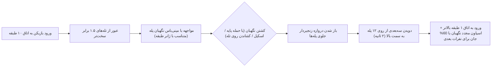

# سند جامع، یکپارچه و کامل طراحی بازی و مشخصات فنی (Master GDD & Technical Specification)
## پروژه: **برج آشوب: ۱۰۰ اتاق (Tower of Chaos: 100 Rooms)**
**نسخه سند:** `v6.2 - Complete Production Master (v1.0 = 6 Floors; rules verified by the Core test-suite)`  
**پلتفرم هدف:** Android (Unity 6.3 LTS - Universal Render Pipeline)  
**زبان‌های پشتیبانی‌شده:** فارسی (RTL) و انگلیسی (LTR) — رابط کاربری، متون، گویندگی و کل‌کل مجزا

---

## فهرست جامع بخش‌های سند
1. [چشم‌انداز، زاویه دید سه‌بعدی از بالا (سبک Brawl Stars) و ستون‌های طراحی](#۱-چشم‌انداز-زاویه-دید-سه‌بعدی-از-بالا-سبک-brawl-stars-و-ستون‌های-طراحی)
2. [معماری فنی، انجین، متریک‌های دقیق سه‌بعدی، دوربین و شبکه](#۲-معماری-فنی-انجین-متریک‌های-دقیق-سه‌بعدی-دوربین-و-شبکه)
3. [طراحی کامل ۱۰ طبقه با ۱۰ ژانر سینمایی متفاوت (صداگذاری، نورپردازی و جو روانی)](#۳-طراحی-کامل-۱۰-طبقه-با-۱۰-ژانر-سینمایی-متفاوت-صداگذاری-نورپردازی-و-جو-روانی)
4. [معماری ویژه «اتاق دهم» هر طبقه (چالش ۱.۵ برابری + مینی‌باس نگهبان + پله‌های سه‌بعدی صعود)](#۴-معماری-ویژه-اتاق-دهم-هر-طبقه-چالش-۱۵-برابری--مینی‌باس-نگهبان--پله‌های-سه‌بعدی-صعود)
5. [دایره‌المعارف کامل ۲۰ موجود و هیولای داخل اتاق‌ها (خنده‌دار/شیمیایی، ترسناک، جدی و نگهبانان پله)](#۵-دایره‌المعارف-کامل-۲۰-موجود-و-هیولای-داخل-اتاق‌ها-خنده‌دارشیمیایی-ترسناک-جدی-و-نگهبانان-پله)
6. [الگوریتم تولید تصادفی تله‌ها با تضمین ۱۰۰٪ قابل‌عبور بودن (Procedural Solvable Room Generation)](#۶-الگوریتم-تولید-تصادفی-تله‌ها-با-تضمین-۱۰۰-قابل‌عبور-بودن-procedural-solvable-room-generation)
7. [دایره‌المعارف کامل ۶۰ تله فوق‌خلاقانه (تفکیک‌شده بر اساس ژانر و خانواده)](#۷-دایره‌المعارف-کامل-۶۰-تله-فوق‌خلاقانه-تفکیک‌شده-بر-اساس-ژانر-و-خانواده)
8. [دایره‌المعارف کامل ۲۰ پاداش و باف انحصاری نفر اول + معماری ماژولار آپدیت‌های فصلی](#۸-دایره‌المعارف-کامل-۲۰-پاداش-و-باف-انحصاری-نفر-اول--معماری-ماژولار-آپدیت‌های-فصلی)
9. [سیستم پورتال‌ها، اسکنر جم (چشم بصیرت) و جنگ روانی (فریب و خرابکاری)](#۹-سیستم-پورتال‌ها-اسکنر-جم-چشم-بصیرت-و-جنگ-روانی-فریب-و-خرابکاری)
10. [جدول کامل هیروها (حمله پایه + اسکیل + پسیو) و جدول کامل تجهیزات کوله‌پشتی](#۱۰-جدول-کامل-هیروها-حمله-پایه--اسکیل--پسیو-و-جدول-کامل-تجهیزات-کوله‌پشتی)
11. [چرخه کامل قوانین گیم‌پلی (تاس شروع، قوانین مرگ، اتاق ۱۰۰ و قفل ۸ ثانیه‌ای تاج)](#۱۱-چرخه-کامل-قوانین-گیم‌پلی-تاس-شروع-قوانین-مرگ-اتاق-۱۰۰-و-قفل-۸-ثانیه‌ای-تاج)
12. [سیستم پیشرفت، فرمول ریاضی XP، کل‌کل دوزبانه، ایونت‌ها، جدول احتمالات چست‌ها و قیمت‌گذاری](#۱۲-سیستم-پیشرفت-فرمول-ریاضی-xp-کل‌کل-دوزبانه-ایونت‌ها-جدول-احتمالات-چست‌ها-و-قیمت‌گذاری)
13. [طراحی رابط کاربری (HUD) و جدول کامل ۲۰ سناریوی گیم‌پلی و حالت‌های مرزی (Edge Cases)](#۱۳-طراحی-رابط-کاربری-hud-و-جدول-کامل-۲۰-سناریوی-گیم‌پلی-و-حالت‌های-مرزی-edge-cases)
14. معماری آنلاین: سرور، شبکه، مچ‌میکینگ، قطع اتصال و سیاست «بدون بات»
15. بودجه زمانی مسابقه، منحنی سختی و مقیاس‌دهی تله با تعداد نفرات
16. مجموعه کامل مهارت‌ها (S1، S2، التیمیت)، انرژی و کنترل/HUD نهایی
17. اتاق ۱۰۰ و طبقه ۱۰، پایان مسابقه، حذف و رتبه‌بندی
18. معماری ماژولار محتوا: Mutatorهای اتاق، دستور ساخت تله و پاداش، محتوای جدید (T61+ / R21+)
19. پیشرفت: جدول جوایز سطح ۱–۶۰، چست‌ها، اسکین/ویس/چت، ایونت و بتل‌پس
20. محلی‌سازی فارسی/انگلیسی و صدا
21. اقتصاد و درآمدزایی کامل (مجاز / ممنوع)
22. سناریوهای مرزی تکمیلی (۲۱ تا ۵۰)
23. نقشه راه مرحله‌ای (MVP تا نسخه کامل) و تیم
24. KPI، تست پذیرش، ریسک‌ها و دفتر تصمیمات
25. بودجه حجم ۲۰۰ مگابایتی و قوانین «کیفیت به ازای هر مگابایت»
26. کتاب هنر و حس بازی (Brawl Stars × Clash of Clans × Mobile Legends)
27. قلاب‌های ماندگاری، شروع بازی جدید و حالت تمرین
28. بک‌لاگ تسک‌ها (`TASKS.md` / `TASKS.csv`)
29. نسخه ۱.۰ (۶ طبقه) و آپدیت بزرگ ۱ (طبقات ۷ تا ۱۰)
30. وضعیت پیاده‌سازی (هسته C# تست‌شده)

---

## ۱. چشم‌انداز، زاویه دید سه‌بعدی از بالا (سبک Brawl Stars) و ستون‌های طراحی

* **ژانر:** اکشن-استراتژی چندنفره همزمان (Real-Time 5-Player Competitive 3D Dungeon Race)
* **نمای دوربین (Camera View):** **کاملاً سه‌بعدی با زاویه دید از بالا (`3D Top-Down Angled Perspective` دقیقاً شبیه *Brawl Stars* و *Dota 2*)**.
  * محیط، دیوارها، راه‌پله‌ها، تله‌ها، هیولاها و هیروها ۱۰۰٪ سه‌بعدی و دارای عمق و سایه واقعی هستند.
  * زاویه دید از بالا ($54^\circ$) باعث می‌شود بازیکن کل عرض ۱۴ متری اتاق، مسیرهای امن از لابه‌لای تیغ‌ها و آب‌ها، هیولاهای کمین‌کرده و رقبای داخل اتاق را به صورت کامل ببیند.
  * کنترل (Twin-Stick + مهارت‌ها): شست چپ = حرکت ۳۶۰ درجه؛ شست راست = دکمه **حمله پایه** (Auto-Aim روی نزدیک‌ترین هیولا/رقیب، کشیدن = نشانه‌گیری دستی) و **۳ دکمه مهارت** (مهارت ۱، مهارت ۲، التیمیت) در کمان اطراف آن. ۳ تجهیز انتخابی + ۲ اسلات غنیمت در ردیف جدا (جزئیات در §۱۶.۳).
* **تعداد بازیکنان در هر مسابقه:** دقیقاً **۵ نفر** (هر بازیکن برای خودش - Free-For-All)
* **مدت زمان هدف برای هر مسابقه:** **۱۰ تا ۱۴ دقیقه** (نفر اول در شرایط عادی ≈ ۱۰–۱۲ دقیقه؛ سقف قطعی مسابقه ۱۴:۰۰ — بودجه زمانی کامل در §۱۵)
* **مرجع کیفیت بصری (Art Benchmark):**
  * **طراحی هیروها، مهارت‌ها و افکت‌ها (VFX):** در تراز **Mobile Legends** (هیروی استایلایز پرجزئیات، التیمیت سینمایی) با خوانایی **Brawl Stars** و گرمای محیط/رابط **Clash of Clans**؛ بودجه حجم ۲۰۰ مگابایتی در §۲۵ و کتاب هنر در §۲۶ تعریف شده است.
  * **زاویه دید، خوانایی تله‌ها، رنگ‌بندی محیط و کنترل سریع موبایلی:** در تراز **Brawl Stars / Clash**.

---

## ۲. معماری فنی، انجین، متریک‌های دقیق سه‌بعدی، دوربین و شبکه

### ۲.۱. انجین و عملکرد هدف
* **انجین:** **Unity 6.3 LTS (6000.3.27f1)** با پایپ‌لاین **Universal Render Pipeline (URP)**.
* **نرخ فریم هدف:** **۶۰ فریم بر ثانیه (60 FPS)** پایدار روی گوشی‌های میان‌رده اندروید (رم ۴ گیگابایت به بالا).
* **قانون استریمینگ ۴ اتاقی (`4-Room GPU Streaming Window`):** در هر لحظه روی گوشی بازیکن فقط **اتاق فعلی (`R`)**، **۱ اتاق قبلی (`R-1`)** و **۲ اتاق بعدی (`R+1`, `R+2`)** در صحنه رندر فعال هستند تا مصرف رم و باتری در حداقل ممکن بماند.

### ۲.۲. جدول متریک‌های سه‌بعدی و شبکه‌بندی کاشی‌ها در یونیتی (`1 Unit = 1 Meter`)
| المان سه‌بعدی | ابعاد دقیق (عرض × طول × ارتفاع) | شبکه شطرنجی کاشی‌ها ($2\text{m} \times 2\text{m}$) | توضیحات فنی و کولایدرها |
| :--- | :--- | :--- | :--- |
| **اتاق استاندارد (Rooms 1–9)** | $14\text{m} \times 14\text{m} \times 6\text{m}$ | **$7 \text{ ستون} \times 7 \text{ ردیف}$** (`49 Tiles`) | ردیف `0` و `1` منطقه امن ورودی؛ ردیف `2` تا `5` منطقه تله و هیولا؛ ردیف `6` درِ خروجی. عبور مستقیم از اتاق ≈ ۲.۳ ثانیه. |
| **اتاق دهم هر طبقه (Room 10 Gauntlet)** | $18\text{m} \times 20\text{m} \times 8\text{m}$ | **$9 \text{ ستون} \times 10 \text{ ردیف}$** (`90 Tiles`) | ≈ ۱.۸ برابر مساحت اتاق عادی و ۱.۵ برابر تراکم تله + **راه‌پله سه‌بعدی صعود به طبقه بالا** در انتهای اتاق. ستون وسط = `Column 4`. |
| **راه‌پله سه‌بعدی صعود (در انتهای اتاق ۱۰)** | $5\text{m} \times 6\text{m} \times 4\text{m}$ | ۱۲ پله سنگی/نوری در ستون‌های وسط | کاراکتر واقعاً از پله‌ها بالا می‌دود (۲ ثانیه زمان صعود) تا وارد اتاق ۱ طبقه بالاتر شود. |
| **درگاه ورود و خروج اتاق (Doors)** | $3.5\text{m} \times 1.0\text{m} \times 4.0\text{m}$ | ستون وسط (`Column 3`) | عرض ۳.۵ متر؛ اجازه عبور همزمان ۲ هیرو. |
| **کپسول کولایدر هیرو (Hero Collider)** | شعاع $0.5\text{m}$ × ارتفاع $2.0\text{m}$ | نصف عرض یک کاشی | سرعت حرکت پایه $6.0\text{ m/s}$ (طی کردن هر کاشی ۲ متری در ۰.۳۳ ثانیه). |
| **پورتال بین‌طبقاتی (Portal Gate)** | شعاع تريگر $1.25\text{m}$ × ارتفاع $3.2\text{m}$ | ۱ کاشی کامل به همراه حلقه نوری | مجهز به هولوگرام وضعیت در شعاع $2.0\text{m}$ روی زمین. |
| **سکوی تاج پیروزی (Crown Altar - Room 100)** | شعاع منطقه تعامل $2.5\text{m}$ | مرکز اتاق ۱۰۰ | بازیکن باید در طول ۸ ثانیه باز کردن قفل، داخل این شعاع ۲.۵ متری باقی بماند. |

### ۲.۳. جدول مشخصات دوربین سه‌بعدی از بالا (3D Brawl-Stars Top-Down Camera)
| پارامتر دوربین | حالت ۱: نمای استاندارد از بالا (Brawl Stars View) | حالت ۲: زوم‌اوت درگیری، اتاق ۱۰ و پورتال | حالت ۳: اسکن پرتو ایکس (X-Ray 2 Rooms) |
| :--- | :--- | :--- | :--- |
| **شرط فعال‌سازی** | حرکت عادی بازیکن در اتاق‌های ۱ تا ۹ | حضور $\ge 2$ بازیکن در اتاق **یا** ورود به اتاق ۱۰ **یا** نزدیکی به پورتال | فشردن دکمه «اسکن ۲ اتاق بعدی با جم» (۳ ثانیه) |
| **زاویه عمودی (Pitch)** | **$54^\circ$ (سه‌بعدی از بالا)** | **$58^\circ$ (دید وسیع کل اتاق)** | **$62^\circ$ (دید کل ۲ اتاق بعدی)** |
| **آفست نسبت به هیرو $(X, Y, Z)$** | $(0,\ 11.0,\ -8.0)$ | $(0,\ 14.4,\ -9.0)$ | $(0,\ 22.0,\ -11.7)$ |
| **میدان دید (Field of View)** | $44^\circ$ | $48^\circ$ | $54^\circ$ |
| **زمان سوییچ نرم (Blend Time)** | $0.4\text{ Seconds}$ (Ease-In-Out) | $0.4\text{ Seconds}$ (Ease-In-Out) | $0.35\text{ Seconds}$ |

> **تصحیح فنی (v6.0):** در نسخه‌های قبلی آفست‌ها با Pitch اعلام‌شده نمی‌خواندند (مثلاً $\arctan(12.5/7.5) \approx 59^\circ$ نه $54^\circ$). مقادیر جدول بازمحاسبه شدند: $\arctan(Y/|Z|)$ = ۵۴.۰°، ۵۸.۰° و ۶۲.۰°.
> با FOV عمودی $44^\circ$ و نسبت ۱۶:۹، عرض دید روی زمین در حالت ۱ ≈ ۱۹.۵ متر است (بزرگ‌تر از عرض ۱۴ متری اتاق). عمق دید روی زمین ≈ ۱۴.۹ متر (۵.۳ متر پشت تا ۹.۶ متر جلوی هیرو)؛ برای دیدن کل اتاق هنگام ورود، دوربین در حالت ۱ **۴ متر جلوتر از هیرو (`Look-Ahead`)** متمایل می‌شود. این اعداد محاسبه هندسی‌اند و باید داخل Unity تأیید شوند؛ حالت ۲ برای اتاق ۱۰ (۱۸×۲۰ متر) نیز باید در Unity تنظیم نهایی شود.

---

## ۳. طراحی کامل ۱۰ طبقه با ۱۰ ژانر سینمایی متفاوت (صداگذاری، نورپردازی و جو روانی)

> **توجه (v6.1):** در انتشار ۱.۰ فقط طبقات ۱ تا ۶ فعال‌اند؛ طبقات ۷ تا ۱۰ در «آپدیت بزرگ ۱» می‌آیند (§۲۹).

هر یک از ۱۰ طبقه برج، یک **ژانر سینمایی و گیم‌پلی کاملاً متمایز** دارد تا بازیکنان با سلیقه‌های مختلف (علاقه‌مندان به طنز و شوخی، عاشقان بازی‌های ترسناک، طرفداران اکشن نظامی جدی، یا فانتزی و علمی-تخیلی) در طول یک مسابقه ۱۰ تا ۱۴ دقیقه‌ای اوج تنوع و هیجان را تجربه کنند:

| طبقه | نام طبقه و ژانر (Genre) | نورپردازی و طراحی بصری | صداگذاری و افکت‌های صوتی (Audio & Ambience) | مکانیک شاخص این ژانر |
| :--- | :--- | :--- | :--- | :--- |
| **طبقه ۱** | **سیاه‌چال باستانی** *(Ancient Dungeon Adventure)* | مشعل‌های آتشین روی دیوارهای سنگی خزهبسته، سایه‌های گرم، زنجیرهای آویزان | صدای سوختن چوب مشعل، چکه کردن آب، موسیقی کوبه‌ای شروع رقابت | آشنایی با مسیر؛ اتاق‌های ۱ تا ۵ دارای صندوقچه‌های تضمینی شروع برای جبران تاس پایین هستند. |
| **طبقه ۲** | **کارناوال دیوانه و کمدی سمی** *(Slapstick Comedy & Toxic Gag)* | رنگ‌های شاد سیرک (بنفش، زرد و قرمز)، بادکنک‌ها، تابلوهای کاریکاتوری | افکت‌های صوتی کارتونی (صدای سوت سر خوردن روی موز، صدای بوق، صدای خنده حضار و **صدای گوز بلند غول‌های شیمیایی!**) | شوخی‌های فیزیکی و سمی: **ابرهای گاز شیمیایی سبز که صفحه را تار و مواج می‌کنند**، کیک خامه‌ای روی لنز دوربین و تغییر صدای کاراکتر با هلیوم! |
| **طبقه ۳** | **تیمارستان وحشت و تاریکی** *(Psychological Horror & Dark Asylum)* | **بسیار تاریک**؛ نور مهتاب سرد و لامپ‌های سوسوزن قرمز؛ دید محدود با چراغ‌قوه زیر پای هیرو | **صداهای ترسناک ناگهانی سه‌بعدی در هدفون:** صدای نجوا کنار گوش، صدای گریه کودک، صدای دویدن سریع از پشت سر و جیغ ناگهانی (Jump-Scare) | بازی با اعصاب و ترس: خاموش شدن ناگهانی برق اتاق برای ۳ ثانیه، مجسمه‌هایی که فقط وقتی پشتت به آن‌هاست حرکت می‌کنند و دست‌های بیرون‌زده از گور! |
| **طبقه ۴** | **سرزمین توهم و جنون** *(Surreal Hallucination & Mindfuck)* | معماری غیرهندسی (سبک اِشِر)، ساعت‌های ذوب‌شده معلق در هوا، مه بنفش و طلایی | موسیقی معکوس و هیپنوتیزم‌کننده، اکو شدن صدای کاراکترها | اختلال حسی و ذهنی: معکوس شدن جوی‌استیک، آینه‌ای شدن تصویر دوربین، عوض شدن ظاهر تیغ و قلبِ جان، و درهای خروجی سرابی. |
| **طبقه ۵** | **آزمایشگاه سایبرپانک و لیزر** *(Sci-Fi Cube & Laser Grid)* | دیوارهای فلزی تیره با خطوط نئون آبی و سرخابی، کف شیشه‌ای با مدارهای نوری | موسیقی سینت‌ویو الکترونیک تند، صدای زوزه لیزر و بوق قفل رادار | دقت و سرعت بالا: دیوارهای لیزری متحرک، میدان‌های EMP خاموش‌کننده اسکیل، جاذبه صفر و صفحات تله‌پورت تصادفی. |
| **طبقه ۶** | **مرداب وحشی و اسیدی** *(Toxic Jungle & Swamp Survival)* | آب‌های عمیق سبز، ریشه‌های درختان غول‌پیکر، مه اسیدی و گل‌های شب‌تاب | صدای قورباغه‌ها، غرش تمساح، قل‌قل کردن اسید جوشان | عبور از موانع آبی و اسیدی با استفاده از برگ‌های نیلوفر متحرک، جامپ‌پدهای فنری رایگان و فرار از گیاهان گوشت‌خوار. |
| **طبقه ۷** | **قطار وسترن و سرقت دینامیت** *(Wild West & Minecart Heist)* | چوب‌های معدن طلا، ریل‌های آهنی متقاطع در کف اتاق، بشکه‌های باروت و فتیله | صدای سوت قطار بخار، زنگ خطر ریل، موسیقی گیتار وسترن سریع | واگن‌های معدن که با سرعت دیوانه‌وار از عرض اتاق رد می‌شوند، بشکه‌های دینامیت که با ورود نفر اول روشن شده و روی سر نفر دوم منفجر می‌شوند! |
| **طبقه ۸** | **قلعه یخبندان و کولاک** *(Frozen Nord & Slippery Blizzard)* | زمین یخی بلورین و آینه‌ای، قندیل‌های یخ، بوران برف در فضای اتاق | صدای زوزه باد قطبی، صدای ترک خوردن یخ زیر پا | فیزیک لغزش روی یخ (سُر خوردن کاراکتر هنگام تغییر جهت)، بهمن گلوله‌های برف و تبدیل شدن بازیکن به آدم‌برفی! |
| **طبقه ۹** | **میدان نبرد نظامی و عملیات ویژه** *(Serious Tactical Spec-Ops & Hellfire)* | سنگرهای بتنی، کیسه‌های شن، سیم‌خاردار، نور آژیر قرمز چرخان و خط لیزر تک‌تیرانداز | صدای بی‌سیم نظامی، آژیر خطر، صدای گلنگدن اسنایپر و انفجارهای سنگین | فضای کاملاً جدی و مرگبار: سنگر گرفتن پشت ستون‌ها برای فرار از خط لیزر تک‌تیرانداز، مین‌های کلیمور، تورت‌های مسلسل و گاز اشک‌آور. |
| **طبقه ۱۰** | **عرش طلایی آشوب** *(Mythic Finale & Throne of Chaos)* | تالار باشکوه آسمانی از مرمر سیاه و طلای ناب، ستون‌های نور و صاعقه‌های آبی | موسیقی کُرال و ارکسترال حماسی در تراز فینال *Dota 2* | ترکیب گلچینی از مرگبارترین تله‌های هر ۹ طبقه قبلی، شوالیه‌های طلایی محافظ و اتاق ۱۰۰ با قفل ۸ ثانیه‌ای تاج پیروزی! |

---

## ۴. معماری ویژه «اتاق دهم» هر طبقه (چالش ۱.۵ برابری + مینی‌باس نگهبان + پله‌های سه‌بعدی صعود)

در تمام طبقات ۱ تا ۹، **اتاق شماره ۱۰ (اتاق‌های ۱۰، ۲۰، ۳۰، ۴۰، ۵۰، ۶۰، ۷۰، ۸۰ و ۹۰)** یک اتاق عادی نیست بلکه **«تالار نگهبان و راه‌پله صعود» (`Staircase Gauntlet Room`)** است:



1. **چرا اتاق ۱۰ سخت‌تر و هیجانی‌تر است؟**
   * ابعاد آن بزرگ‌تر ($18\text{m} \times 20\text{m}$) است و تراکم تله‌های آن **۱.۵ برابر** اتاق‌های عادی است.
   * در انتهای اتاق، به جای درِ مسطح، یک **راه‌پله سه‌بعدی باشکوه** قرار دارد که به طبقه بالاتر می‌رود.
2. **قفل نگهبان پله (`Staircase Guardian Seal`):**
   * جلوی راه‌پله یک دروازه بسته وجود دارد که توسط **«مینی‌باس نگهبان طبقه»** محافظت می‌شود.
   * بازیکن **الزاماً باید نگهبان را بکشد** تا دروازه پله باز شود.
3. **قانون توازن برای نفرات دوم تا پنجم در اتاق ۱۰:**
   * وقتی نفر اول نگهبان را می‌کشد و از پله‌ها بالا می‌رود، ۵ ثانیه بعد از خروج او دروازه پله دوباره بسته شده و یک نگهبان جدید ولی با **`60% HP` (جان کمتر)** جلوی پله ظاهر می‌شود؛ به این ترتیب نفرات بعدی هم چالش اتاق ۱۰ و کشتن هیولا را تجربه می‌کنند، اما زمان کمتری نسبت به نفر اول از دست می‌دهند تا رقابت نزدیک بماند!

---

## ۵. دایره‌المعارف کامل ۲۰ موجود و هیولای داخل اتاق‌ها (خنده‌دار/شیمیایی، ترسناک، جدی و نگهبانان پله)

علاوه بر مینی‌باسِ اتاق ۱۰ هر طبقه، در **۳۵٪ از اتاق‌های عادی (اتاق‌های ۲ تا ۹)** نیز ۱ یا ۲ موجود متناسب با ژانر همان طبقه حضور دارند که درِ خروجی اتاق تا زمان کشته شدن آن‌ها قفل است (`Monster Lock Room`).

### ۵.۱. سه روش کشتن موجودات توسط بازیکن
1. **حمله پایه سریع هیرو (`Basic Attack` - کول‌داون `0.6s`، مهمات بی‌نهایت):** دکمه شلیک/ضربه سریع در سمت راست صفحه (مثل *Brawl Stars*) که به صورت خودکار نزدیک‌ترین هیولا (یا رقیب) را نشانه می‌گیرد (`25 DMG` به هیولاها).
2. **کشاندن هیولا روی تله‌های اتاق (`Instant Trap-Kill`):** اگر بازیکن جاخالی بدهد تا هیولا به دنبالش بدود و پای هیولا به تیغه پاندولی، نیزه کف، واگن قطار یا بشکه انفجاری بخورد، هیولا **درجا با ۱ ضربه تله متلاشی می‌شود!**
3. **مهارت فعال هیرو (`Active Skill`) و سلاح‌های کوله‌پشتی.**

### ۵.۲. جدول کامل ۲۰ موجود و مینی‌باس به تفکیک ژانر هر ۱۰ طبقه *(به‌علاوه `M21` و `M22` طبقه ۱۰ در §۱۷.۱ ← مجموع ۲۲ موجود)*

| کد | نام موجود / مینی‌باس | طبقه و ژانر | نوع اتاق | جان (`HP`) | سناریوی دقیق رفتار، حمله و اثر روی صفحه بازیکن | اتفاق بعد از مرگ هیولا |
| :--- | :--- | :--- | :--- | :--- | :--- | :--- |
| `M01` | **اسکلت سپردار (`Shield Skeleton`)** | طبقه ۱ *(باستانی)* | اتاق عادی | `50 HP` (۲ ضربه) | با شمشیر زنگ‌زده به سمت بازیکن می‌دود و ضربه می‌زند (`-15 HP`). | استخوان‌هایش می‌ریزد و درِ اتاق باز می‌شود. |
| `M02` | **گولم سنگی پله (`Stone Gargoyle`)** | طبقه ۱ *(باستانی)* | **مینی‌باس اتاق ۱۰** | `125 HP` (۵ ضربه) | روی زمین می‌کوبد و موج لرزشی دایره‌ای می‌فرستد (`-25 HP`)؛ اگر روی نیزه‌های کف کشانده شود درجا می‌شکند! | باز شدن راه‌پله طبقه ۲ + افتادن شیلد `+25`. |
| `M03` | **غول لوبیاخور گوزو (`Gassy Goblin`)** | طبقه ۲ *(کمدی)* | اتاق عادی | `50 HP` (۲ ضربه) | با خنده شیطانی به بازیکن نزدیک می‌شود، می‌چرخد و **با صدای بم و خنده‌دار می‌گوزد!** ابر شیمیایی سبز به شعاع ۴ متر رها می‌شود؛ **صفحه بازیکن به مدت ۴ ثانیه سبز، تار و مواج (حالت مسمومیت شیمیایی) می‌شود** و کاراکتر سرفه می‌کند (`-10 HP` و ۲۵٪ کندی). | مثل بادکنک سوراخ با صدای سوت در هوا می‌چرخد و می‌ترکد، اما **ابر گاز شیمیایی او ۵ ثانیه دیگر در اتاق می‌ماند** تا نفر دومی که وارد می‌شود هم شیمیایی شود! |
| `M04` | **دلقک کیک‌پران (`Cream Pie Jester`)** | طبقه ۲ *(کمدی)* | اتاق عادی | `50 HP` | روی تک‌چرخ حرکت می‌کند و کیک خامه‌ای به صورت بازیکن پرتاب می‌کند؛ خامه سفید برای ۳.۵ ثانیه روی شیشه دوربین می‌ماسد و دید مرکز صفحه را می‌بندد! | با صدای بوق سیرک منفجر شده و ۱۰ سکه طلا پخش می‌کند. |
| `M05` | **سرآشپز دیوانه لوبیاپزی (`Chef Flatulence`)** | طبقه ۲ *(کمدی)* | **مینی‌باس اتاق ۱۰** | `150 HP` | جلوی پله‌های طبقه ۲ ایستاده؛ ملاقه سوپ لوبیا پرتاب می‌کند و هر ۴ ثانیه یک موج بزرگ گاز شیمیایی سبز در عرض اتاق رها می‌کند که کل تصویر را مواج و تار می‌کند! | باز شدن راه‌پله طبقه ۳ + افتادن آیتم «چکمه‌های سرعت». |
| `M06` | **عروسک جیغ‌کش تاریکی (`Screaming Doll`)** | طبقه ۳ *(ترسناک)* | اتاق عادی | `50 HP` | اتاق تاریک است؛ عروسک کنار دیوار بی‌حرکت نشسته و وقتی بازیکن به فاصله ۳ متری می‌رسد، ناگهان با **صدای جیغ ترسناک سه‌بعدی در هدفون و تصویر ترسناک ۰.۳ ثانیه‌ای (Jump-Scare)** می‌پرد (`-20 HP` + ۱ ثانیه لرزش دست و قفل حرکت). | در آتش بنفش می‌سوزد و چراغ‌های اتاق روشن می‌شود. |
| `M07` | **شبح مجسمه گریان (`Weeping Stalker`)** | طبقه ۳ *(ترسناک)* | اتاق عادی | `75 HP` (۳ ضربه) | **سناریوی وحشت روانی:** تا وقتی صورت کاراکتر بازیکن به سمت اوست، مثل مجسمه سنگی بی‌حرکت می‌ایستد و هیچ کاری نمی‌کند؛ اما به محض اینکه بازیکن پشتش را به او کند تا به سمت در بدود، با صدای خرخر ترسناک و سرعت $9\text{ m/s}$ از پشت حمله می‌کند (`-30 HP`)! | بازیکن باید عقب‌عقب راه برود (نگاهش به مجسمه باشد) و شلیک کند تا مجسمه خرد شود! |
| `M08` | **جلاد زنجیردار تیمارستان (`The Butcher`)** | طبقه ۳ *(ترسناک)* | **مینی‌باس اتاق ۱۰** | `150 HP` | در تاریکی جلوی پله‌های طبقه ۳ با صدای کشیده شدن ساطور روی زمین راه می‌رود؛ هر ۵ ثانیه برق اتاق را ۱.۵ ثانیه خاموش می‌کند و از زاویه جدید حمله می‌کند (`-35 HP`). | باز شدن راه‌پله طبقه ۴ + روشن شدن کامل تالار. |
| `M09` | **همزاد سایه‌ای (`Shadow Doppelganger`)** | طبقه ۴ *(توهم)* | اتاق عادی | `50 HP` | دقیقاً هم‌شکل و هم‌نامِ خود بازیکن است! هر جهتی بازیکن حرکت کند، او برعکسش حرکت می‌کند و گوی توهم شلیک می‌کند که جوی‌استیک را ۳ ثانیه معکوس می‌کند. | با مرگش کول‌داون اسکیل بازیکن صفر می‌شود. |
| `M10` | **ارباب هزارچهره سراب (`Mirage Weaver`)** | طبقه ۴ *(توهم)* | **مینی‌باس اتاق ۱۰** | `125 HP` | جلوی پله‌ها به ۳ نسخه از خودش تقسیم می‌شود (۱ نسخه واقعی و ۲ نسخه توهمی که با ۱ ضربه دود می‌شوند). بازیکن باید نسخه واقعی (که روی زمین سایه دارد!) را بزند تا پله باز شود. | باز شدن راه‌پله طبقه ۵ + اهدای حباب ضدتوهم. |
| `M11` | **پهپاد شوکر سایبری (`Cyber Enforcer`)** | طبقه ۵ *(سایبرپانک)* | اتاق عادی | `75 HP` | لیزر آبی روی بازیکن قفل می‌کند و موج الکتریکی می‌فرستد که تمام شیلد بازیکن را درجا تخلیه می‌کند (`-15 HP`). | افتادن باتری شیلد (`+30 Shield`) روی زمین. |
| `M12` | **مکعب هسته‌ای نگهبان (`Omega Core`)** | طبقه ۵ *(سایبرپانک)* | **مینی‌باس اتاق ۱۰** | `150 HP` | یک گوی رباتیک معلق جلوی پله‌ها که ۴ پرتو لیزر چرخان دور خودش دارد؛ بازیکن باید همراه با چرخش لیزرها دور او بچرخد و به هسته مرکزی‌اش شلیک کند. | باز شدن راه‌پله طبقه ۶. |
| `M13` | **گیاه گوشت‌خوار غول‌پیکر (`Venus Man-Trap`)** | طبقه ۶ *(مرداب)* | اتاق عادی | `75 HP` | اگر بازیکن نزدیکش شود، او را درجا قورت می‌دهد، ۱.۵ ثانیه می‌جود (`-20 HP`) و سپس با صدای تف کردن، او را ۶ متر به عقب (به داخل آب یا تله!) پرتاب می‌کند. | خشک شدن گیاه و باز شدن مسیر. |
| `M14` | **پادشاه تمساح‌های اسیدی (`Swamp Leviathan`)** | طبقه ۶ *(مرداب)* | **مینی‌باس اتاق ۱۰** | `175 HP` | از داخل کانال آب جلوی پله‌ها سر درمی‌آورد، موج آب سمی می‌فرستد و با دهان باز به سمت سکوها حمله می‌کند. | باز شدن پل روی آب و راه‌پله طبقه ۷. |
| `M15` | **یاغی دینامیت‌انداز (`Mad Bomber Bandit`)** | طبقه ۷ *(وسترن)* | اتاق عادی | `50 HP` | با خنده وسترن، دینامیت روشن به سمت پای بازیکن پرتاب می‌کند (که حتی می‌تواند تله‌های اتاق را هم بترکاند!). | افتادن ۱ عدد مین یا نارنجک برای کوله‌پشتی بازیکن. |
| `M16` | **کلانتر اسکلتی لوکوموتیو (`Sheriff Ironjaw`)** | طبقه ۷ *(وسترن)* | **مینی‌باس اتاق ۱۰** | `150 HP` | سوار بر یک واگن زرهی جلوی پله‌های طبقه ۷ چپ و راست می‌رود و با دو هفت‌تیر شلیک می‌کند؛ بازیکن باید بشکه‌های باروت کنار ریل را منفجر کند تا واگنش چپ شود! | باز شدن راه‌پله طبقه ۸. |
| `M17` | **یتی برف‌انداز (`Frost Yeti`)** | طبقه ۸ *(یخبندان)* | اتاق عادی | `75 HP` | گلوله برفی بزرگی پرتاب می‌کند که با برخورد به بازیکن، او را ۲ ثانیه تبدیل به **آدم‌برفی** می‌کند (حرکت قفل می‌شود تا بازیکن ۳ بار دکمه حمله را بزند و برف بشکند!). | با مرگش یخ‌های کف اتاق ذوب شده و لغزندگی از بین می‌رود. |
| `M18` | **غول یخی وایکینگ (`Frostmourne Jarl`)** | طبقه ۸ *(یخبندان)* | **مینی‌باس اتاق ۱۰** | `175 HP` | با تبر یخی روی زمین می‌کوبد و ستون‌های قندیل یخ در خط مستقیم ایجاد می‌کند (`-35 HP`). | باز شدن راه‌پله طبقه ۹. |
| `M19` | **تک‌تیرانداز لیزری و کماندو (`Spec-Ops Sniper`)** | طبقه ۹ *(جدی/نظامی)* | اتاق عادی | `75 HP` | **سناریوی اکشن جدی:** در انتهای اتاق پشت کیسه شن نشسته است؛ یک **خط لیزر قرمز باریک** روی سینه هیروی بازیکن می‌اندازد که بعد از ۱.۸ ثانیه شلیک مرگبار (`-40 HP`) می‌کند! بازیکن باید از سنگر به سنگر (پشت ستون‌های بتنی) حرکت کند تا به او برسد و نابودش کند. | افتادن کیت کمک‌های اولیه (`+25 HP`) و باز شدن درِ زرهی اتاق. |
| `M20` | **تورت زرهی جاگرنات (`Juggernaut Mech`)** | طبقه ۹ *(نظامی)* | **مینی‌باس اتاق ۱۰ (اتاق ۹۰)** | `200 HP` | نگهبان زره‌پوش سنگین جلوی پله‌های طبقه ۹ که از روبرو سپر ضدگلوله دارد؛ بازیکن باید به پشت سر او دور بزند یا او را روی لیزرها/تله‌ها بکشاند تا سپرش بشکند! | باز شدن راه‌پله به **اتاق ۱ طبقه ۱۰**. طبقه ۱۰ نگهبان پله ندارد؛ نگهبان اتاق ۱۰۰ در §۱۷ تعریف شده است. |

---

## ۶. الگوریتم تولید تصادفی تله‌ها با تضمین ۱۰۰٪ قابل‌عبور بودن (Procedural Solvable Room Generation)

> [!IMPORTANT]
> تله‌های هر اتاق در هر مسابقه به صورت کاملاً تصادفی چیده می‌شوند، اما **تحت هیچ شرایطی نباید اتاقی تولید شود که بازیکن بدون داشتن آیتم یا دکمه پرش در آن گیر کند** (مثلاً اینکه کل عرض اتاق پر از آب عمیق یا تیغ دائمی شود).

### ۶.۱. قوانین هشت‌گانه ضد بن‌بست (`Eight Anti-Softlock Rules`)
1. **قانون «مسیر طلایی پیاده» (`Golden Walkable Path`):** الگوریتم قبل از چیدن هر تله‌ای، یک مسیر پیوسته روی شبکه $7 \times 7$ کاشی از درِ ورودی تا درِ خروجی، تا پورتال و تا هیولای اتاق علامت‌گذاری می‌کند که هیچ مانع دائمی (دیوار تیغ یا چاله بسته) حق قرار گرفتن روی آن را ندارد.
2. **قانون عبور تضمینی از آب، اسید و شکاف زمین (`Hazard Crossing Guarantee`):** هرگاه کانال آب عمیق، حوضچه اسید یا شکاف زمین کل عرض اتاق را قطع کند، الگوریتم **الزاماً یکی از ۳ ابزار عبور رایگان زیر** را روی آن قرار می‌دهد:
   * **الف) سکوهای متحرک / برگ‌های نیلوفر (`Stepping Stones`)** که روی آب حرکت می‌کنند.
   * **ب) جامپ‌پد فنری رایگان محیطی (`Free Jump Pad` شبیه *Brawl Stars*)** قبل از آب یا تیغ که هر بازیکنی رویش برود را به صورت خودکار به آن‌طرف مانع پرتاب می‌کند.
   * **ج) کلید پل بازشو (`Drawbridge Switch`)** که با عبور بازیکن، پلی ۵ ثانیه‌ای روی مانع باز می‌کند.
3. **قانون پنجره امن ۱.۲ ثانیه‌ای (`Minimum 1.2s Safe Window`):** تله‌های روی مسیر طلایی فقط می‌توانند از نوع ریتمیک/زمان‌دار (با حداقل ۱.۲ ثانیه توقف بین هر ضربه) یا توهمی باشند تا بازیکن با مهارت بتواند بدون خوردن حتی ۱ دمیج رد شود.
4. **قانون منطقه امن ورودی (`Entrance Safe Zone`):** ردیف `0` و `1` جلوی درِ ورودی همیشه ۱۰۰٪ بدون تله است تا بازیکن به محض ورود به اتاق، چیدمان تصادفی اتاق را ببیند.
5. **قانون مصونیت پرتاب ۱.۵ ثانیه‌ای (`Anti-Pinball Immunity`):** پس از برخورد با هر تله پرتاب‌کننده، بازیکن ۱.۵ ثانیه در برابر پرتاب مجدد مصون است تا هرگز بین دو فنر گیر نکند.
6. **تست خودکار مسیریاب `BFS / A*` قبل از شروع مسابقه:** سرور باز بودن مسیر پیاده تمام ۱۰۰ اتاق را قبل از شروع بازی تست و تایید می‌کند.
7. **قانون «مسیر صفر دمیج» (v6.2):** روی مسیر طلایی فقط تله‌های زمان‌دار با پنجره ≥ ۱.۲ ثانیه یا تله‌های بی‌آسیب رده S مجازند. هر تله آسیب‌زننده یا کنترل‌کننده بدون زمان‌بندی (مثل `T48`) فقط **خارج** از مسیر قرار می‌گیرد. *(تست ربات فیزیکی نشان داد نسخه قبلی این قانون را نقض می‌کرد.)*
8. **قانون دروازه‌های زمان‌دار (v6.2):** حداکثر ۱ دروازه زمان‌دار (لاین یا کاشی زمان‌دار) روی مسیر در طبقات ۱–۲ و ۲ دروازه در طبقات ۳ به بالا؛ بین هر دو دروازه حداقل یک کاشی امن. در اتاق قفل‌هیولا، بازیکن اول هیولا را می‌کشد و بعد به در می‌رسد (ایستادن در صف جلوی در قفل‌شده داخل لاین ممنوع/بی‌معنی است).

---

## ۷. دایره‌المعارف کامل ۶۰ تله فوق‌خلاقانه (تفکیک‌شده بر اساس ژانر و خانواده)

### خانواده ۱: تله‌های کمدی، تحقیرآمیز و شیمیایی (Comedy & Gag Traps - طبقه ۲)
| کد | نام تله | دمیج / اثر | شارژ | سناریوی دقیق عملکرد و راه عبور |
| :--- | :--- | :--- | :--- | :--- |
| `T01` | **کوسن گوزو و ابر شیمیایی (`Mega Whoopee Cushion`)** | `-10 HP` + ۴ ثانیه صفحه سبز و تار و مواج | ۳ شارژ | کاشی پنهانی که با پا گذاشتن رویش صدای گوز بلندی در کل طبقه پخش می‌کند (موقعیت بازیکن لو می‌رود!) و گاز شیمیایی سبز صفحه را تار می‌کند. |
| `T02` | **پوست موز غول‌پیکر (`Giant Banana Peel`)** | `0 HP` + سر خوردن ۴ متری و ۱ ثانیه زمین خوردن | دائمی | با صدای سوت کارتونی بازیکن را در جهت حرکتش به سمت جلو (یا به داخل تله بعدی!) سر می‌دهد. |
| `T03` | **دستکش بوکس فنری درِ دیوار (`Spring Boxing Glove`)** | `-15 HP` + پرتاب عرضی ۵ متر | ۴ شارژ | از داخل یک تابلوی نقاشی خنده‌دار روی دیوار بیرون می‌جهد؛ با دیدن لرزش قاب تابلو قابل تشخیص است. |
| `T04` | **توپ پرتاب کیک خامه‌ای (`Cream Pie Cannon`)** | `0 HP` + پوشاندن ۴۰٪ مرکز صفحه با خامه برای ۳.۵ ثانیه | ۳ شارژ | خامه سفید روی شیشه دوربین می‌ماسد و به آرامی به پایین سر می‌خورد. |
| `T05` | **تله فنر شلوارک (`Bungee Rope Snare`)** | `0 HP` + کشیدن بازیکن به عقب مثل تیرکمان | ۲ شارژ | طناب کشی به کمر هیرو وصل می‌شود؛ اگر ظرف ۲ ثانیه با ۱ ضربه حمله پایه پاره نشود، بازیکن را ۶ متر به عقب برمی‌گرداند! |
| `T06` | **دریچه گاز هلیوم (`Helium Vent`)** | `0 HP` + ۳ ثانیه حرکت بادکنکی + تغییر صدا | دائمی | کاراکتر مثل بادکنک پف می‌کند و صدای تمام ویس‌لاین‌های کل‌کل او برای ۱۰ ثانیه نازک و خنده‌دار (صدای سنجابی) می‌شود! |
| `T07` | **چکش بادی دلقک (`Squeaky Giant Hammer`)** | `-15 HP` + پهن و قدکوتاه شدن کاراکتر برای ۴ ثانیه | دائمی | چکشی که با صدای «قوژ!» فرود می‌آید و مدل سه‌بعدی هیرو را ۴ ثانیه مثل کارتون‌های تام و جری لِه و تخت می‌کند! |
| `T08` | **شیپور بوق کامیون (`Airhorn Trap`)** | `0 HP` + ۰.۸ ثانیه پریدن کاراکتر هوا از تعجب | ۲ شارژ | بوق بسیار بلندی می‌زند که باعث می‌شود هیولاهای اتاق بیدار شده و به سمت آن بازیکن بدوند! |

### خانواده ۲: تله‌های ترسناک و وحشت روانی (Horror & Dark Traps - طبقه ۳)
| کد | نام تله | دمیج / اثر | شارژ | سناریوی دقیق عملکرد و راه عبور |
| :--- | :--- | :--- | :--- | :--- |
| `T09` | **خاموشی ناگهانی و نجوا (`Blackout & Whisper`)** | `0 HP` + ۳.۵ ثانیه تاریکی مطلق + صدای ترسناک | ۲ شارژ | برق اتاق قطع می‌شود (فقط چشمان هیرو و تله‌ها برق می‌زند) و صدای دویدن و نفس کشیدن در گوش چپ/راست هدفون پخش می‌شود. |
| `T10` | **آینه روح‌دار (`Haunted Mirror`)** | `-15 HP` + ۱.۵ ثانیه فرار از ترس (`Fear`) | ۲ شارژ | وقتی بازیکن از جلوی آینه رد می‌شود، روحی با جیغ از آینه بیرون می‌جهد و کاراکتر ۱.۵ ثانیه بی‌اختیار به عقب می‌دود. |
| `T11` | **تابوت میخ‌دار (`Iron Maiden Coffin`)** | `-30 HP` + ۲ ثانیه حبس شدن در تابوت | ۲ شارژ | تابوتی کنار دیوار که با نزدیک شدن بازیکن، دست‌های مومیایی او را به داخل می‌کشند؛ از کاشی وسط اتاق به راحتی دور زده می‌شود. |
| `T12` | **فرش خونی چسبنده (`Blood Swamp Rug`)** | `-5 HP/sec` + کاهش ۶۰٪ سرعت حرکت | دائمی | لجن سرخ با دست‌های متحرک که پای بازیکن را می‌گیرند؛ دارای سنگ‌فرش‌های پرشی در کنارش. |
| `T13` | **لوستر سقوط‌کننده (`Falling Chandelier`)** | `-35 HP` در شعاع ۲.۵ متر | ۱ شارژ (One-Shot) | ابتدا سایه دایره‌ای و صدای جیرجیر زنجیر می‌آید و ۰.۹ ثانیه بعد لوستر سقوط می‌کند (نفر اول فعالش می‌کند و برای نفرات بعدی روی زمین مانع می‌شود). |
| `T14` | **عنکبوت سقفی (`Drop Widow Spider`)** | `-10 HP` + تنیدن تار عنکبوت دور صفحه | ۳ شارژ | از سقف روی سر کاراکتر می‌افتد و دید و سرعت را کم می‌کند تا زمانی که بازیکن ۱ بار دکمه حمله پایه را بزند. |
| `T15` | **زنگ کلیسای نفرین‌شده (`Cursed Bell`)** | `0 HP` + تبدیل عدد جان (`HP`) به `???` برای ۵ ثانیه | دائمی | با به صدا درآمدن زنگ، نوار جان بازیکن بنفش شده و عددش مخفی می‌شود تا بازیکن نداند چقدر به مرگ نزدیک است! |
| `T16` | **تلویزیون برفکی (`Static Poltergeist TV`)** | `-20 HP` + ۰.۵ ثانیه برفک تلویزیون روی صفحه | ۲ شارژ | تلویزیونی قدیمی در گوشه اتاق روشن می‌شود و موج مغناطیسی به شعاع ۳ متر می‌فرستد. |

### خانواده ۳: تله‌های توهم‌زا و شناختی (Surreal & Hallucination Traps - طبقه ۴)
| کد | نام تله | دمیج / اثر | شارژ | سناریوی دقیق عملکرد و راه عبور |
| :--- | :--- | :--- | :--- | :--- |
| `T17` | **مه سرگیجه (`Inverted Gas`)** | `0 HP` + معکوس شدن جوی‌استیک برای ۶ ثانیه | دائمی | بالا = پایین، چپ = راست؛ حلقه دور جوی‌استیک بنفش و چشمک‌زن می‌شود. |
| `T18` | **نفرین تاریکی (`Abyssal Blindness`)** | `0 HP` + سیاه شدن صفحه به جز شعاع `1.5m` برای ۵ ثانیه | ۱ شارژ | گوی سیاه معلق که با برخورد نفر اول می‌ترکد. |
| `T19` | **درگاه سراب (`Mirage Door`)** | `-25 HP` + پرتاب ۴ متری به عقب | ۱ شارژ | نمایش ۲ یا ۳ درِ خروجی یکسان؛ برخورد نفر اول با درِ تقلبی آن را منفجر و محو می‌کند تا نفر دوم درِ واقعی را ببیند! |
| `T20` | **صندوقچه میمیک (`Mimic Chest`)** | `-25 HP` + ۱ ثانیه گاز گرفتن | ۱ شارژ | صندوقچه پاداش تقلبی که هر ۲.۵ ثانیه پلک می‌زند. |
| `T21` | **شبح تعقیب‌کننده (`Phantom Rival`)** | `0 HP` (فریب روانی کامل) | ۲ شارژ | هولوگرامی با نام و اسکین نفر دوم بازی با سرعت به سمت بازیکن می‌دود تا بازیکن از ترس اسکیل یا تله‌اش را هدر بدهد! |
| `T22` | **اتاق آینه‌ای (`Mirror Flip`)** | قرینه شدن افقی تصویر دوربین تا خروج از اتاق | دائمی | تصویر چپ و راست برعکس دیده می‌شود؛ فلش کوچک زیر پای هیرو جهت واقعی را نشان می‌دهد. |
| `T23` | **توهم جایزه و تیغ (`Swapped Reality`)** | تغییر ظاهر تیغ به قلب و گوی پاداش به تیغ برای ۵ ثانیه | ۲ شارژ | سایه روی زمین حقیقت را نشان می‌دهد (تیغ واقعی سایه تیز دارد و قلب واقعی سایه گرد!). |
| `T24` | **پورتال کاذب سراب (`Mirage Portal`)** | `0 HP` + اتلاف وقت ۲ ثانیه‌ای | دائمی | پورتالی که وقتی واردش می‌شوی، به جای رفتن به طبقه دیگر، از ۲ متر آن‌طرف‌تر در همان اتاق بیرون می‌آیی! |

### خانواده ۴: تله‌های علمی-تخیلی و سایبرپانک (Sci-Fi & Cyber Traps - طبقه ۵)
| کد | نام تله | دمیج / اثر | شارژ | سناریوی دقیق عملکرد و راه عبور |
| :--- | :--- | :--- | :--- | :--- |
| `T25` | **شبکه لیزری متحرک (`Moving Laser Grid`)** | `-25 HP` | دائمی | دیوار لیزری که با یک شکاف ۲ متری در طول اتاق حرکت می‌کند. |
| `T26` | **میدان EMP خاموش‌کننده (`EMP Stasis Field`)** | `0 HP` + قفل اسکیل و کوله‌پشتی برای ۴ ثانیه (`Silence`) | دائمی | گنبد آبی الکتریکی که قابل دور زدن از کاشی‌های کناری است. |
| `T27` | **تله جاذبه صفر (`Zero-G Bubble`)** | `0 HP` + ۲ ثانیه معلق شدن در هوا | ۳ شارژ | بازیکن را در هوا شناور می‌کند تا نتواند جهت حرکتش را عوض کند. |
| `T28` | **صفحه تله‌پورت تصادفی (`Glitch Teleporter`)** | `0 HP` + تله‌پورت به کاشی امن تصادفی در همان اتاق | ۴ شارژ | کاشی نئونی چشمک‌زن که ممکن است بازیکن را به جلوی درِ خروجی یا به ابتدای اتاق بفرستد! |
| `T29` | **دیوار هولوگرافیک زمان‌دار (`Phase Barrier`)** | `0 HP` (مانع عبوری) | دائمی | دیواری از نور که ۲ ثانیه روشن (بسته) و ۲ ثانیه خاموش (باز) است. |
| `T30` | **ربات جاروبرقی مکنده (`Vortex Drone`)** | `-10 HP` + کشیدن بازیکنان به سمت مرکز اتاق | ۳ شارژ | با ۲ ضربه حمله پایه منفجر می‌شود. |

### خانواده ۵: تله‌های محیطی، مرداب، وسترن و یخبندان (Elemental, Western & Ice Traps - طبقات ۶، ۷ و ۸)
| کد | نام تله | دمیج / اثر | شارژ | سناریوی دقیق عملکرد و راه عبور تضمین‌شده |
| :--- | :--- | :--- | :--- | :--- |
| `T31` | **کانال آب عمیق و گرداب (`Whirlpool Canal`)** | `-15 HP` + پس زدن به ساحل اول کانال | دائمی | **تضمین عبور بدون پرش:** همیشه دارای برگ‌های نیلوفر متحرک یا **جامپ‌پد فنری رایگان (سبک *Brawl Stars*)** قبل از آب است! |
| `T32` | **حوضچه اسید جوشان (`Acid Pool`)** | `-15 HP/sec` | دائمی | همیشه دارای پل بازشو با کلید فشاری یا ردیف سنگ‌فرش خشک است. |
| `T33` | **کف یخی سرسره‌ای (`Glacier Ice Floor`)** | `0 HP` + لغزش ۱.۵ متری هنگام تغییر جهت | دائمی | در طبقه ۸؛ با کشتن یتی اتاق یا حرکت پله‌ای کنترل می‌شود. |
| `T34` | **واگن معدن دیوانه (`Runaway Minecart`)** | `-40 HP` + پرتاب به گوشه اتاق | دائمی | در طبقه ۷؛ هر ۲.۵ ثانیه چراغ ریل قرمز شده و صدای بوق قطار می‌آید و واگن از عرض اتاق رد می‌شود. |
| `T35` | **بشکه‌های دینامیت فتیله‌دار (`Fuse Dynamite`)** | `-40 HP` در شعاع ۳.۵ متر | ۱ شارژ | با عبور نفر اول فتیله ۵ ثانیه‌ای روشن می‌شود؛ نفر اول رد می‌شود و بشکه درست جلوی پای نفر دوم می‌ترکد! |
| `T36` | **بهمن گلوله‌های برفی (`Snowball Avalanche`)** | `-20 HP` + ۱.۵ ثانیه کندی برفی | دائمی | غلتیدن گوله‌های برف در ۲ ستون مشخص اتاق با سایه هشداردهنده. |
| `T37` | **تونل باد مخالف (`Gale Wind Tunnel`)** | `0 HP` + کاهش سرعت به نصف | دائمی | ۳ ثانیه وزش باد شدید و ۲ ثانیه توقف کامل برای عبور سریع. |
| `T38` | **فواره گدازه زمان‌دار (`Lava Geyser`)** | `-35 HP` | دائمی | ۱.۵ ثانیه قل‌قل کردن هشدار و ۱ ثانیه فوران آتش. |
| `T39` | **طناب کمند گاوچران (`Lasso Snare`)** | `-10 HP` + ۱.۵ ثانیه گیر افتادن پا | ۲ شارژ | حلقه طناب روی زمین در طبقه وسترن که با ۱ ضربه پاره می‌شود. |
| `T40` | **قندیل‌های سقفی (`Falling Icicles`)** | `-25 HP` | ۲ شارژ | با صدای شکستن یخ ۰.۸ ثانیه بعد از عبور بازیکن سقوط می‌کنند. |

### خانواده ۶: تله‌های جدی، نظامی و تاکتیکی (Tactical Spec-Ops Traps - طبقه ۹)
| کد | نام تله | دمیج / اثر | شارژ | سناریوی دقیق عملکرد و راه عبور |
| :--- | :--- | :--- | :--- | :--- |
| `T41` | **تورت مسلسل خودکار (`Auto-Sentry Turret`)** | `-10 HP` به ازای هر گلوله | ۳ شارژ | ۱ ثانیه بوق قفل لیزری می‌زند و به آخرین نقطه بازیکن شلیک می‌کند؛ با سنگر گرفتن پشت ستون‌ها یا ۳ ضربه نابود می‌شود. |
| `T42` | **مین کلیمور لیزری (`Claymore Mine`)** | `-40 HP` انفجار مخروطی روبرو | ۱ شارژ | دو خط لیزر قرمز دارد؛ از پشت سر کاملاً بی‌خطر است و حتی می‌توان جهتش را به سمت نفرات بعدی چرخاند! |
| `T43` | **بشکه سوخت قرمز (`Explosive Fuel Barrel`)** | `-45 HP` در شعاع ۴ متر با ۱ شلیک | ۱ شارژ | بازیکن می‌تواند از دور با ۱ شلیک پایه آن را بترکاند تا هیولاها یا رقیبی که کنارش است درجا نابود شوند! |
| `T44` | **گاز اشک‌آور تاکتیکی (`CS Tear Gas`)** | `-5 HP` + تار شدن دید و سرفه برای ۳ ثانیه | ۲ شارژ | نارنجک دودزای خاکستری که خودکار فعال می‌شود. |
| `T45` | **سیم‌خاردار برق‌دار (`Electrified Barbed Wire`)** | `-20 HP` + ۱ ثانیه شوک الکتریکی | دائمی | دارای کلید قطع برق قرمز روی دیوار کناری. |
| `T46` | **حسگر حرکتی توپخانه (`Mortar Strike Beacon`)** | `-40 HP` پس از ۱.۵ ثانیه هشدار دایره قرمز | ۳ شارژ | دایره هدف‌گیری قرمز روی زمین می‌افتد و ۱.۵ ثانیه بعد خمپاره فرود می‌آید. |

### خانواده ۷: تله‌های مکانیکی کلاسیک، طمع و تعاملی چندنفره (طبقات ۱ و ۱۰ و سراسر برج)
| کد | نام تله | دمیج / اثر | شارژ | سناریوی دقیق عملکرد و راه عبور |
| :--- | :--- | :--- | :--- | :--- |
| `T47` | **تیغه پاندولی (`Pendulum Scythe`)** | `-30 HP` | دائمی | نوسان عرضی با دوره تناوب ۲.۲ ثانیه. |
| `T48` | **کاشی ریزشی (`Cracked Floor Tile`)** | `-35 HP` | ۱ شارژ | ۰.۸ ثانیه بعد از عبور نفر اول فرو می‌ریزد و نفر دوم داخلش می‌افتد! |
| `T49` | **فنر پین‌بال (`Pinball Bumper`)** | `-10 HP` + پرتاب ۶ متری در جهت فلش | ۴ شارژ | اغلب بازیکن بی‌دقت را به سمت پورتال سقوط یا روی تیغه‌ها پرتاب می‌کند. |
| `T50` | **نیزه‌های ریتمیک کف (`Rhythmic Spikes`)** | `-25 HP` | دائمی | ۱.۵ ثانیه داخل زمین (امن) و ۱.۰ ثانیه بیرون از زمین. |
| `T51` | **دیوارهای فشرده‌ساز (`Crusher Jaws`)** | `-45 HP` | ۳ شارژ | کوبیده شدن دو دیوار سنگی به هم و ۲ ثانیه زمان باز شدن مجدد. |
| `T52` | **غلتک میخ‌دار (`Rolling Boulder`)** | `-40 HP` | ۲ شارژ | غلتیدن استوانه میخ‌دار همراه با تورفتگی‌های امن کنار دیوار. |
| `T53` | **تردمیل تغییر جهت (`Shifting Conveyor`)** | `0 HP` | دائمی | هر ۳ ثانیه جهت حرکتش عوض می‌شود. |
| `T54` | **قفس طلایی طمع (`Greed Cage`)** | اهدای ۱ آیتم عالی ولی ۲.۵ ثانیه حبس در قفس! | ۱ شارژ | وسوسه ریسک در برابر زمان برای نفر اول. |
| `T55` | **قربانگاه خون (`Blood Altar`)** | کسر `-25 HP` در ازای `+35%` سرعت برای ۸ ثانیه | ۱ شارژ | معامله جان با سرعت برای سبقت گرفتن در طبقات بالا. |
| `T56` | **چرخ گردونه سرنوشت (`Roulette Pedestal`)** | ۵۰٪ درمان کامل (`+50 HP`) یا ۵۰٪ تبدیل به مرغ برای ۳ ثانیه! | ۱ شارژ | شانس برگشت به بازی برای نفرات عقب‌مانده. |
| `T57` | **اهرم خیانت نفر اول (`Betrayal Lever`)** | ۲ برابر کردن سرعت تله‌های اتاق برای ۴ ثانیه! | ۱ شارژ | کنار درِ خروجی قرار دارد تا نفر اول موقع خروج پشت سرش را جهنم کند. |
| `T58` | **پل الاکلنگی روی آب (`Seesaw Bridge`)** | سر خوردن نفر عقب‌تر به داخل آب اگر ۲ نفر همزمان رویش باشند! | دائمی | ایجاد نبرد تن‌به‌تن روی پل در طبقه ۶. |
| `T59` | **بمب ساعتی پاس‌کاری (`Hot Potato Orb`)** | `-35 HP` پس از ۵ ثانیه؛ قابل پاس دادن با کوبیدن خود به رقیب یا هیولا! | ۱ شارژ | اوج هیجان و خنده در اتاق‌های شلوغ. |
| `T60` | **ستون صاعقه زنجیره‌ای (`Chain Tesla Coil`)** | `-15 HP` اگر ۱ نفر در اتاق باشد، ولی `-30 HP` اگر ۲ نفر نزدیک هم باشند! | دائمی | مجبور کردن بازیکنان به فاصله گرفتن از هم در درگیری‌های اتاق ۱۰. |

---

## ۸. دایره‌المعارف کامل ۲۰ پاداش و باف انحصاری نفر اول + معماری ماژولار آپدیت‌های فصلی

در هر اتاقِ دست‌نخورده (`Untouched`)، یک **گوی/صندوقچه پاداش پیشتاز** وجود دارد که فقط **اولین نفری که به آن برسد** دریافتش می‌کند و بلافاصله برای ۴ نفر بعدی محو می‌شود:

| کد | نام پاداش / باف | دسته‌بندی | اثر دقیق و مدت زمان |
| :--- | :--- | :--- | :--- |
| `R01` | **اکسیر حیات (`Vitality Orb`)** | بقا | بازیابی فوری **`+30 HP`** جان از دست رفته. |
| `R02` | **گنبد تیتانیوم (`Titanium Shield`)** | بقا | افزودن **`+40 Shield`** محافظ روی نوار جان. |
| `R03` | **چکمه‌های شبح‌آسا (`Ghostwalker Boots`)** | حرکتی | افزایش سرعت **`+30%`** و قابلیت راه رفتن مستقیم از روی آب، اسید و نیزه‌های کف بدون دمیج به مدت **۶ ثانیه**! |
| `R04` | **پرتابگر صعود (`Mini-Rocket Boost`)** | حرکتی | پرواز دادن فوری بازیکن با جت‌پک نوری از مرکز اتاق تا جلوی درِ خروجی همان اتاق! |
| `R05` | **ماسک ضدگاز و حباب ضدتوهم (`Clarity & Gas Mask`)** | محافظتی | تا ۱۵ ثانیه آینده، اولین تله توهم‌زا (جهت معکوس/کوری) یا **گاز شیمیایی غول گوزو** را ۱۰۰٪ خنثی می‌کند! |
| `R06` | **جعبه مهمات تصادفی (`Tactical Supply Box`)** | تهاجمی | پر کردن یکی از ۲ اسلات غنیمت کوله‌پشتی با یک سلاح یا تله آماده مصرف. |
| `R07` | **اورشارژ مهارت (`Skill Overcharge`)** | تهاجمی | صفر کردن فوری کول‌داون مهارت فعال هیرو (`Active Skill`) + کاهش ۵۰٪ کول‌داون بعدی. |
| `R08` | **زره بازتابنده تیغ (`Thorn Mail`)** | دفاعی/تهاجمی | به مدت ۱۰ ثانیه، ۵۰٪ آسیب هر حمله یا تله رقیب را به خودِ او برمی‌گرداند! |
| `R09` | **پهپاد محافظ خودکار (`Auto-Sentry Orb`)** | تهاجمی | به مدت ۱۲ ثانیه دور هیرو می‌چرخد و به هیولاهای اتاق و اولین رقیب نزدیک شلیک می‌کند (`-15 HP`). |
| `R10` | **توکن رایگان چشم بصیرت (`Free Oracle Token`)** | اطلاعاتی | اهدای **`+1` شارژ رایگان اسکن پورتال/اتاق** در همان مسابقه بدون کسر جم! |
| `R11` | **قطب‌نمای پورتال (`Portal Compass`)** | اطلاعاتی | تا پایان طبقه فعلی، با یک فلش سبز یا قرمز زیر پا نشان می‌دهد پورتال این طبقه صعودی است یا سقوطی! |
| `R12` | **نفرین پیشتاز (`Leader's Curse`)** | برگشت به بازی | اگر شما نفر اول کل مسابقه نباشید، صاعقه‌ای به **نفر اولِ فعلی مسابقه** می‌زند و او را ۱.۵ ثانیه کند می‌کند! |
| `R13` | **کیسه سکه و جم (`Treasure Jackpot`)** | اقتصادی | اهدای فوری **`+25 Gold`** (یا با احتمال ۱۰٪: **`+3 Gems`**) مستقیم به کیف پول دائمی اکانت! |
| `R14` | **کلید طلایی (`Master Key`)** | تاکتیکی | اجازه می‌دهد ۱ بار از درِ قفل‌شده (قفل ۵ ثانیه‌ای PvP یا قفل هیولا) بدون توقف عبور کنید! |
| `R15` | **بسته تله دوبل (`Double Trap Charge`)** | تهاجمی | شارژ تمام تله‌های کاشتنی موجود در کوله‌پشتی را `+1` عدد افزایش می‌دهد. |
| `R16` | **مشت آهنین هیولاکُش (`Monster Slayer Buff`)** | تهاجمی PvE | به مدت ۱۵ ثانیه، حمله پایه (`Basic Attack`) شما هر هیولای عادی را با **۱ ضربه (`One-Hit Kill`)** می‌کشد! |
| `R17` | **تله‌ربای مغناطیسی (`Trap Stealer`)** | تاکتیکی | اولین تله کاشته‌شده توسط رقیب در اتاق بعدی را به جای ترکاندن، خنثی کرده و وارد کوله‌پشتی خودتان می‌کند! |
| `R18` | **ردپای نامرئی (`Stealth Tracker`)** | اطلاعاتی | به مدت ۱۲ ثانیه آیکون شما را روی مینی‌مپ عمودی ۱۰ طبقه از دید ۴ بازیکن دیگر مخفی می‌کند تا ندانند در کدام طبقه هستید! |
| `R19` | **شربت غول‌پیکری (`Titan Elixir`)** | بقا و نبرد | به مدت ۶ ثانیه سایز هیرو ۲۰٪ بزرگ‌تر شده، ضدضربه پرتاب (`Knockback Immune`) می‌شود و از روی موانع کوچک رد می‌شود. |
| `R20` | **بلیت آسانسور پله (`Staircase Sprint`)** | حرکتی | وقتی به اتاق ۱۰ همین طبقه برسید، سرعت دویدن شما روی پله‌های صعود ۲ برابر می‌شود و نگهبان اتاق ۱۰ به شما ۳۰٪ آسیب کمتر می‌زند. |

---

## ۹. سیستم پورتال‌ها، اسکنر جم (چشم بصیرت) و جنگ روانی (فریب و خرابکاری)

* **تعداد و محل قرارگیری:** ۲ پورتال در هر طبقه (۳ پورتال در طبقات ۴، ۵ و ۸)؛ هرگز در اتاق ۱ یا اتاق ۱۰ قرار نمی‌گیرند.
* **مقصد ثابت در طول یک مسابقه:**
  * در طبقه ۱: ۱۰۰٪ صعودی (`+1` یا `+2` طبقه بالا).
  * در طبقات ۲ تا ۹: ۵۰٪ صعودی (`+1` یا `+2` طبقه بالا، سقف تا طبقه ۱۰ اتاق ۵) و ۵۰٪ سقوطی (`-1` یا `-2` طبقه پایین).
  * در طبقه ۱۰: ۸۰٪ سقوطی (طمع در طبقه آخر بسیار خطرناک است!).
* **جدول ابزارهای اسکن جم (با سقف مجاز حداکثر ۳ بار استفاده در هر مسابقه برای حفظ عدالت رقابتی):**
  1. **اسکن مقصد پورتال (`5 Gems`):** نمایش رنگ واقعی (سبز = صعود / قرمز = سقوط) و شماره طبقه و اتاق مقصد فقط برای بازیکن اسکن‌کننده.
  2. **اسکن پرتو ایکس ۲ اتاق بعدی (`8 Gems`):** زوم‌اوت ۳ ثانیه‌ای دوربین و نمایش کامل تله‌ها، هیولاها، پورتال‌ها و رقبای حاضر در اتاق `R+1` و `R+2`.
* **مکانیک فریب پورتال (`Portal Spoofer`):** کاشتن هولوگرام سبز تقلبی (`+2 Floors Boost`) روی پورتال سقوط برای فریب نفرات بعدی، یا کاشتن مین پرتاب‌کننده جلوی پورتال سقوط برای شوت کردن حریف به طبقات پایین!

---

## ۱۰. جدول کامل هیروها (حمله پایه + اسکیل + پسیو) و جدول کامل تجهیزات کوله‌پشتی

### ۱۰.۱. جدول مشخصات ۵ هیروی زمان عرضه (`100 Base HP` | `Max 50 Shield`)
| کد و نام هیرو | کلاس | سرعت پایه | حمله پایه سریع (`Basic Attack` - `0.6s CD`) | ویژگی ذاتی (`Passive`) | مهارت ۱ (`S1`) | کول‌داون S1 |
| :--- | :--- | :--- | :--- | :--- | :--- | :--- |
| **۱. کاوه (`Kaveh`)** *آهنگر سپردار* | Tank | $5.8\text{ m/s}$ | ضربه موج سپر (برد ۳.۵ متر، `25 DMG` به هیولاها، `10 DMG` به رقبا) | دریافت ۲۰٪ آسیب کمتر از تله‌های فیزیکی و حملات هیولاها | **یورش سپر (`Shield Charge`):** ۰.۸ ثانیه دَش ضدتله با سرعت $10\text{ m/s}$ (۸ متر) + پرتاب و `1.5s Stun` رقیب یا هیولا (`-15 HP`). | `14.0s` |
| **۲. سایه (`Nyx`)** *شکارچی شب* | Assassin | $6.4\text{ m/s}$ | پرتاب ۲ خنجر سریع (برد ۷ متر، `25 DMG` به هیولاها) | عمل کردن تله‌های رقبا با ۰.۵ ثانیه تاخیر + تشخیص داده شدن دیرتر توسط هیولاهای اتاق | **گام شبح (`Phantom Dash`):** ۳ ثانیه نامرئی شدن + ۴۰٪ سرعت بیشتر + عبور بدون برخورد از لیزرها و هیولاها. | `15.0s` |
| **۳. کیمیا (`Kimia`)** *مهندس تله* | Trapper | $6.0\text{ m/s}$ | شلیک گوی پلاسما (برد ۸ متر، `25 DMG` به هیولاها) | دیدن هاله قرمز درهای سرابی، صندوقچه میمیک و مین‌های کاشته‌شده از ۶ متری | **پهپاد خرابکار (`Sabotage Drone`):** تبدیل نزدیک‌ترین تله محیطی اتاق به تله شوکر به نفع کیمیا (`-25 HP`). | `16.0s` |
| **۴. رستم (`Titan`)** *پهلوان نبرد* | Brawler | $6.0\text{ m/s}$ | ضربه گرز سنگین با پس‌زدن هیولاها به سمت تله‌ها (برد ۴ متر) | +۱۵٪ سرعت و دمیج هنگام حضور $\ge 2$ بازیکن یا هیولا در اتاق | **کمند جاذبه (`Gravity Lasso`):** کشیدن رقیب جلویی یا هیولا به عقب (روی تله یا بیرون از دایره تاج) (`-20 HP`). | `13.0s` |
| **۵. میترا (`Astra`)** *جادوگر توهم* | Illusionist | $6.1\text{ m/s}$ | پرتاب صاعقه ذهنی (برد ۸.۵ متر، `25 DMG` به هیولاها) | ۵۰٪ کاهش مدت تمام تله‌های توهم‌زا، ترس و گاز شیمیایی | **موج سراب (`Illusion Pulse`):** موجی به شعاع ۸ متر که جوی‌استیک تمام رقبای داخل اتاق را ۳.۵ ثانیه معکوس می‌کند (`-15 HP`). | `18.0s` |

> مهارت ۲ (`S2`) و التیمیت (`Ultimate`) هر هیرو و سیستم انرژی در **§۱۶** تعریف شده‌اند.

### ۱۰.۲. جدول کامل تجهیزات کوله‌پشتی (۳ اسلات انتخابی قبل از بازی + ۲ اسلات غنیمت)

> **قانون اقتصادی (قطعی):** هیچ تجهیز جنگی با جم خریداری نمی‌شود. باز شدن تجهیز فقط با **سطح حساب + طلای بازی** است و هر ۳ اسلات انتخابی برای همه بازیکنان از نظر قدرت برابر است؛ جم فقط برای اطلاعات (اسکن)، ظاهر، صوت/چت و راحتی خرج می‌شود (§۲۱).

| نام تجهیز / سلاح | دسته‌بندی | شارژ در مسابقه | کول‌داون | عملکرد دقیق در بازی | لول باز شدن و قیمت |
| :--- | :--- | :--- | :--- | :--- | :--- |
| **۱. مین مغناطیسی (`Magnetic Mine`)** | تله کاشتنی | ۳ عدد | `8.0s` | کاشت روی زمین؛ انفجار با **`-30 HP`** آسیب به رقیب (یا `-75 HP` به هیولا) و ۵۰٪ کندی برای ۳ ثانیه. | Level 1 (رایگان) |
| **۲. نارنجک یخ‌زن (`Cryo Grenade`)** | سلاح پرتابی | ۲ عدد | `10.0s` | منجمد کردن کامل رقیب یا مینی‌باس اتاق ۱۰ در شعاع ۲.۵ متری به مدت **۲.۰ ثانیه** (`-15 HP`). | Level 1 (رایگان) |
| **۳. چنگک سرعت (`Grappling Hook`)** | ابزار حرکتی | ۲ عدد | `12.0s` | شلیک چنگک به چارچوب درِ خروجی یا راه‌پله (برد ۱۲ متر) و کشیدن سریع بازیکن از بالای تله‌ها و آب. | Level 1 (رایگان) |
| **۴. هولوگرام فریب پورتال (`Portal Spoofer`)** | خرابکاری | ۲ عدد | `15.0s` | تغییر هولوگرام ظاهری پورتال به سبز (صعود) یا قرمز (سقوط) برای فریب تعقیب‌کنندگان. | Level 2 (`600 Gold`) |
| **۵. مین پرتاب‌کننده (`Repulsor Mine`)** | تله کاشتنی | ۲ عدد | `10.0s` | کاشت کنار پورتال سقوط یا تله‌ها؛ پرتاب شدید رقیب یا هیولا (۷ متر) به داخل پورتال یا روی تیغ! | Level 4 (`800 Gold`) |
| **۶. بمب دودزا و کورکننده (`Abyssal Smoke`)** | خرابکاری | ۲ عدد | `14.0s` | پر کردن شعاع ۶ متری اتاق از دود سیاه برای ۶ ثانیه؛ پنهان شدن تله‌ها و هیولاها از دید نفرات بعدی. | Level 6 (`900 Gold`) |
| **۷. کیت خنثی‌ساز فوری (`EMP Kit`)** | ابزار دفاعی | ۲ عدد | `16.0s` | غیرفعال کردن تمام تله‌های اتاق برای ۴ ثانیه + پاک کردن فوری اثر توهم، ترس و گاز شیمیایی از روی بازیکن. | Level 7 (`1,200 Gold`) |
| **۸. تله جاذبه معکوس (`Vortex Trap`)** | تله کاشتنی | ۲ عدد | `14.0s` | کاشت در اتاق؛ با رد شدن رقیب، به مدت ۴ ثانیه جوی‌استیک او را معکوس می‌کند (`-10 HP`). | Level 10 (`1,500 Gold`) |

---

## ۱۱. چرخه کامل قوانین گیم‌پلی (تاس شروع، قوانین مرگ، اتاق ۱۰۰ و قفل ۸ ثانیه‌ای تاج)

1. **تاسِ شروع بازی (`1` تا `6`):** فقط در ثانیه صفر پرتاب می‌شود و بازیکنان را در اتاق‌های ۱ تا ۶ طبقه اول پخش می‌کند. اتاق‌های ۱ تا ۵ دارای **صندوقچه تضمینی شروع (`+25 Shield` + ۱ آیتم جنگی)** هستند تا کسی که تاس پایین آورده کاملاً مسلح شود.
2. **قفل ۵ ثانیه‌ای PvP:** هرگاه ۲ یا چند بازیکن همزمان در یک اتاق قرار بگیرند، درِ خروجی به مدت **۵.۰ ثانیه** قفل می‌شود (با مرگ یکی از طرفین، در فوراً باز می‌شود).
3. **قوانین مرگ و بازگشت:**
   * مرگ در اتاق‌های ۲ تا ۱۰ هر طبقه $\leftarrow$ بازگشت به **اتاق ۱ همان طبقه** (پس از ۲ ثانیه).
   * مرگ در اتاق ۱ هر طبقه $\leftarrow$ ماندن در **اتاق ۱ همان طبقه** با **مکث جریمه ۳ تا ۵ ثانیه‌ای** (هرگز به طبقه پایین‌تر سقوط نمی‌کند).
   * در هر دو حالت، بازیکن پس از زنده شدن در اتاق ۱ دارای **۳ ثانیه حباب محافظ ضدضربه (`Spawn Shield`)** است، **۱ آیتم غنیمت (`Loot`)** در محل مرگش روی زمین می‌افتد و **۳ تجهیز اصلی کوله‌پشتی (`Loadout`)** او کاملاً حفظ می‌شود.
4. **اتاق ۱۰۰ و قفل ۸ ثانیه‌ای تاج پیروزی:** در اتاق ۱۰ طبقه ۱۰، باز کردن قفل تاج پیروزی نیازمند **۸.۰ ثانیه** نگه‌داشتن کلید در شعاع `2.5m` است که به همه هشدار می‌دهد و با دریافت هرگونه دمیج یا خروج از دایره قطع شده و صفر می‌شود. به محض پر شدن ۸ ثانیه، بازی تمام شده و نفرات ۲ تا ۵ بر اساس طبقه و اتاق فعلی رتبه‌بندی می‌شوند.

---

## ۱۲. سیستم پیشرفت، فرمول ریاضی XP، کل‌کل دوزبانه، ایونت‌ها، جدول احتمالات چست‌ها و قیمت‌گذاری

### ۱۲.۱. فرمول ریاضی XP و جوایز مسابقه
$$\text{XP}_{\text{Required}}(L \to L+1) = 60 + 30 \times L$$
* **سقف سطح حساب:** **۴۰ در انتشار ۱.۰** (مجموع XP لازم: $60 \times 39 + 30 \times 780 = 25{,}740$) و **۶۰ پس از آپدیت بزرگ ۱** (مجموع XP تا ۶۰: $60 \times 59 + 30 \times 1770 = 56{,}640$).
* **میانگین XP هر مسابقه:** ≈ ۲۱۰ در برج ۱۰ طبقه و ≈ ۱۶۰ در برج ۶ طبقه (تخمین طراحی) ← سطح ۴۰ در ۱.۰ ≈ ۱۶۱ مسابقه (≈ ۵۴ روز با ۳ مسابقه در روز)؛ سطح ۶۰ در برج کامل ≈ ۲۷۰ مسابقه.
* **چرا فرمول قبلی ($150L + 25L^2$) حذف شد:** رسیدن به سطح ۶۰ حدود ۲.۰۲ میلیون XP (≈ ۹٬۶۰۰ مسابقه) می‌خواست؛ با خواسته «هر سطح یک جایزه» سازگار نبود.
* **جوایز رتبه ۱ تا ۵:** نفر اول (`+150 XP`, `+100 Gold`, `+30 Trophies`) | نفر دوم (`+100 XP`, `+65 Gold`, `+15 Trophies`) | نفر سوم (`+70 XP`, `+40 Gold`, `+5 Trophies`) | نفر چهارم (`+40 XP`, `+20 Gold`, `-5 Trophies`) | نفر پنجم (`+25 XP`, `+10 Gold`, `-15 Trophies`).
* **پاداش‌های عملکردی داخل بازی:** فتح هر اتاق به‌عنوان نفر اول (`+3 XP`, `+2 Gold`) | کشتن هیولای اتاق (`+5 XP`, `+3 Gold`) | کشتن مینی‌باس اتاق ۱۰ (`+15 XP`, `+10 Gold`) | فریب موفق رقیب در پورتال سقوط (`+15 XP`, `+10 Gold`).

### ۱۲.۲. جدول احتمالات چست‌ها (Chest Drop Rates)
| نوع چست | طلا (Gold) | اسکین Rare | اسکین Epic | اسکین Mythic | اسکین Arcana | ویس‌لاین / ایموت کل‌کل |
| :--- | :--- | :--- | :--- | :--- | :--- | :--- |
| **چست چوبی (`Wooden`)** | `50 – 100` | `15%` | `2%` | `0%` | `0%` | `25%` |
| **چست نقره‌ای (`Silver`)** | `150 – 300` | `45%` | `10%` | `1%` | `0%` | `40%` |
| **چست طلایی (`Golden`)** | `400 – 800` | `60%` | `30%` | `8%` | `0.5%` | `50%` |
| **چست اسطوره‌ای (`Mythic`)** | `1,000` | `0%` | `65%` | `30%` | `5.0%` | `100% (تضمینی)` |
| **صندوق آرکانا (`Arcana Vault`)** | `2,500` | `0%` | `0%` | `80%` | **`20.0%` (تضمین در ۵ جعبه)** | `100% (بسته صوتی آرکانا)` |

### ۱۲.۳. جدول قیمت‌گذاری بسته‌های جم و بتل‌پس (کافه‌بازار / مایکت / Google Play)
| نام بسته | تعداد جم کل | قیمت بازار ایران (تومان) | قیمت جهانی (USD) |
| :--- | :--- | :--- | :--- |
| **کیسه جوینده (`Starter Pouch`)** | `80 Gems` | ۴۹,۰۰۰ تومان | `\$0.99` |
| **صندوقچه برج (`Spire Pack`)** | `500 Gems` (`450 + 50`) | ۲۴۹,۰۰۰ تومان | `\$4.99` |
| **گنجینه آشوب (`Chaos Chest`)** | `1,200 Gems` (`1000 + 200`) | ۴۹۰,۰۰۰ تومان | `\$9.99` |
| **خزانه پادشاهان (`Royal Vault`)** | `3,150 Gems` (`2500 + 650`) | ۱,۱۹۰,۰۰۰ تومان | `\$24.99` |
| **بتل‌پس ۳۰ روزه (`Tower Pass`)** | ۵۰ پله جایزه + اسکین Mythic + `300 Gems` | ۲۱۹,۰۰۰ تومان | `\$4.99` |
| **اشتراک ماهانه (`Oracle VIP`)** | روزانه ۱ اسکن رایگان پورتال + `600 Gems` ماهانه | ۱۸۹,۰۰۰ تومان | `\$3.99` |

---

## ۱۳. طراحی رابط کاربری (HUD) و جدول کامل ۲۰ سناریوی گیم‌پلی و حالت‌های مرزی (Edge Cases)

### ۱۳.۱. چیدمان دقیق ویجت‌های HUD در نمای افقی (Landscape) — *قدیمی؛ جایگزین‌شده با چیدمان نهایی §۱۶.۳*
```
+-----------------------------------------------------------------------------------+
| [آواتار | HP: 100 | Shield: 50]       [طبقه 3: تیمارستان وحشت - اتاق 10 (نگهبان!)] |
|                                                                [اسکن پورتال 💎 2/3] |
|  +--برج ۱۰ طبقه--+                                             [اسکن ۲ اتاق 👁️ 2/3] |
|  | F10 [👑]      |         [⚠️ نوار جان مینی‌باس پله: 150/150]  [چرخ کل‌کل 🔊💬]    |
|  | F08 [🔴 نفر۱] |                                                                |
|  | F06 [🟡 نفر۲] |       (نمای سه‌بعدی از بالا شبیه Brawl Stars)                   |
|  | F03 [🟢 شما ] |                                             [تجهیز ۱] [تجهیز ۲] |
|  | F03 [🔵 نفر۴] |                                             [تجهیز ۳] [غنیمت ۱] |
|  | F02 [🟣 نفر۵] |       (جوی‌استیک حرکت)                [🗡️ حمله پایه] (( ⚡ اسکیل )) |
|  +---------------+          (  🕹️  )                      (0.6s CD)     (14s CD)  |
+-----------------------------------------------------------------------------------+
```

### ۱۳.۲. جدول کامل ۲۰ سناریوی گیم‌پلی و حالت‌های مرزی (Zero-Ambiguity Scenarios)
| شماره | سناریو یا حالت مرزی (Scenario / Edge Case) | حکم قطعی سرور و رفتار دقیق بازی |
| :--- | :--- | :--- |
| **۱** | **تولید تصادفی تله آبی/اسیدی/تیغ در کل عرض اتاق در حالی که بازیکن پرش ندارد.** | الگوریتم `SolvableRoomGenerator` **الزاماً** یک پل متحرک، سکوهای سنگی متناوب یا یک **جامپ‌پد فنری رایگان (سبک *Brawl Stars*)** روی مانع قرار می‌دهد و با مسیریاب `BFS` باز بودن مسیر را قبل از شروع بازی تضمین می‌کند. |
| **۲** | **غول گوزو (`M03`) در طبقه ۲ به بازیکن گاز شیمیایی می‌زند.** | صدای گوز پخش می‌شود، صفحه بازیکن به مدت ۴.۰ ثانیه سبز، تار و مواج می‌شود، کاراکتر سرفه می‌کند (`-10 HP` و ۲۵٪ کندی)، اما جوی‌استیک و دکمه‌ها کار می‌کنند تا بتواند غول را بکشد یا از اتاق خارج شود. |
| **۳** | **نفر اول غول گوزو را می‌کشد و از در خارج می‌شود؛ نفر دوم ۲ ثانیه بعد وارد اتاق می‌شود.** | درِ اتاق برای نفر دوم باز است، اما ابر گاز شیمیایی که از ترکیدن غول جا مانده تا ۵ ثانیه وسط اتاق است و اگر نفر دوم از وسط آن بدود، صفحه او هم شیمیایی و تار می‌شود! |
| **۴** | **در طبقه ۳ (ترسناک) بازیکن با «شبح مجسمه گریان» (`M07`) روبرو می‌شود.** | تا وقتی کاراکتر بازیکن رو به مجسمه حرکت کند یا شلیک کند، مجسمه خشک و بی‌حرکت است؛ اگر بازیکن پشتش را به مجسمه کند، مجسمه با جیغ ترسناک و سرعت بالا از پشت حمله می‌کند. |
| **۵** | **در طبقه ۹ (نظامی) تک‌تیرانداز (`M19`) خط لیزر قرمز روی بازیکن می‌اندازد.** | اگر بازیکن ظرف ۱.۸ ثانیه پشت یکی از ستون‌های سنگر اتاق نرود یا اسکیل نامرئی/سپر نزند، تیر به او خورده و `-40 HP` کم می‌کند (اگر پشت ستون برود، تیر به ستون می‌خورد). |
| **۶** | **بازیکن به جای زدن هیولا با شمشیر، جاخالی می‌دهد و هیولا روی تیغه پاندولی یا نیزه کف می‌رود.** | هیولا **درجا با ۱ ضربه تله متلاشی می‌شود (`Instant Trap-Kill`)**، قفل درِ اتاق (یا راه‌پله اتاق ۱۰) فوراً باز می‌شود و XP کشتن هیولا به همان بازیکن داده می‌شود! |
| **۷** | **نفر اول در اتاق ۱۰ مینی‌باس نگهبان پله را می‌کشد و از پله‌های سه‌بعدی بالا می‌رود؛ نفر دوم دیرتر به اتاق ۱۰ می‌رسد.** | ۵ ثانیه پس از صعود نفر اول، دروازه پله دوباره بسته شده و یک مینی‌باس نگهبان با **`60% HP` (جان کمتر)** ظاهر می‌شود تا نفر دوم هم چالش اتاق ۱۰ را تجربه کند ولی زمان کمتری برای کشتن آن صرف کند. |
| **۸** | **دو بازیکن همزمان در اتاق ۱۰ هستند و با هم به مینی‌باس نگهبان پله ضربه می‌زنند.** | به محض مرگ نگهبان، دروازه پله برای هر دو باز می‌شود و هر دو می‌توانند از روی پله‌ها به طبقه بعد بدوند؛ پاداش کشتن نگهبان (`+15 XP`) به بازیکنی می‌رسد که ضربه آخر (`Last Hit`) را زده است! |
| **۹** | **بازیکنی در حال بالا رفتن از پله‌های سه‌بعدی اتاق ۱۰ است و بازیکن دوم با کمند رستم (`Gravity Lasso`) به او شلیک می‌کند.** | کمند او را از وسط پله‌ها به پایین (به داخل اتاق ۱۰) می‌کشد تا بازیکن دوم بتواند زودتر از او از پله‌ها بالا برود! |
| **۱۰** | **دو بازیکن در شروع بازی تاس یکسان (مثلاً هر دو عدد ۴) می‌آورند.** | هر دو در اتاق ۴ طبقه اول با فاصله ۴ متر از هم اسپاون می‌شوند؛ در ثانیه اول بازی قفل ۵ ثانیه‌ای در اعمال نمی‌شود تا بتوانند بین درگیری فوری یا دویدن به اتاق ۵ انتخاب کنند. |
| **۱۱** | **بازیکنی تاس ۱ می‌آورد و بازیکن دیگری تاس ۶ می‌آورد.** | بازیکنِ تاس ۱ در طول اتاق‌های ۱ تا ۵ به **صندوقچه‌های تضمینی شروع** دسترسی دارد و با شیلد پر و سلاح‌های اضافه مسلح می‌شود تا فاصله ۵ اتاقی را جبران کند. |
| **۱۲** | **بازیکنی در اتاق‌های ۲ تا ۱۰ کشته می‌شود.** | پس از ۲ ثانیه به **اتاق ۱ همان طبقه** برمی‌گردد (به طبقه پایین سقوط نمی‌کند)، ۱ آیتم غنیمت (`Loot`) در محل مرگش می‌افتد و ۳ تجهیز اصلی کوله‌پشتی (`Loadout`) حفظ می‌شود. |
| **۱۳** | **بازیکنی در اتاق ۱ کشته می‌شود.** | در **اتاق ۱ همان طبقه** می‌ماند (به طبقه پایین‌تر سقوط نمی‌کند) اما یک **مکث جریمه ۳ تا ۵ ثانیه‌ای** قبل از زنده شدن دریافت می‌کند. |
| **۱۴** | **بازیکنی در اتاق ۱ زنده می‌شود و رقیبی همان‌جا منتظر است تا دوباره او را بکشد.** | بازیکن زنده‌شده در اتاق ۱ به مدت **۳.۰ ثانیه دارای حباب محافظ ضدضربه، ضدتله و ضدهیولا (`Spawn Invulnerability`)** است. |
| **۱۵** | **بازیکنی با تله هلیوم (`T06`) برخورد می‌کند و دکمه کل‌کل صوتی (Voice Wheel) را می‌زند.** | صدای دیالوگ کل‌کل او (چه فارسی و چه انگلیسی) با فیلتر صوتی `Pitch = 1.6x` (صدای نازک و خنده‌دار سنجابی) برای تمام بازیکنان آن طبقه پخش می‌شود! |
| **۱۶** | **بازیکنی روی پورتال سقوط هولوگرام سبز تقلبی گذاشته است؛ بازیکن دوم دکمه «اسکن جم» را می‌زند.** | اسکن جم فریب را خنثی می‌کند و روی صفحه بازیکن اسکن‌کننده، رنگ واقعی پورتال (قرمز = سقوط) را با مهر طلایی `Verified` نشان می‌دهد. |
| **۱۷** | **بازیکنی در یک مسابقه ۳ بار از اسکن جم استفاده کرده و می‌خواهد بار چهارم اسکن کند.** | دکمه اسکن جم برای او در آن مسابقه قفل (`0/3`) است تا عدالت رقابتی بین تمام ۵ بازیکن حفظ شود. |
| **۱۸** | **در اتاق ۱۰۰ (طبقه ۱۰ اتاق ۱۰)، نفر اول ۶ ثانیه از قفل ۸ ثانیه‌ای تاج را پر کرده که نفر دوم می‌رسد و با حمله پایه به او می‌زند.** | به محض برخورد ضربه، قفل تاج قطع شده و نوار پیشرفت به `0.0s` برمی‌گردد و هر دو برای تصاحب تاج وارد نبرد نهایی می‌شوند! |
| **۱۹** | **پورتالی در طبقه ۹ بازیکن را ۲ طبقه بالا (`+2 Floors`) می‌برد.** | سقف مقصد هر پورتال صعودی در کل بازی حداکثر **طبقه ۱۰، اتاق ۵** است تا هیچ پورتالی بازیکن را مستقیماً به داخل اتاق ۱۰۰ نبرد. |
| **۲۰** | **مسابقه به دقیقه ۹:۰۰ می‌رسد و هنوز کسی تاج اتاق ۱۰۰ را برنداشته است.** | مکانیزم **«طغیان آشوب» (`Rising Chaos Fog`)** فعال می‌شود: از طبقه ۱ به بالا، هر ۲۵ ثانیه یک طبقه کامل پر از مه کشنده (`-25 HP/sec`) می‌شود (طبقه ۱۰ در ۱۲:۴۵). بازیکنی که در مه بمیرد **حذف‌شده (`Eliminated`)** است (بدون احیا) و بر اساس بیشترین پیشرفتش رتبه می‌گیرد. سقف قطعی مسابقه ۱۴:۰۰ است؛ جزئیات در §۱۷. |


---

## ۱۴. معماری آنلاین: سرور، شبکه، مچ‌میکینگ، قطع اتصال و سیاست «بدون بات»

### ۱۴.۰. پاسخ قطعی به سؤال «کدام انجین؟ یا انجین شخصی؟»
| گزینه | حکم | دلیل |
| :--- | :--- | :--- |
| **Unity 6.3 LTS + URP** | **انتخاب‌شده** | بهترین ابزار موبایل، Addressables، پروفایلر، اکوسیستم Asset، نیروی کار در دسترس، سرور اختصاصی با همان کد گیم‌پلی، و **پایه کوچک**: پروژه خالی URP حدود ۱۱ مگابایت (≈ ۶ پس از بهینه‌سازی) گزارش شده است؛ جا برای سقف ۲۰۰ مگابایت (§۲۵). |
| Unreal Engine 5 | ردشده | پایه سنگین‌تر: گزارش‌ها برای پروژه خالی از چند ده تا ۱۵۰–۳۰۰ مگابایت متغیرند (منابع ناهمخوان)؛ در هر حال با سقف ۲۰۰ مگابایت و گوشی ۴ گیگ جور نیست. |
| Godot 4 | جایگزین ممکن | سبک و رایگان، ولی ابزار شبکه/۳بعدی موبایل و نیروی متخصص کمتر. |
| نوشتن انجین شخصی | **ردشده** | ۲ تا ۴ سال کار انجین بدون هیچ مزیت برای این ژانر؛ تیم کوچک باید همه تلاش را صرف گیم‌پلی و محتوا کند. |

### ۱۴.۱. معماری سرور و شبکه
* **مدل:** `Server-Authoritative` — سرور اختصاصی (Headless Linux build از همان پروژه Unity). کلاینت فقط ورودی (جهت، دکمه‌ها) می‌فرستد؛ **سرور تنها مرجع** موقعیت، دمیج، کول‌داون، پاداش و جم است.
* **کتابخانه شبکه:** `Mirror` با ترنسپورت `KCP` (UDP قابل‌اطمینان). جایگزین‌ها: `FishNet`، `Netcode for GameObjects`. **دلیل:** متن‌باز و قابل میزبانی روی سرور خودمان؛ وابستگی به سرویس ابری خارجی (Relay/Photon) برای کاربران ایران ریسک دسترسی دارد.
* **بک‌اند حساب و اقتصاد:** `Nakama` (متن‌باز، میزبانی خودمان) برای حساب، موجودی، چست، لیدربرد، ایونت و صف مچ‌میکینگ + دیتابیس `PostgreSQL`.
* **دو منطقه مستقل (Shard):**
  * `IR` — داده‌مرکز داخل ایران؛ پرداخت: Cafe Bazaar / Myket؛ قیمت تومان.
  * `GL` — اروپا/ترکیه؛ پرداخت: Google Play Billing؛ قیمت دلار.
  * هر Shard حساب، مچ‌میکینگ و دیتابیس **جداگانه** دارد (انتقال حساب بین Shard پس از آپدیت بزرگ ۱ بررسی می‌شود).
* **پارامترهای هدف (طراحی؛ باید با Load-Test تأیید شوند):**

| پارامتر | مقدار هدف |
| :--- | :--- |
| نرخ شبیه‌سازی سرور (`Tick`) | `30 Hz` |
| ارسال Snapshot به کلاینت | `20 Hz` برای نزدیکان، `10 Hz` برای بقیه |
| پیش‌بینی کلاینت | حرکت هیرو خودی با `Prediction + Reconciliation`؛ بقیه با `Interpolation 100 ms` |
| پینگ مطلوب / هشدار | `IR ≤ 80 ms`، `GL ≤ 120 ms` / نمایش آیکون «اتصال ضعیف» از `200 ms` |
| پهنای باند هر کلاینت | `≤ 10 KB/s` میانگین |
| ظرفیت سرور | هر مسابقه = ۱ پروسه؛ فرض اولیه ≥ ۲۰ مسابقه همزمان روی ۴ vCPU (با تست بار تعیین می‌شود) |

* **تله‌ها قطعی (Deterministic) هستند:** الگو و فاز زمانی هر تله از `matchSeed + roomId` به دست می‌آید؛ سرور فقط ساعت مشترک را همگام می‌کند، نه موقعیت هر فریم تله را (صرفه‌جویی پهنای باند + نمایش یکسان برای همه).
* **محافظت در برابر Map-Hack:** استریمینگ ۴ اتاقی (§۲.۱) فقط **دارایی‌های گرافیکی** (Asset) را از قبل بارگیری می‌کند. **چیدمان تله/هیولا/پاداش** هر اتاق فقط هنگام ورود بازیکن به همان اتاق به کلاینت ارسال می‌شود؛ محتوای `R+1` و `R+2` فقط از مسیر **اسکن جم** (§۹) برای اسکن‌کننده فرستاده می‌شود.

### ۱۴.۲. جریان قبل از مسابقه (Lobby)
1. **صف:** بازیکن هیرو + ۳ تجهیز انتخاب می‌کند و وارد صف می‌شود.
2. **مچ‌میکینگ:** فقط **۵ انسان**. پنجره جام (`Trophy`) از `±150` شروع می‌شود و هر ۱۰ ثانیه `+100` باز می‌شود تا سقف `±800`، سپس بدون محدودیت. **هرگز بات وارد نمی‌شود.**
3. **تأیید آمادگی:** ۲۰ ثانیه. بازیکنی که آماده نشود از لابی برمی‌گردد (جریمه کوچک: ۳۰ ثانیه محرومیت صف) و ۴ نفر دیگر با اولویت دوباره وارد صف می‌شوند.
4. **تولید جهان:** سرور `matchSeed` می‌سازد، ۱۰۰ اتاق را با `SolvableRoomGenerator` تولید و با `BFS` تأیید می‌کند (هدف < ۳ ثانیه؛ در شکست، `reseed`).
5. **پرتاب تاس (۶ ثانیه):** هر بازیکن جداگانه تاس می‌اندازد (RNG سرور)؛ ۱ تا ۶ = اتاق شروع در طبقه ۱. مساوی بودن مجاز است (سناریو ۱۰).
6. **شروع:** شمارش معکوس ۳ ثانیه، سپس کنترل به بازیکنان داده می‌شود.
* **هیروی تکراری:** مجاز است (ظاهر/اسکین‌ها آن‌ها را از هم جدا می‌کنند).
* **مسابقه خصوصی (`Custom Room`):** کد ۶ حرفی برای ۵ دوست؛ بدون جام، XP نصف، برای حل مشکل صف کم.
* **ریسک شروع سرد (Cold Start):** چون بات نداریم، در ساعات کم‌جمعیت صف طولانی می‌شود. راه‌حل‌ها: «ساعات برج» (`Tower Hours`) — دو پنجره زمانی روزانه با جایزه XP ×۱.۵ برای تجمیع بازیکنان، دعوت دوست، ایونت‌های زمان‌دار. هدف: میانه انتظار ≤ ۴۵ ثانیه.

### ۱۴.۳. قطع اتصال، AFK و بازگشت
| وضعیت | حکم قطعی |
| :--- | :--- |
| قطعی < ۵ ثانیه | پنهان؛ کلاینت با Reconciliation ادامه می‌دهد. |
| قطعی ≥ ۵ ثانیه | هیرو **مجسمه روح (`Ghost Statue`)** می‌شود: آسیب‌ناپذیر، غیرقابل هدف‌گیری، در شمارش قفل PvP حساب نمی‌شود. **۴۵ ثانیه** فرصت بازگشت (حتی از دستگاه دیگر). |
| عدم بازگشت تا ۴۵ ثانیه | **ترک‌کننده (`Forfeit`)**: رتبه آخر، بدون XP/طلا، جریمه جام معادل رتبه ۵. |
| ترک مکرر | بیش از ۳ بار در ۲۰ مسابقه → محرومیت صف ۱۰ دقیقه، سپس ۳۰ دقیقه، سپس ۲ ساعت. |
| AFK (بدون ورودی) | ۲۰ ثانیه هشدار، ۴۰ ثانیه مجسمه روح، ۶۰ ثانیه = ترک‌کننده. |
| کرش سرور | مسابقه باطل؛ جام کم/زیاد نمی‌شود؛ ۵۰ طلا جبران به همه. |
* **نکته مقیاس:** بازیکن ترک‌کننده یا حذف‌شده از **تعداد بازیکنان فعال (`k`)** کم می‌شود و حجم تله‌ها طبق §۱۵.۳ کاهش می‌یابد.

### ۱۴.۴. ضد تقلب
* حرکت: سرور سرعت واقعی را با تلورانس ۱۵٪ بررسی می‌کند؛ تخطی = بازگرداندن موقعیت + شمارنده شک.
* کول‌داون، آسیب، پاداش، رفتن به پورتال و مصرف جم **فقط سمت سرور**؛ درخواست مصرف جم با شناسه یکتا (`Idempotent Request ID`).
* ثبت ورودی‌های هر مسابقه (`Input Replay Log`) برای بررسی گزارش‌ها.
* بررسی تمامیت برنامه: `Play Integrity API` در Shard `GL`؛ در `IR` تشخیص روت/مودیفای + امضای APK.
* دکمه گزارش بازیکن بعد از مسابقه؛ بازبینی خودکار + دستی.
* رسید خرید: همیشه تأیید سمت سرور با API فروشگاه (Bazaar/Myket/Google).

---

## ۱۵. بودجه زمانی مسابقه، منحنی سختی و مقیاس‌دهی تله با تعداد نفرات

> این اعداد **هدف طراحی** هستند و باید در Phase 0/1 با بازی‌تست واقعی تأیید و اصلاح شوند.

### ۱۵.۱. بودجه زمانی (نفر اول، بدون هیچ برخورد)
| نوع اتاق | تعداد در برج | زمان هدف هر اتاق | جمع |
| :--- | :--- | :--- | :--- |
| اتاق ۱ هر طبقه (ورودی آرام) | ۱۰ | ۴ ثانیه | ۴۰ ثانیه |
| اتاق عادی ۲ تا ۹ **بدون** هیولا | ≈ ۵۲ | ۴ ثانیه | ≈ ۲۰۸ ثانیه |
| اتاق عادی ۲ تا ۹ **با** هیولا (۳۵٪) | ≈ ۲۸ | ۷ ثانیه | ≈ ۱۹۶ ثانیه |
| اتاق ۱۰ هر طبقه (باس + ۱۲ پله) | ۹ | ۱۸ ثانیه | ۱۶۲ ثانیه |
| اتاق ۱۰۰ (تایتان + قفل ۸ ثانیه تاج) | ۱ | ۲۵ ثانیه | ۲۵ ثانیه |
| **جمع** | **۱۰۰** | | **≈ ۶۳۱ ثانیه ≈ ۱۰.۵ دقیقه** |

* مسیر مستقیم یک اتاق عادی ۱۴ متری ≈ ۲.۳ ثانیه است؛ ۱.۷ ثانیه باقی‌مانده برای صبر کردن پنجره امن ۱.۲ ثانیه‌ای و جاخالی (قانون §۶.۱ بند ۳) است.
* با برخورد با تله، قفل PvP ۵ ثانیه‌ای و نبرد، انتظار می‌رود **نفر اول ۱۱ تا ۱۳ دقیقه** تمام کند. سقف قطعی ۱۴:۰۰.

### ۱۵.۲. بودجه تله (`Trap Budget Points - TBP`) و منحنی سختی
$$\text{TBP}(f, r) = \text{round}\big(B(f) \times m(r)\big), \quad B(f) = 8 + 1.5 \times (f - 1)$$
| اتاق | ضریب $m(r)$ | توضیح |
| :--- | :--- | :--- |
| اتاق ۱ هر طبقه | `0.5` | آرام؛ بازیکن نفس بکشد. |
| اتاق ۲ تا ۹ | `1.0` | استاندارد. |
| اتاق ۱۰ (Gauntlet) | `1.5` | چالش + باس. |
* $B(1) = 8$ تا $B(10) = 21.5$: طبقه ۱ ≈ ۳–۴ تله در اتاق، طبقه ۱۰ ≈ ۷–۹ تله.

| رده هزینه | هزینه TBP | معیار |
| :--- | :--- | :--- |
| `S` (مزاحمت) | ۱ | بدون دمیج؛ فقط اثر ظاهری یا کندی < ۱.۵ ثانیه. |
| `A` | ۲ | دمیج ≤ ۱۵ **یا** کنترل (`CC`) ≤ ۱.۵ ثانیه. |
| `B` | ۳ | دمیج ۱۶ تا ۳۰ **یا** CC ۲ تا ۴ ثانیه **یا** اختلال دید/کنترل. |
| `C` | ۴ | دمیج ≥ ۳۱ **یا** انفجار منطقه‌ای/تک‌شارژ مرگبار. |
* **سقف‌ها:** حداکثر ۲ تله رده `C` در هر اتاق (طبقات ۱ تا ۳ حداکثر ۱)؛ تله‌ها حداکثر ۴۵٪ کاشی‌های منطقه تله (ردیف ۲ تا ۵) را اشغال می‌کنند تا مسیر طلایی باقی بماند.
* **ترکیب ژانری:** ۷۰٪ از ژانر طبقه، ۲۰٪ «آشوب» از ژانر دیگر، ۱۰٪ مکانیکی عمومی (خانواده ۷). **طبقه ۱۰:** ۱۰۰٪ ترکیب همه ژانرها.
* همه چیدمان‌ها از `matchSeed + floor + room` تولید می‌شوند (تکرارپذیر برای دیباگ).

### ۱۵.۳. مقیاس‌دهی با تعداد نفرات («ضریب بار تله»)
مسابقه همیشه با ۵ انسان شروع می‌شود، ولی با حذف/ترک بازیکنان تعداد فعال $k$ کم می‌شود.
| بازیکنان فعال $k$ | ضریب تعداد تله ($\times$ TBP) | ضریب جان هیولا/باس |
| :--- | :--- | :--- |
| ۵ | `1.00` | `1.00` |
| ۴ | `0.90` | `0.95` |
| ۳ | `0.80` | `0.90` |
| ۲ | `0.70` | `0.85` |
| ۱ | مسابقه تمام می‌شود (§۱۷.۳) | — |
* **ضریب تراکم اتاق ($n$ = تعداد بازیکنان داخل همان اتاق):** تله‌های تعاملی چندنفره (`T57`، `T58`، `T59`، `T60`) وزن انتخابشان در اتاق‌های پرجمعیت ($n \ge 3$) **۲ برابر** و در اتاق تک‌نفره **۰.۵ برابر** می‌شود.
* **جان باس/هیولا:** $\text{HP} = \text{HP}_{\text{پایه}} \times \big(1 + 0.25 \times (n - 1)\big)$، سقف ×۲ (اعداد اولیه برای تنظیم بالانس).
* **تغییر ضریب:** هنگام تولید اتاق‌های هنوزنرسیده اعمال می‌شود (اتاق‌هایی که بازیکنی داخل آن‌هاست تغییر نمی‌کنند).

### ۱۵.۴. جبران عقب‌ماندگی (فقط مکانیزم‌های شفاف، بدون لاستیک‌کشی پنهان)
* تاس شروع + صندوقچه تضمینی اتاق ۱ تا ۵.
* `R12` نفرین پیشتاز، `T56` چرخ سرنوشت، `T57` اهرم خیانت.
* **جرقه بازگشت (`Comeback Spark`):** بازیکن آخر (رتبه ۵ زنده) در اتاق‌های جدید، پاداش پیشتاز را یک رده بالاتر می‌گیرد (Common ← Rare و …) — در HUD به‌صورت آیکون شفاف دیده می‌شود.

---

## ۱۶. مجموعه کامل مهارت‌ها (S1، S2، التیمیت)، انرژی و کنترل/HUD نهایی

### ۱۶.۱. ساختار هر هیرو
هر هیرو: **حمله پایه + پسیو + مهارت ۱ (`S1`) + مهارت ۲ (`S2`) + التیمیت (`Ult`)**. مهارت ۱ همان مهارت فعال جدول §۱۰.۱ است. بازیکن مهارت را داخل مسابقه ارتقا نمی‌دهد (پیچیدگی کم برای مسابقه ۱۰–۱۴ دقیقه‌ای).
* **حالت نشانه‌گیری:** لمس کوتاه = `Auto-Aim` روی نزدیک‌ترین هدف؛ کشیدن = نشانه‌گیری دستی با خط راهنما؛ برگرداندن به مرکز = لغو.

### ۱۶.۲. جدول مهارت‌های ۲ و التیمیت (اعداد اولیه برای تنظیم بالانس)
| هیرو | مهارت ۲ (`S2`) | کول‌داون S2 | التیمیت (`Ult`) |
| :--- | :--- | :--- | :--- |
| **کاوه** | **ضربه سندان (`Anvil Slam`):** شعاع ۳ متر؛ `20 DMG` به رقیب (`40 DMG` به هیولا)، ۰.۸ ثانیه `Root`؛ اشیای شکستنی (بشکه، ستون یخ) را می‌شکند. | `11.0s` | **کوره تیتان (`Titan Forge`):** ۵ ثانیه `+40 Shield`، ایمن در برابر پرتاب و CC، ۵۰٪ دمیج کمتر از تله‌ها؛ حمله پایه مخروط ۳ متری می‌شود. |
| **سایه** | **بادبزن خنجر (`Dagger Fan`):** ۵ خنجر در زاویه ۴۰ درجه، برد ۸ متر، هرکدام `12 DMG` (هیولا `15`). | `8.0s` | **گام نیمه‌شب (`Midnight Step`):** تله‌پورت فوری به درِ خروج اتاق + ۲ ثانیه `+40%` سرعت؛ نسخه سایه‌ای ۳ ثانیه در مبدأ می‌ماند. **ممنوع:** اتاق قفل‌هیولا، اتاق ۱۰، اتاق ۱۰۰. |
| **کیمیا** | **برج خودکار (`Auto-Turret`):** ۸ ثانیه، شلیک `10 DMG` هر ۰.۵ ثانیه، برد ۷ متر؛ حداکثر ۱ برج؛ به کیمیا آسیب نمی‌زند. | `14.0s` | **اضافه‌بار اتاق (`Overclock Room`):** ۶ ثانیه همه تله‌های محیطی اتاق به رقبا `+50%` دمیج می‌زنند و کیمیا از آن‌ها آسیب نمی‌بیند. |
| **رستم** | **غرش نبرد (`Battle Roar`):** شعاع ۵ متر؛ ۱ ثانیه `Fear` + پس‌زدن ۳ متر برای رقبا و هیولاها. | `12.0s` | **یورش رخش (`Rakhsh Charge`):** ۱.۲ ثانیه دَش اسبی ۱۶ متر؛ رقبا کنار می‌روند (`25 DMG`)، هیولاها `80 DMG`؛ حین دَش ضدتله. |
| **میترا** | **تصاویر آینه‌ای (`Mirror Images`):** ۲ کپی ۵ ثانیه‌ای؛ Auto-Aim رقبا ترجیحاً کپی را هدف می‌گیرد. کپی‌ها **سایه ندارند** (راه تشخیص). | `13.0s` | **هذیان بزرگ (`Grand Delusion`):** ۶ ثانیه برای همه رقبای همان اتاق: تصویر قرینه (مثل `T22`) + نمایش درهای خروجی سرابی. با `EMP Kit` پاک می‌شود. |

### ۱۶.۳. انرژی التیمیت و HUD نهایی
* **انرژی `0 → 100`:** پسیو `+1/ثانیه`؛ ورود اول‌نفر به اتاق `+8`؛ کشتن هیولا `+12`؛ کشتن نگهبان `+20`؛ ضربه به رقیب `+6` (سقف `+30` در هر اتاق). با مرگ، انرژی **نصف** می‌شود. در حالت `Silence` (EMP) قابل استفاده نیست.
* **جایگزین چیدمان §۱۳.۱ (نمای افقی):**
```
+-----------------------------------------------------------------------------------+
| [آواتار|HP|Shield|⚡انرژی]   [طبقه 3: تیمارستان - اتاق 10 | ⏱ 06:42]   [👁 اسکن 2/3] |
| +-برج ۱۰ طبقه-+                                                  [💎 پورتال]   [💬🔊]|
| | F10 [👑]     |      [⚠️ جان نگهبان: 150/150]                                      |
| | F08 [🔴 ۱]   |                                                                    |
| | F06 [🟡 ۲]   |        (نمای سه‌بعدی از بالا)                    [Ult]               |
| | F03 [🟢 شما] |                                              [S2]      [S1]        |
| | F02 [🟣 ۵]   |   (  🕹️  جوی‌استیک شناور )                  [ 🗡️ حمله پایه ]       |
| +--------------+                          [تجهیز۱][۲][۳]  [غنیمت۱][۲]               |
+-----------------------------------------------------------------------------------+
```
* **اندازه لمس (حداقل):** حمله پایه `72dp`، S1/S2 `56dp`، Ult `64dp`، تجهیز/غنیمت `44dp`؛ فاصله ≥ `8dp`؛ نواحی ایمن (`Safe Area`) برای ناچ.
* **جوی‌استیک شناور** در نیمه چپ؛ **حالت چپ‌دست** با یک گزینه (آینه‌کردن چیدمان دکمه‌ها). چیدمان HUD بازی **با زبان RTL آینه نمی‌شود** (فقط متن و منوها، §۲۰).
* **مینی‌مپ برج:** فقط **طبقه** رقبا نمایش داده می‌شود (نه اتاق)، با تأخیر ۲ ثانیه. `R18` آیکون شما را مخفی می‌کند.
* **حالت کم‌بینایی/رنگ‌کوری:** نشانگر شکل برای تله‌ها (مثلث = خطر، دایره = ایمن) علاوه بر رنگ.

---

## ۱۷. اتاق ۱۰۰ و طبقه ۱۰، پایان مسابقه، حذف و رتبه‌بندی

> **توجه (v6.1):** قوانین این بخش برای برج کامل ۱۰ طبقه‌اند. در انتشار ۱.۰ ارتفاع برج `H = 6` است و اتاق تاج «اتاق ۶۰» می‌شود؛ جایگزینی‌ها در §۲۹.۳.

### ۱۷.۱. طبقه ۱۰ (عرش طلایی آشوب)
* اتاق‌های ۲ تا ۹ این طبقه از «استخر میکس اسطوره‌ای (`Mythic Remix`)» پر می‌شوند: تله‌های همه ژانرها (رده بالاتر) + هیولاهای نسخه **طلاکاری‌شده** (`Gilded`: جان `+25%`) از طبقات ۱ تا ۹ + هیولای جدید `M21`.
* **طبقه ۱۰ پله ندارد.** اتاق ۱۰ آن (= اتاق ۱۰۰) اتاق تاج است.

| کد | نام | جان | رفتار |
| :--- | :--- | :--- | :--- |
| `M21` | **شوالیه طلایی (`Golden Knight`)** — اتاق عادی طبقه ۱۰ | `100 HP` | با شمشیر و سپر؛ ضربه جلو ۷۰٪ دمیج کمتر می‌گیرد (پشت‌سر آسیب‌پذیر)؛ هر ۴ ثانیه شارژ ۶ متری (`-30 HP`). |
| `M22` | **تایتان عرش (`Throne Titan`)** — نگهبان اتاق ۱۰۰ | `250 HP` (×ضریب §۱۵.۳) | **۳ فاز** (۱۰۰٪/۶۶٪/۳۳٪ جان): ۱) موج کوبشی `-30 HP`؛ ۲) احضار ۲ `M21`؛ ۳) ستون‌های صاعقه با اخطار ۱ ثانیه‌ای `-40 HP`. |

### ۱۷.۲. قوانین اتاق ۱۰۰ و تاج
* تایتان تا زمانی که اولین بازیکن وارد دایره ۲.۵ متری مذبح نشده خفته است؛ سپس فعال می‌شود. **کشتن او الزامی نیست**، ولی **هر دمیج** دریافتی قفل ۸ ثانیه‌ای را صفر می‌کند (§۱۱.۴)؛ پس عملاً یا او را می‌کشید یا از حملاتش جاخالی می‌دهید.
* تایتان فقط یک بار کشته می‌شود و دیگر برنمی‌گردد (بازیکنان بعدی فقط با رقبا درگیرند). ضربه آخر به او `+30` انرژی و `+15 XP` می‌دهد.
* با شروع قفل، **اعلان سراسری «هشدار تاج»** برای همه ۵ نفر با نشانگر موقعیت و نوار پیشرفت نمایش داده می‌شود.
* **همزمانی:** اگر دو نفر هم‌زمان قفل را پر کنند → برنده کسی است که زودتر شروع کرده؛ اگر همان تیک → جان بیشتر؛ اگر باز مساوی → قرعه با `matchSeed`.
* **مصونیت تاج‌بردار:** بعد از رسیدن به ۸ ثانیه مسابقه همان لحظه تمام می‌شود؛ پیروز اعلام می‌شود و بقیه رتبه‌بندی می‌شوند.

### ۱۷.۳. شرایط پایان مسابقه
1. **تاج گرفته شد** (برد عادی).
2. **تنها یک بازیکن فعال** باقی مانده (دیگران حذف/ترک‌کننده) ← او برنده است و مسابقه تمام می‌شود.
3. **سقف زمانی ۱۴:۰۰:** مسابقه تمام می‌شود و رتبه‌ها طبق شاخص پیشرفت تعیین می‌شود.

### ۱۷.۴. «طغیان آشوب» (`Rising Chaos Fog`) و حذف
* شروع در **۹:۰۰**؛ طبقه ۱ ← هر **۲۵ ثانیه** یک طبقه بالاتر پر از مه می‌شود (طبقه $k$ در $9{:}00 + 25 \times (k-1)$ ثانیه؛ طبقه ۱۰ در ۱۲:۴۵). مه دائمی است و `-25 HP/sec` می‌زند (شیلد را هم مصرف می‌کند).
* **هشدار:** ۱۵ ثانیه قبل از رسیدن مه به هر طبقه، زنگ و قرمزشدن لبه‌های صفحه + اعلان در مینی‌مپ.
* بازیکنی که در طبقه مه‌گرفته بمیرد **حذف‌شده (`Eliminated`)** است و **احیا نمی‌شود**؛ تماشاچی می‌شود.
* پله‌ها: هنگام صعود روی پله ۲ ثانیه مصونیت از مه وجود دارد؛ مقصد پله بالاتر از مه است، پس ایمن می‌ماند.
* **پورتال سقوطی** که بازیکن را به طبقه‌ی مه‌گرفته ببرد: بازیکن با ۳ ثانیه مصونیت از مه وارد می‌شود و هشدار «مه!» می‌بیند (می‌تواند فوراً از پورتال‌های همان طبقه به بالا برود). اسکن پورتال (§۹) نشان می‌دهد مقصد مه‌گرفته است یا نه.

### ۱۷.۵. رتبه‌بندی
$$\text{Progress} = (\text{Floor} - 1) \times 10 + \text{Room} \qquad (1 \le \text{Progress} \le 100)$$
ترتیب رتبه‌ها:
1. **تاج‌بردار** (یا تنها بازمانده در شرط ۲).
2. **زنده‌ها** (در پایان مسابقه) — بر اساس `Progress` بیشتر؛ مساوی ← کسی که زودتر به آن رسیده.
3. **حذف‌شده‌ها** — بر اساس `Progress` بیشتر؛ مساوی ← کسی که دیرتر حذف شده.
4. **ترک‌کننده‌ها** (`Forfeit`) — آخر.
* پیشرفت پورتال سقوطی `Progress` را کم نمی‌کند؛ **«بیشترین پیشرفت»** (`MaxProgress`) ملاک رتبه است، نه موقعیت لحظه‌ای.
* صفحه نتیجه: رتبه، جام، XP، طلا، چست، جزئیات (اتاق‌های اول‌نفر، هیولا کشته‌شده، تله‌ای که بیشترین دمیج زد) و دکمه «دوباره».

### ۱۷.۶. پورتال‌ها: جزئیات تکمیلی
* **مقصد دقیق:** هر پورتال هنگام تولید جهان یک `(طبقه مقصد، اتاق مقصد)` ثابت می‌گیرد: طبقه = طبقه فعلی $\pm 1$ یا $\pm 2$ طبق جدول §۹؛ اتاق مقصد تصادفی از ۲ تا ۹ (هرگز ۱ یا ۱۰). سقف صعود طبقه ۱۰ اتاق ۵؛ کف سقوط طبقه ۱.
* **استفاده:** ایستادن در حلقه ۱.۵ ثانیه (کانال‌شونده، با دمیج قطع می‌شود). **اختیاری است**: پورتال کنار مسیر طلایی قرار دارد نه روی آن. هر بازیکن از هر پورتال حداکثر ۱ بار می‌تواند استفاده کند. پرتاب اجباری با `Repulsor Mine` یا `T49` مجاز است (قطع نمی‌شود، ولی `Titan Elixir` مانع می‌شود).
* **درز اطلاعات پذیرفته‌شده:** مینی‌مپ طبقه رقبا (با ۲ ثانیه تأخیر) عملاً جهت پورتال را برای دیگران لو می‌دهد؛ نفر اول ریسک را می‌پذیرد و بقیه استنباط می‌کنند — قصداً به همین شکل است و `Portal Spoofer` همین را هدف می‌گیرد.
* قبل از پورتال، `پیش‌نمایش` وجود ندارد؛ فقط هولوگرام وضعیت (که قابل جعل است) و اسکن جم (قابل اعتماد، با مهر `Verified`).


---

## ۱۸. معماری ماژولار محتوا: Mutatorهای اتاق، دستور ساخت تله و پاداش، محتوای جدید (T61+ / R21+)

### ۱۸.۱. اصول داده‌محور (برای افزودن محتوا بدون بازنویسی کد)
* **هر محتوا یک دارایی داده با شناسه یکتای متنی** است: `hero`، `skill`، `trap`، `reward`، `monster`، `mutator`، `floorTheme`، `skin`، `voiceLine`، `chatLine`، `event`، `chest`. (JSON سمت سرور + `ScriptableObject`/Addressables سمت کلاینت.)
* **کاتالوگ نسخه‌دار:** سرور و کلاینت هش کاتالوگ را مقایسه می‌کنند؛ کاتالوگ جدید از CDN با مانیفست امضاشده دانلود می‌شود. محتوای جدید فقط با `Addressables Bundle` + ردیف داده اضافه می‌شود (کد جدید فقط برای **اثر/تریگر جدید** لازم است).
* **حجم:** کل محتوای هسته ≤ ۲۰۰ مگابایت؛ دانلود اولیه ≤ ۱۲۰ مگابایت (هسته + طبقات ۱–۳)؛ بقیه با Wi-Fi در پس‌زمینه (جزئیات §۲۵).
* **پرچم آزمایشی (`Experimental`) + کلید قطع (`Kill Switch`):** هر تله/پاداش جدید ابتدا در ۱۰٪ مسابقه‌ها فعال می‌شود و از `Remote Config` قابل خاموشی فوری است.

### ۱۸.۲. تعریف داده تله (`TrapDef`) و دستور ساخت ترکیبی
هر تله با فیلدهای زیر تعریف می‌شود: `id`، `family`، `genreTags`، `costTier` (S/A/B/C)، `trigger`، `delivery`، `effects[]`، `telegraph` (علامت هشدار)، `counterplay`، `pathPolicy`، `charges`، `weightPerFloor`، `scalingHooks`، `locKeys`، `vfx/sfx`، `introducedInSeason`، `enabled`.
| محور ترکیب | گزینه‌های موجود (قابل افزایش) |
| :--- | :--- |
| **Trigger** | زمان‌دار (`Timer`)، نزدیکی (`Proximity`)، گام (`Step`)، کلید (`Switch`)، وزن/چندنفره (`Weight`)، خط دید (`LineOfSight`)، صدا (`Sound`)، زنجیره (`Chain`)، کاشته‌شده توسط بازیکن (`Placed`)، فاز باس (`BossPhase`)، شرط جان کم (`LowHP`)، شرط رتبه (`LeaderOnly`) |
| **Delivery** | ثابت، متحرک، پرتابه، منطقه‌ای (AoE)، مخروطی، خطی (`Lane`)، سقوطی، ظهورکننده از دیوار/کف |
| **Effect** | دمیج، دمیج در ثانیه، پس‌زدن، کشش، کندی، `Stun`، `Root`، `Silence`، `Fear`، کوری شعاعی، تاری/موج صفحه، معکوس جوی‌استیک، قرینه دوربین، چرخش دوربین، مخفی‌کردن عدد جان، جابجایی آیکون‌ها، کوچک/بزرگ‌شدن، تبدیل (مرغ/آدم‌برفی)، تله‌پورت، درمان، شیلد، سرعت، رها کردن طلا، تخلیه انرژی، قفل تجهیزات، تغییر صدا، لرزش دوربین، اعداد دمیج جعلی |
| **Presentation** | مدل، رنگ‌بندی ژانر، صدا، VFX هشدار، متن بومی‌سازی‌شده |
* **قاعده هشدار (`Telegraph Rule`):** هر تله غیرآنی حداقل **۰.۸ ثانیه** پیش از اثر، نشانه بصری+صوتی دارد. استثنا فقط تله‌های `Instant` تک‌شارژ که با نشانه ثابت قابل پیش‌بینی هستند (مثل کاشی ترک‌دار).
* **قاعده دسترس‌پذیری:** هر اثر مختل‌کننده دید/کنترل حداکثر **۶ ثانیه**؛ چشمک‌زنی ≤ ۳ بار در ثانیه (حساسیت نوری)؛ گزینه `Reduce Effects` شدت را کم می‌کند (حذف نمی‌کند)؛ اثر «جابجایی آیکون‌های HUD» **ممنوع** است.

### ۱۸.۳. سیاست عبور (`PathPolicy`) — اتصال به ضد بن‌بست §۶
| مقدار | معنی |
| :--- | :--- |
| `NeverBlocks` | روی مسیر طلایی هرگز مانع دائمی نیست (اکثر تله‌ها). |
| `TimedBlocks` | مانع زمان‌دار با پنجره باز ≥ ۱.۲ ثانیه. |
| `BlocksWithBypass` | فقط با ابزار عبور رایگان (جامپ‌پد/پل/برگ نیلوفر) در همان کاشی‌ها مجاز است. |
* تله‌های جدید بدون `pathPolicy` در تولید رد می‌شوند. هر تله جدید باید **تست خودکار** (BFS در ≥ ۱۰۰٬۰۰۰ `seed` برای هر طبقه + ربات مسیر طلایی که بدون هیچ ضربه‌ای همه اتاق‌ها را رد می‌کند) را بگذراند. (این **ربات تست** است، نه بات مسابقه.)

### ۱۸.۴. جهش‌دهنده‌های اتاق (`Room Mutators`)
یک لایه جدا از تله‌ها که قوانین کل اتاق را عوض می‌کند. **قوانین:** حداکثر ۱ Mutator در اتاق؛ حداکثر ۲۵٪ اتاق‌های هر طبقه (به‌جز طبقه ۱)؛ هرگز در اتاق ۱؛ در اتاق ۱۰ فقط Mutatorهای برچسب `GauntletSafe`؛ Mutator با تله هم‌اثر (جدول «تعارض») ترکیب نمی‌شود.
| کد | نام | اثر | طبقات مجاز | تعارض | `GauntletSafe` |
| :--- | :--- | :--- | :--- | :--- | :--- |
| `MU01` | **اتاق تاریک (`Dark Room`)** | دید ۵ متر، فقط نور فانوس هیرو | ۱، ۳، ۶، ۹ | `T09`، `T18` | ✗ |
| `MU02` | **اتاق آینه (`Mirror Room`)** | قرینه افقی تصویر | ۴، ۵ | `T22`، `T17` | ✗ |
| `MU03` | **جاذبه کم (`Low Gravity`)** | پرش جامپ‌پد ۱.۵ برابر دورتر و معلق | ۵، ۱۰ | `T27` | ✓ |
| `MU04` | **کف لغزنده (`Slick Floor`)** | کل کف مثل `T33` (لغزش ۱ متر) | ۲، ۸ | `T33`، `T02` | ✗ |
| `MU05` | **آب تا زانو (`Knee-Deep Water`)** | ۲۰٪ کندی در کل اتاق | ۶ | `T31` | ✗ |
| `MU06` | **تالار پژواک (`Echo Hall`)** | قدم/خنده/نجوای جعلی از جهت‌های تصادفی (فقط صوتی) | ۳، ۴ | `T09` | ✗ |
| `MU07` | **اتاق ریتم (`Rhythm Room`)** | همه تله‌ها روی ضرب موسیقی (۱۲۰ BPM)؛ پنجره امن روی ضرب خالی | ۲، ۵ | — | ✓ |
| `MU08` | **اضافه‌بار (`Overclock`)** | چرخه تایمرها ×۱.۲۵ سریع‌تر (پنجره امن ≥ ۱.۲ ثانیه ثابت می‌ماند) | ۵، ۷، ۹ | `T57` | ✓ |
| `MU09` | **رگبار (`Downpour`)** | باران، دید ۸ متر، صاعقه‌های تصادفی با اخطار ۱ ثانیه‌ای (`-20 HP`) | ۶، ۸ | `T13` | ✓ |
| `MU10` | **قهرمانان کوچک (`Tiny Heroes`)** | هیروها ۶۰٪ کوچک‌تر، سرعت `+10%`، تله‌ها بزرگ‌تر به نظر می‌رسند | ۲، ۴ | `R19` | ✗ |
| `MU11` | **باران سکه (`Gold Rain`)** | ۴۰ سکه در اتاق می‌ریزد + تخته‌سنگ‌های اخطاردار (`-15 HP`) | ۱، ۷ | — | ✗ |
| `MU12` | **اتاق سکوت (`Mute Room`)** | قفل S1/S2/Ult (فقط حمله پایه و تجهیزات) | ۵، ۹ | `T26` | ✗ |
| `MU13` | **اتاق حافظه (`Memory Room`)** | تله‌ها فقط ۲ ثانیه اول اتاق کامل دیده می‌شوند و بعد کم‌نور (درخشش ضعیف باقی می‌ماند) | ۴، ۱۰ | `T18`، `T23` | ✗ |

### ۱۸.۵. ۳۰ تله جدید (T61 تا T90) — پوشش هر ۱۰ طبقه
| کد | نام | طبقه / رده | تریگر ← اثر دقیق | راه مقابله |
| :--- | :--- | :--- | :--- | :--- |
| `T61` | **دیوار تیرانداز (`Arrow Slit Wall`)** | ۱ / A | ۳ ستون سوراخ دیوار با چشمک ۰.۸ ثانیه‌ای ← ۳ تیر پشت‌سرهم هر ۲.۵ ثانیه، `-10 HP` هرکدام. | ایستادن بین ستون‌ها؛ تیرها به هیولا هم می‌خورند. |
| `T62` | **بولینگ جمجمه (`Skull Bowling`)** | ۱ / B | ۳ جمجمه سنگی در ۳ لاین ← سایه ۱ ثانیه قبل، `-20 HP` + پرتاب ۲ متر. | همیشه ≥ ۱ لاین خالی. |
| `T63` | **دست‌های اسکلت (`Skeleton Hand Pit`)** | ۱ / A | ۲ کاشی خاک متحرک ← `Root` ۱.۵ ثانیه + `-5 HP`. | ۱ ضربه حمله پایه آزاد می‌کند. |
| `T64` | **وزش مشعل (`Torch Gust`)** | ۱ / S | هر ۸ ثانیه مشعل‌ها خاموش ← دید ۴۰٪ برای ۳ ثانیه. | تله‌ها درخشش کم دارند. |
| `T65` | **پرتابگر مرغ لاستیکی (`Rubber Chicken Launcher`)** | ۲ / A | هر ۳ ثانیه مرغ عظیم ← پرتاب ۳ متر + `-10 HP` + صدای قدقد. | سایه دایره‌ای ۰.۸ ثانیه قبل. |
| `T66` | **توپ کانفتی (`Confetti Cannon`)** | ۲ / B | شلیک ← ۲ ثانیه دید سفید رنگی + بوق (جایگاه بازیکن به اتاق لو می‌رود). | بی‌دمیج؛ از کنار توپ عبور کنید. |
| `T67` | **خط حباب صابون (`Soap Bubble Lane`)** | ۲ / B | ایستادن در حباب ← ۳ ثانیه انحراف ۵۰٪ جهت حرکت. | لاین کناری بدون حباب. |
| `T68` | **هجوم ماشین دلقک (`Clown Car Rush`)** | ۲ / C | هر ۶ ثانیه بوق ۱.۲ ثانیه‌ای ← ماشین از عرض اتاق رد می‌شود، `-35 HP` + پرتاب ۵ متر. | ورودی/خروجی ماشین با چراغ مشخص؛ پناهگاه گوشه. |
| `T69` | **گروه کر عروسک‌ها (`Doll Choir`)** | ۳ / A | نزدیکی ← ۱.۵ ثانیه لرزش دوربین + صدای جهت‌دار گمراه‌کننده + `-10 HP`. | فاصله ۳ متر. |
| `T70` | **دست سایه (`Shadow Hand`)** | ۳ / B | نزدیکی < ۲ متر به دیوار ← کشش ۴ متر به دیوار + `-15 HP`. | دور از دیوار؛ دست سایه دارد. |
| `T71` | **فانوس فریب (`Lantern Lure`)** | ۳ / S | فانوس کاذب مسیر روشن به سمت تله‌ها نشان می‌دهد (بی‌دمیج، فقط فریب). | مسیر طلایی با علامت کم‌نور روی کاشی. |
| `T72` | **چرخش جاذبه (`Gravity Roll`)** | ۴ / B | دوربین ۹۰° می‌چرخد ۴ ثانیه؛ جوی‌استیک نسبت به دوربین باقی می‌ماند. | کنترل‌پذیر؛ فقط توهم دید. |
| `T73` | **ازدحام همزاد (`Clone Swarm`)** | ۴ / A | ۴ کپی از هیرو در جهت‌های مختلف می‌دوند (بی‌آسیب؛ فریب). ۳ شارژ. | کپی سایه ندارد. |
| `T74` | **پژواک زمان (`Time Echo`)** | ۴ / B | ۲ ثانیه بعد از عبور نفر اول، شبح او همان مسیر را می‌دود و `-20 HP` به هرکس در مسیر می‌زند. ۱ شارژ. | مسیر شبح با رد نوری مشخص. |
| `T75` | **کف مغناطیسی (`Magnet Floor`)** | ۵ / A | ۳ ثانیه کشش `4 m/s` به سمت دیوار نشان‌داده‌شده. | فلش کف جهت را نشان می‌دهد. |
| `T76` | **ترمینال هک (`Hack Terminal`)** | ۵ / A | ۲ ثانیه تعامل ← لیزرهای اتاق ۶ ثانیه خاموش، ولی آژیر موقعیت شما را به همه رقبا نشان می‌دهد. | ریسک/پاداش انتخابی. |
| `T77` | **ازدحام پهپاد (`Drone Swarm`)** | ۵ / B | ۳ پهپاد کوچک ۶ ثانیه تعقیب، `-8 HP` هرکدام؛ هر کدام با ۲ ضربه نابود می‌شود. | کشتن یا فرار. |
| `T78` | **ماسه روان (`Quicksand Whirl`)** | ۶ / B | ۵۰٪ کندی + کشش به مرکز. | همیشه سنگ‌فرش خشک کنار آن. |
| `T79` | **قارچ هاگ (`Spore Pop`)** | ۶ / A | ترکیدن ← ۱ ثانیه جهت تصادفی + ابر سبز بصری. | با ۱ ضربه از دور بترکانید. |
| `T80` | **پیچک زالو (`Leech Vines`)** | ۶ / A | `-5 HP/sec` + `-8` انرژی در ثانیه + ۴۰٪ کندی تا ۳ ثانیه. | ۲ ضربه پیچک را می‌برد. |
| `T81` | **هجوم علف غلتان (`Tumbleweed Stampede`)** | ۷ / B | ۴ علف در لاین‌های مورب ← `-15 HP` + پرتاب ۳ متر. | سایه هشدار. |
| `T82` | **درهای چرخان سالون (`Saloon Swing Doors`)** | ۷ / B | عبور ← پرتاب ۳ متر به جهت تصادفی + `-10 HP`. | دور زدن از ستون کناری. |
| `T83` | **واگن طلای طمع (`Gold Rush Trolley`)** | ۷ / B | برداشتن `+20 Gold` شما را روی ریل می‌گذارد ← واگن بعدی `-30 HP`. | تصمیم طمع: بردار یا نه. |
| `T84` | **یخ نازک (`Thin Ice`)** | ۸ / B | وقتی ≥ ۲ نفر همزمان روی آن باشند می‌شکند ← `-10 HP` + ۲ ثانیه ۴۰٪ کندی. | یکی‌یکی رد شوید. |
| `T85` | **مجسمه نفس یخی (`Frost Breath Statue`)** | ۸ / A | مخروط ۶ متری ← کندی انباشتی ۱۵٪/ثانیه تا ۶۰٪. | از زاویه پشت. |
| `T86` | **گردان آدم‌برفی (`Snowman Brigade`)** | ۸ / C | نزدیکی ← انفجار، `-35 HP` در ۳ متر. | ۱ ضربه از دور نابودش می‌کند. |
| `T87` | **سیم‌تله فلش‌بنگ (`Flashbang Trip`)** | ۹ / B | عبور ← ۱.۵ ثانیه صفحه سفید + ۲ ثانیه ناشنوایی. | سیم با لیزر سبز دیده می‌شود. |
| `T88` | **سنگر مسدود (`Barricade Gate`)** | ۹ / A | سنگر ۲ ضربه‌ای ← ۱.۵ ثانیه باز کردن. | یا بشکنید یا دور بزنید (روی مسیر طلایی نیست). |
| `T89` | **حمله هوایی پهپاد (`Recon Strike`)** | ۹ / C | نشانگر روی نفر اول ← ۲ ثانیه بعد `-40 HP` در شعاع ۲.۵ متر. | نشانگر قرمز قابل جاخالی. |
| `T90` | **مذبح تاس سرنوشت (`Fate Dice Altar`)** | ۱۰ / — | اختیاری؛ تاس ۱–۶: ۱) صاعقه `-20`؛ ۲) `+20 Shield`؛ ۳) تله‌پورت به ابتدای اتاق؛ ۴) `+30%` سرعت ۵ ثانیه؛ ۵) `+30 Gold`؛ ۶) باز شدن فوری درِ خروجی. هر بازیکن ۱ بار. | کاملاً انتخابی. |

### ۱۸.۶. ۱۷ پاداش جدید (R21 تا R37) و رده‌بندی ندرت
| کد | نام | اثر |
| :--- | :--- | :--- |
| `R21` | **سکه قمارباز (`Gambler's Coin`)** | شیر یا خط (قابل رد کردن): ۵۰٪ `+40 Shield` / ۵۰٪ `-15 HP`. |
| `R22` | **حباب زمان‌کند (`Slow-Time Bubble`)** | ۳ ثانیه رقبا در شعاع ۶ متر ۳۰٪ کند می‌شوند. |
| `R23` | **تاس شانس (`Lucky Dice`)** | تاس ۱–۶ ← همان تعداد ثانیه `+30%` سرعت. |
| `R24` | **پرچم فریب (`Decoy Banner`)** | گوی پاداش تقلبی در اتاق بعدی؛ لمس رقیب ← `Stun` ۱.۵ ثانیه. |
| `R25` | **زنجیرشکن (`Chain Breaker`)** | پاک شدن همه CCها + ۳ ثانیه ایمنی CC. |
| `R26` | **پژواک تله (`Trap Echo`)** | اولین تله فعال‌شده در اتاق بعدی یک بار دیگر برای نفر بعدی هم فعال می‌شود (بدون مصرف شارژ). |
| `R27` | **طلسم دفع المان (`Elemental Ward`)** | ۱۰ ثانیه ایمنی در برابر یک المان تصادفی (آتش/برق/اسید/یخ) که نمایش داده می‌شود. |
| `R28` | **اکسیر دید حقیقی (`True Sight Elixir`)** | ۱۰ ثانیه نمایش تله‌های مخفی/میمیک/سرابی + ایمنی از کوری `T18`. |
| `R29` | **بت نفرین‌شده (`Cursed Idol`)** | `+60 Shield` ولی ۱۰ ثانیه ۲۰٪ کندی و ستون نور بالای سر (همه می‌بینند). |
| `R30` | **جعبه شگفتی دلقک (`Clown Surprise Box`)** | تصادفی: `+30 HP` یا ۳ ثانیه مرغ شدن یا `+40 Gold`. |
| `R31` | **طلسم جاذبه (`Loot Magnet`)** | ۱۵ ثانیه جذب سکه/آیتم تا ۴ متر. |
| `R32` | **کوله انرژی (`Energy Cell`)** | `+40` انرژی التیمیت. |
| `R33` | **سپر بازتاب‌دهنده (`Deflector`)** | ۵ ثانیه پرتابه‌ها به فرستنده بازمی‌گردند. |
| `R34` | **ردیاب شکارچی (`Hunter's Tracker`)** | ۱۰ ثانیه جهت و جان نزدیک‌ترین رقیب. |
| `R35` | **جام دیدبان (`Watcher's Chalice`)** | ۵ ثانیه موقعیت همه بازیکنان طبقه فعلی. |
| `R36` | **نجوای پورتال (`Portal Whisper`)** | جهت (صعود/سقوط) یک پورتال دلخواه همین طبقه. |
| `R37` | **بلیت پرش (`Dice Jump Token`)** | از اتاق بعدی رد می‌شوید؛ فقط اگر اتاق بعدی عادی (۲–۹) و بدون پورتال/قفل باشد؛ طبقات ۹ و ۱۰ غیرفعال. |

| ندرت | وزن | کدها |
| :--- | :--- | :--- |
| **Common** | ۶۰٪ | `R01`، `R02`، `R06`، `R10`، `R13`، `R14`، `R15`، `R25`، `R31` |
| **Rare** | ۲۸٪ | `R03`، `R05`، `R07`، `R09`، `R11`، `R16`، `R19`، `R20`، `R22`، `R23`، `R28`، `R30`، `R32`، `R34` |
| **Epic** | ۱۰٪ | `R04`، `R08`، `R12`، `R17`، `R18`، `R21`، `R24`، `R26`، `R27`، `R29`، `R33`، `R35`، `R36` |
| **Legendary** | ۲٪ (فقط طبقات ۱–۸؛ در ۹–۱۰ به Epic می‌رود) | `R37` |
* درون هر ندرت، انتخاب یکنواخت است؛ ضریب‌های ژانری: `R05` ×۳ در طبقات ۲ و ۴، `R16` ×۲ در اتاق‌های هیولادار، `R03` ×۲ در طبقات ۶ و ۸.
* **جرقه بازگشت** (§۱۵.۴) ندرت را یک رده بالا می‌برد.

### ۱۸.۷. فرایند افزودن محتوا (فصلی) و تعریف «انجام‌شده» (`Definition of Done`)
* **ریتم:** فصل ۸ هفته‌ای. حداقل محتوای هر فصل: ۶ تله + ۳ پاداش + ۱ Mutator + ۱ ایونت + بتل‌پس؛ هر ۲ فصل ۱ هیرو یا ۱ مد ویژه.
* **هر تله/پاداش جدید قبل از انتشار باید:** (۱) `pathPolicy` + تست BFS؛ (۲) هشدار ≥ ۰.۸ ثانیه؛ (۳) ربات مسیر طلایی بدون ضربه؛ (۴) متن/صدای فارسی و انگلیسی؛ (۵) VFX/SFX و حالت `Reduce Effects`؛ (۶) تله‌متری (نرخ برخورد، میانگین دمیج، میانگین زمان از دست‌رفته، گزارش بازیکنان)؛ (۷) بررسی دسترس‌پذیری (حساسیت نوری)؛ (۸) پرچم آزمایشی + کلید قطع.
* **خاموشی خودکار:** اگر تله‌ای بیش از ۱۲٪ مرگ‌ها یا ۲٪ گزارش بازیکنان را بسازد، هشدار بالانس به تیم ارسال و به‌طور پیش‌فرض ضریب وزنش نصف می‌شود.

---

## ۱۹. پیشرفت: جدول جوایز سطح ۱–۶۰، چست‌ها، اسکین/ویس/چت، ایونت و بتل‌پس

### ۱۹.۱. ارزها
| ارز | نوع | منابع | مصارف |
| :--- | :--- | :--- | :--- |
| **طلا (`Gold`)** | نرم | پایان مسابقه، سطح، چست، کوئست | باز کردن تجهیز، خرید ویس/چت/اسکین Rare، چست نقره‌ای |
| **جم (`Gems`)** | پریمیوم | خرید، سطح‌های ۱۰تایی، ایونت، بتل‌پس | اسکن‌ها، اسکین، ویس/چت، چست، ظاهر تاس/تله، تغییر نام |
| **جام (`Trophies`)** | رتبه | پایان مسابقه | لیگ و لیدربرد؛ **قابل خرج‌کردن نیست** |
| **خرده‌ها (`Shards`)** | تبدیل | اسکین تکراری | ساخت اسکین دلخواه (جدول §۱۹.۳) |
| **امتیاز ایونت/پس** | موقت | کوئست و مسابقه | پیشرفت ایونت/بتل‌پس؛ با پایان ایونت منقضی می‌شود |

### ۱۹.۲. جوایز سطح ۱ تا ۶۰ (هر سطح یک جایزه)
**قواعد تولید جدول:** هر سطح `طلا = 50 + 10×L`؛ سطح زوج ← یک **خط چت**؛ سطح مضرب ۳ ← یک **ویس‌لاین**؛ سطح مضرب ۵ ← **اسکین** (هیروها به‌ترتیب می‌چرخند)؛ سطح مضرب ۷ ← **قاب آواتار**؛ مضرب ۱۰ ← `+20 Gems`؛ سطح ۱ و `L mod 4 = 1` ← چست چوبی؛ `L mod 10 = 9` ← چست نقره‌ای (جایگزین چوبی)؛ سطوح ۲۵ و ۴۵ ← چست طلایی؛ سطح ۵۰ ← چست اسطوره‌ای؛ سطح ۶۰ ← صندوق آرکانا. **هیرو:** رستم در سطح ۶ و میترا در سطح ۱۲ **رایگان** باز می‌شوند (کاوه، سایه و کیمیا از ابتدا).

> *(تعدیل ۱.۰: جایزه Epic سطح ۲۰ برای کیمیا است چون Epic رستم/میترا در آپدیت ۱ می‌آید.)*
> **در انتشار ۱.۰ سقف سطح ۴۰ است**؛ جوایز سطوح ۴۱ تا ۶۰ (از جمله اسکین‌های سطح ۵۰ و ۶۰) با آپدیت بزرگ ۱ فعال می‌شوند (§۲۹.۴).

| سطح | جوایز |
| :--- | :--- |
| ۱ | ۶۰ طلا، چست چوبی |
| ۲ | ۷۰ طلا، خط چت #۱ |
| ۳ | ۸۰ طلا، ویس‌لاین #۱ |
| ۴ | ۹۰ طلا، خط چت #۲ |
| ۵ | ۱۰۰ طلا، **اسکین Rare کاوه**، چست چوبی |
| ۶ | ۱۱۰ طلا، **هیرو رستم**، خط چت #۳، ویس‌لاین #۲ |
| ۷ | ۱۲۰ طلا، قاب آواتار |
| ۸ | ۱۳۰ طلا، خط چت #۴ |
| ۹ | ۱۴۰ طلا، ویس‌لاین #۳، چست نقره‌ای |
| ۱۰ | ۱۵۰ طلا، خط چت #۵، **اسکین Epic سایه**، `+20 Gems` |
| ۱۱ | ۱۶۰ طلا |
| ۱۲ | ۱۷۰ طلا، **هیرو میترا**، خط چت #۶، ویس‌لاین #۴ |
| ۱۳ | ۱۸۰ طلا، چست چوبی |
| ۱۴ | ۱۹۰ طلا، خط چت #۷، قاب آواتار |
| ۱۵ | ۲۰۰ طلا، ویس‌لاین #۵، **اسکین Rare کیمیا** |
| ۱۶ | ۲۱۰ طلا، خط چت #۸ |
| ۱۷ | ۲۲۰ طلا، چست چوبی |
| ۱۸ | ۲۳۰ طلا، خط چت #۹، ویس‌لاین #۶ |
| ۱۹ | ۲۴۰ طلا، چست نقره‌ای |
| ۲۰ | ۲۵۰ طلا، خط چت #۱۰، **اسکین Epic کیمیا**، `+20 Gems` |
| ۲۱ | ۲۶۰ طلا، ویس‌لاین #۷، قاب آواتار، چست چوبی |
| ۲۲ | ۲۷۰ طلا، خط چت #۱۱ |
| ۲۳ | ۲۸۰ طلا |
| ۲۴ | ۲۹۰ طلا، خط چت #۱۲، ویس‌لاین #۸ |
| ۲۵ | ۳۰۰ طلا، **اسکین Rare میترا**، چست طلایی |
| ۲۶ | ۳۱۰ طلا، خط چت #۱۳ |
| ۲۷ | ۳۲۰ طلا، ویس‌لاین #۹ |
| ۲۸ | ۳۳۰ طلا، خط چت #۱۴، قاب آواتار |
| ۲۹ | ۳۴۰ طلا، چست نقره‌ای |
| ۳۰ | ۳۵۰ طلا، خط چت #۱۵، ویس‌لاین #۱۰، **اسکین Epic کاوه**، `+20 Gems` |
| ۳۱ | ۳۶۰ طلا |
| ۳۲ | ۳۷۰ طلا، خط چت #۱۶ |
| ۳۳ | ۳۸۰ طلا، ویس‌لاین #۱۱، چست چوبی |
| ۳۴ | ۳۹۰ طلا، خط چت #۱۷ |
| ۳۵ | ۴۰۰ طلا، **اسکین Rare سایه**، قاب آواتار |
| ۳۶ | ۴۱۰ طلا، خط چت #۱۸، ویس‌لاین #۱۲ |
| ۳۷ | ۴۲۰ طلا، چست چوبی |
| ۳۸ | ۴۳۰ طلا، خط چت #۱۹ |
| ۳۹ | ۴۴۰ طلا، ویس‌لاین #۱۳، چست نقره‌ای |
| ۴۰ | ۴۵۰ طلا، خط چت #۲۰، **اسکین Mythic کیمیا**، `+20 Gems` |
| ۴۱ | ۴۶۰ طلا، چست چوبی |
| ۴۲ | ۴۷۰ طلا، خط چت #۲۱، ویس‌لاین #۱۴، قاب آواتار |
| ۴۳ | ۴۸۰ طلا |
| ۴۴ | ۴۹۰ طلا، خط چت #۲۲ |
| ۴۵ | ۵۰۰ طلا، ویس‌لاین #۱۵، **اسکین Rare رستم**، چست طلایی |
| ۴۶ | ۵۱۰ طلا، خط چت #۲۳ |
| ۴۷ | ۵۲۰ طلا |
| ۴۸ | ۵۳۰ طلا، خط چت #۲۴، ویس‌لاین #۱۶ |
| ۴۹ | ۵۴۰ طلا، قاب آواتار، چست نقره‌ای |
| ۵۰ | ۵۵۰ طلا، خط چت #۲۵، **اسکین Epic میترا**، `+20 Gems`، چست اسطوره‌ای |
| ۵۱ | ۵۶۰ طلا، ویس‌لاین #۱۷ |
| ۵۲ | ۵۷۰ طلا، خط چت #۲۶ |
| ۵۳ | ۵۸۰ طلا، چست چوبی |
| ۵۴ | ۵۹۰ طلا، خط چت #۲۷، ویس‌لاین #۱۸ |
| ۵۵ | ۶۰۰ طلا، **اسکین Rare کاوه** |
| ۵۶ | ۶۱۰ طلا، خط چت #۲۸، قاب آواتار |
| ۵۷ | ۶۲۰ طلا، ویس‌لاین #۱۹، چست چوبی |
| ۵۸ | ۶۳۰ طلا، خط چت #۲۹ |
| ۵۹ | ۶۴۰ طلا، چست نقره‌ای |
| ۶۰ | ۶۵۰ طلا، خط چت #۳۰، ویس‌لاین #۲۰، **اسکین Mythic سایه**، `+20 Gems`، **صندوق آرکانا** |

**جمع جوایز سطوح ۱ تا ۶۰:** ۲۱,۳۰۰ طلا، ۳۰ خط چت، ۲۰ ویس‌لاین، ۱۲ اسکین (۶ Rare، ۴ Epic، ۲ Mythic)، ۸ قاب آواتار، ۱۲۰ جم، چست‌ها: ۱۰ چوبی، ۶ نقره‌ای، ۲ طلایی، ۱ اسطوره‌ای و ۱ صندوق آرکانا، به‌علاوه ۲ هیروی رایگان.

### ۱۹.۳. چست‌ها: منبع، قیمت، تکراری‌ها و ضمانت
* **منبع چست:** هر مسابقه ۱ چست برحسب رتبه (جدول زیر)؛ **سقف روزانه ۱۲ چست** (بعد از آن فقط طلا)؛ بدون تایمر باز شدن (فوری).
| رتبه | چوبی | نقره‌ای | طلایی | بدون چست |
| :--- | :--- | :--- | :--- | :--- |
| ۱ | ۱۰٪ | ۶۰٪ | ۳۰٪ | — |
| ۲ | ۳۰٪ | ۵۵٪ | ۱۵٪ | — |
| ۳ | ۵۵٪ | ۴۰٪ | ۵٪ | — |
| ۴ | ۷۰٪ | ۱۰٪ | — | ۲۰٪ |
| ۵ | ۵۰٪ | — | — | ۵۰٪ |
* **جدول احتمالات محتویات** در §۱۲.۲ است؛ **درصدها باید در فروشگاه به کاربر نمایش داده شود** (الزام فروشگاه‌ها).
* **خرید با جم:** نقره‌ای `60 Gems`، طلایی `150 Gems`، اسطوره‌ای `400 Gems`، صندوق آرکانا `900 Gems`. (چوبی قابل خرید نیست.)
* **اسکین تکراری ← خرده:** Rare `10`، Epic `40`، Mythic `150`، Arcana `400`. **ساخت اسکین:** Rare `100`، Epic `400`، Mythic `1,500`، Arcana `4,000` خرده.
* **ضمانت (`Pity`):** شمارنده جدا برای هر نوع چست؛ صندوق آرکانا در ۵مین باز کردن بدون Arcana، Arcana تضمینی است؛ چست اسطوره‌ای در ۸مین بدون Mythic، Mythic تضمینی.

### ۱۹.۴. اسکین‌ها و ظاهرها
| ندرت | تعریف | محتوا |
| :--- | :--- | :--- |
| **Rare** | تغییر رنگ + لوازم | رنگ‌بندی جدید، کلاه/سپر/لوازم |
| **Epic** | ظاهر نیمه‌جدید | قطعات مدل جدید + رنگ VFX مهارت‌ها |
| **Mythic** | مدل کامل جدید | مدل جدید + VFX اختصاصی هر ۳ مهارت + انیمیشن حمله پایه جدید |
| **Arcana** | نهایی/متحرک | مدل جدید + VFX جدید + بسته صوتی اختصاصی + انیمیشن پیروزی/تاج |
* **مقدار هر هیرو در ۱.۰:** کاوه، سایه و کیمیا: ۱ پیش‌فرض + ۳ Rare + ۲ Epic + ۱ Mythic. رستم و میترا: ۱ پیش‌فرض + ۳ Rare (Epic و Mythic آنها در آپدیت بزرگ ۱). Arcana از آپدیت بزرگ ۱ به بعد.
* **ظاهرهای غیرهیرویی:** ظاهر تاس (`Dice Skin` + انیمیشن پرتاب)، ظاهر مین/تله کاشتنی (فقط ظاهر)، رد پا (`Trail`)، افکت باز شدن در، پوز پیروزی، قاب و نشان آواتار، پس‌زمینه پروفایل.
* **پیش‌نمایش سه‌بعدی** قبل از خرید برای اسکین و ظاهر تاس الزامی است.

### ۱۹.۵. ویس‌لاین و چت (کل‌کل)
* **چرخ کل‌کل:** ۸ جایگاه ویس + ۸ جایگاه چت (متن) قابل تنظیم؛ کول‌داون ۶ ثانیه؛ بدون چت آزاد (فقط جمله‌های از پیش تعریف‌شده ← بدون بار نظارتی).
* **دسته‌ها:** کل‌کل (`Taunt`)، تشویق، ترس، تشکر، خنده، تسلیم. هر ویس‌لاین و جمله چت **شناسه** دارد و ترجمه فارسی/انگلیسی؛ **گیرنده آن را به زبان خودش می‌بیند/می‌شنود** (ضبط دو زبانه، §۲۰).
* **منابع:** سطح، چست، ایونت، بتل‌پس، فروشگاه (`80–200 Gems` بسته ۳تایی). هر هیرو ویس‌لاین اختصاصی هم دارد.
* **پخش:** برای بازیکنان همان طبقه (مثل سناریو ۱۵)؛ حباب متنی بالای سر برای بازیکنان همان اتاق. هر بازیکن می‌تواند ویس یا چت رقیب را **محلی بی‌صدا** کند.

### ۱۹.۶. کوئست‌ها
* **روزانه (۳ عدد):** نمونه: «۳ اتاق را اول‌نفر بگذران»، «۲ هیولا بکش»، «۲ مسابقه بازی کن». پاداش هر کدام `40–80 Gold` + `50` امتیاز پس. بازنشانی ساعت ۰۴:۰۰ (IR: تهران، GL: UTC).
* **هفتگی (۵ عدد):** پاداش چست نقره‌ای/طلایی و `20 Gems` با تکمیل همه.

### ۱۹.۷. ایونت‌ها (الگوی Dota 2 و Clash of Clans)
| ایونت | مدل | مدت / تکرار | جایزه |
| :--- | :--- | :--- | :--- |
| **آزمون‌های برج (`Tower Trials`)** — مدل Clash of Clans Games | مسیر امتیازی با ۱۰ نقطه عطف | ۷ روز، هر ۳ هفته | چست‌ها، خط چت/ویس ایونت، اسکین Epic و Mythic ایونتی |
| **جام برج (`Tower Cup`)** — مدل Dota 2 | امتیاز بهترین ۱۰ مسابقه در ۳ روز؛ لیدربرد | هر هفته | درصدی: بالاترین ۱٪ چست اسطوره‌ای + نشان؛ ۱۰٪ طلایی؛ ۵۰٪ نقره‌ای؛ مشارکت چوبی (**بدون پول واقعی**) |
| **آخر هفته‌های ویژه** | یک Mutator/مد برای همه اتاق‌ها: «آخر هفته کمدی»، «شب بی‌وزنی»، «رگبار طلا»، «کابوس» | هر ۲ هفته، ۳ روز | XP ×۱.۵ + چست اضافه |
| **جنگ قبایل (`Clan War`)** — آپدیت بزرگ ۱ | قبیله تا ۳۰ نفر؛ مجموع `Progress` اعضا | هفتگی | چست قبیله + نشان |
* **نقاط عطف آزمون‌های برج:** `100، 250، 500، 900، 1400، 2000، 2800، 3800، 4800، 6000` امتیاز ← ۱۰۰ طلا، چست چوبی، خط چت ایونت، چست نقره‌ای، ویس ایونت، چست طلایی، `40 Gems`، اسکین Epic ایونتی، چست اسطوره‌ای، اسکین Mythic ایونتی.
* **امتیازدهی:** اتاق اول‌نفر `+1`، کشتن هیولا `+3`، کشتن نگهبان `+10`، استفاده از پورتال `+5`، هر مسابقه `+25`، برد `+60`. **سقف روزانه ۱,۰۰۰ امتیاز.**
* حداکثر ۲ ایونت فعال هم‌زمان؛ پایان‌زمان‌ها به‌صورت شمارنده نمایش داده می‌شود (فارسی: تقویم جلالی).

### ۱۹.۸. بتل‌پس «برج» (`Tower Pass`)
* **۳۰ روز، ۵۰ پله، ۲۰۰ امتیاز هر پله** (۱۰٬۰۰۰ امتیاز). کسب: هر مسابقه `80` + کوئست روزانه ≈ `150` در روز ← حدود ۳ مسابقه در روز برای تکمیل.
* **رایگان:** طلا، چست‌ها، خطوط چت، اسکین Rare (پله ۳۰).
* **ویژه (`Premium`):** اسکین Epic (پله ۲۵)، بسته ویس (پله ۱۰)، ظاهر تاس (پله ۴۰)، اسکین Mythic (پله ۵۰)، مجموع `300 Gems`، `+50%` طلای چست. قیمت در §۱۲.۳.


---

## ۲۰. محلی‌سازی فارسی/انگلیسی و صدا

* **زبان‌ها:** فارسی (`fa-IR`، راست‌به‌چپ) و انگلیسی (`en`، چپ‌به‌راست). تشخیص خودکار در اولین اجرا؛ تغییر در تنظیمات (اعمال از صفحه بعد، نه وسط مسابقه).
* **فناوری:** `Unity Localization` با جدول رشته‌ها و جمع/جنسیت `ICU`؛ **هیچ متن ثابت داخل کد/مدل نباید باشد.** نمایش متن فارسی با کتابخانه RTL برای TextMeshPro (شکل‌دهی حروف و `ZWNJ` صحیح). فونت UI فارسی: `Vazirmatn` (مجوز OFL) و فونت لاتین هماهنگ.
* **ارقام:** در فارسی پیش‌فرض ارقام فارسی (۰–۹) با گزینه تغییر؛ در انگلیسی ارقام لاتین. قیمت‌ها از فروشگاه می‌آیند (تومان/دلار) و تبدیل نمی‌شوند.
* **تاریخ و ساعت:** فارسی ← تقویم جلالی؛ انگلیسی ← میلادی. سرور UTC؛ بازنشانی روزانه IR ساعت ۰۴:۰۰ تهران، GL ساعت ۰۰:۰۰ UTC.
* **جهت HUD:** جای دکمه‌ها بر اساس دست غالب است نه زبان؛ فقط متن‌ها، منوها و ترتیب لیست‌ها آینه می‌شوند.
* **نام کاربری:** ۳ تا ۱۶ نویسه؛ حروف فارسی، لاتین، ارقام، `ZWNJ`؛ فیلتر ناسزا برای هر دو زبان؛ تست متن ترکیبی (فارسی + لاتین) در Bidi.
* **صدا:**
  * گویندگی هر ویس‌لاین و **اعلام‌کننده** (`Announcer`) در **هر دو زبان** ضبط می‌شود؛ بازیکن همه ویس‌ها را به زبان خودش می‌شنود (شناسه ویس یکی است، ضبط دو تا).
  * هر هیرو یک گوینده ثابت در هر زبان دارد؛ فیلترهای ویژه مثل هلیوم (`Pitch ×1.6`، سناریو ۱۵) روی هر دو زبان کار می‌کند.
  * موسیقی و صدای محیطی هر ژانر (§۳) بدون زبان است. **زیرنویس** برای اعلام‌ها و **نشانگر بصری** برای صداهای مهم (تله‌ها) برای ناشنوایان.
* **تست:** `Pseudo-Localization`، افزایش طول متن ۳۰٪، اسکرین‌شات خودکار هر صفحه در دو زبان.

---

## ۲۱. اقتصاد و درآمدزایی کامل (مجاز / ممنوع)

### ۲۱.۱. قاعده اصلی
**پول فقط می‌تواند «اطلاعات»، «ظاهر»، «صوت/چت» و «راحتی» بخرد؛ هرگز قدرت مستقیم.** تجهیز جنگی، آسیب، جان، سرعت و التیمیت با جم خریدنی نیست.

### ۲۱.۲. مصارف مجاز جم
| مورد | قیمت (جم) | توضیح |
| :--- | :--- | :--- |
| اسکن مقصد پورتال | `5` | نتیجه فقط برای خریدار، با مهر `Verified`. |
| اسکن پرتو ایکس ۲ اتاق بعدی | `8` | تله‌ها، هیولاها، پورتال‌ها و رقبا برای ۳ ثانیه. |
| **سقف اسکن** | **۳ بار در هر مسابقه از مجموع همه منابع** | جم + `R10` + اشتراک VIP؛ همه به همین سقف حساب می‌شوند. |
| اسکین | Rare `150` / Epic `500` / Mythic `1,500` | Arcana مستقیم فروخته نمی‌شود؛ از چست/ساخت/ایونت. |
| بسته ویس یا چت | `80 – 200` | بسته ۳تایی. |
| ظاهر تاس / مین / رد پا / افکت در / پوز پیروزی | `100 – 400` | فقط ظاهر. |
| قاب آواتار | `60` | |
| چست‌ها | نقره‌ای `60`، طلایی `150`، اسطوره‌ای `400`، آرکانا `900` | درصدها نمایش داده می‌شوند. |
| تغییر نام | `100` | بار اول رایگان. |

### ۲۱.۳. ممنوعات (تصمیم قطعی)
* ❌ خرید جان، شیلد، سرعت، دمیج، شارژ تله، کول‌داون، انرژی التیمیت.
* ❌ خرید «احیا» یا لغو جریمه مرگ.
* ❌ خرید تجهیز کوله‌پشتی با جم (فقط سطح + طلا).
* ❌ خرید جام/رتبه، یا ورود پولی به جام برج.
* ❌ جایزه نقدی در هیچ ایونتی (جلوگیری از قمار).
* ❌ تبلیغ اجباری در حین مسابقه.

### ۲۱.۴. بسته‌های ویژه و تبلیغ
* **بسته شروع (یک‌بار، ۷ روز اول):** `300 Gems` + اسکین Epic + ۳ چست طلایی — `\$2.99` / ۱۴۹,۰۰۰ تومان.
* **پاداش اولین خرید:** هر بسته جم برای بار اول `×2`.
* **تبلیغ جایزه‌ای (`Rewarded Ad`) اختیاری:** ۲۰٪ طلای پایان مسابقه یا دو برابر طلای چست؛ حداکثر ۵ بار در روز؛ نه در ۳ مسابقه اول؛ هرگز در مسابقه. شبکه‌های کاندید: IR ← Tapsell / Adivery؛ GL ← AdMob؛ (انتخاب نهایی در زمان یکپارچه‌سازی).
* **اشتراک `Oracle VIP`** (§۱۲.۳): روزانه ۱ اسکن رایگان پورتال (به سقف ۳ تایی حساب می‌شود) + `600 Gems` ماهانه.

### ۲۱.۵. جریان اقتصاد بازیکن رایگان (تخمین طراحی)
| منبع | مقدار |
| :--- | :--- |
| ورود روزانه | `5 Gems` (روز هفتم `+15`) ← ≈ `50` در هفته |
| کوئست هفتگی | `20 Gems` در هفته |
| جایزه سطح (مضرب ۱۰) | `20 Gems` هر ۱۰ سطح |
| ایونت‌ها | ≈ `40 – 80` در ایونت |
* **جمع ≈ ۷۰ جم در هفته** برای بازیکن رایگان، یعنی هر چند روز یک مسابقه با اسکن. اسکین Epic رایگان فقط از سطح/ایونت/بتل‌پس رایگان.

### ۲۱.۶. رعایت قوانین فروشگاه‌ها
* نمایش درصد چست‌ها و ضمانت‌ها؛ رده سنی هدف **۱۲+** (خشونت کارتونی، وحشت خفیف) باید با پرسشنامه فروشگاه‌ها تأیید شود.
* هشدار هزینه ماهانه و تأیید دو مرحله‌ای برای خرید بالای مبلغ مشخص.
* بازپرداخت فقط از طریق فروشگاه‌ها؛ سرور خرید قطع‌شده را در ورود بعدی از روی رسید دوباره اعمال می‌کند (Idempotent).

---

## ۲۲. سناریوهای مرزی تکمیلی (۲۱ تا ۵۰)

| شماره | سناریو | حکم قطعی |
| :--- | :--- | :--- |
| **۲۱** | قطع اتصال در ثانیه ۳ مسابقه. | مجسمه روح، ۴۵ ثانیه بازگشت (§۱۴.۳). تاس شروع او از قبل رخ داده و حفظ می‌شود. |
| **۲۲** | دو نفر هم‌زمان وارد یک پورتال می‌شوند. | هر دو تله‌پورت می‌شوند و در مقصد با ۲ متر فاصله ظاهر می‌شوند؛ قفل ۵ ثانیه‌ای درِ خروجی مقصد ۱ ثانیه به تعویق می‌افتد. |
| **۲۳** | پورتال هنگام قفل PvP درِ اتاق. | پورتال داخل اتاق است؛ قفل فقط درِ خروجی را می‌بندد؛ پورتال کار می‌کند. |
| **۲۴** | کشته شدن حین کانال پورتال (۱.۵ ثانیه). | کانال لغو؛ قوانین مرگ و بازگشت اجرا می‌شود. |
| **۲۵** | پرتاب اجباری به پورتال با مین پرتاب‌کننده. | تله‌پورت انجام می‌شود، مگر هدف `Titan Elixir` (`R19`) داشته باشد. |
| **۲۶** | دو نفر هم‌زمان (یک تیک سرور) به گوی پاداش می‌رسند. | نزدیک‌تر به مرکز گوی برنده؛ مساوی ← قرعه با `matchSeed`؛ بازنده `+5` انرژی (`Consolation Spark`). |
| **۲۷** | درخواست اسکن جم هنگام قطع اتصال. | با `Request ID` یکتا؛ جم فقط هنگام **تحویل** نتیجه کم می‌شود؛ تحویل‌نشده ← برگشت جم. |
| **۲۸** | چند نفر به یک هیولا آسیب می‌زنند. | `Last Hit` جایزه کامل (XP/طلا)؛ کمک (`Assist`، ≥ ۳۰٪ دمیج) ← ۵۰٪ XP. |
| **۲۹** | کشتن با تله. | اعتبار برای صاحب تله کاشتنی یا آخرین رقیبی که ظرف ۵ ثانیه آسیب زده؛ تله محیطی بدون صاحب ← بدون اعتبار. |
| **۳۰** | غنیمت مرگ. | ۱ آیتم روی زمین؛ هر رقیب می‌تواند بردارد؛ ۲۰ ثانیه بعد محو می‌شود. |
| **۳۱** | بازیکن نیمه‌راه نبرد با نگهبان اتاق ۱۰ می‌میرد. | جان نگهبان حفظ می‌شود؛ بعد از ۸ ثانیه بدون نبرد با ۵٪/ثانیه بازسازی. |
| **۳۲** | نگهبان با تله/هیولا کشته می‌شود. | `Last Hit` به صاحب تله یا آخرین آسیب‌زننده ظرف ۵ ثانیه می‌رسد. |
| **۳۳** | قفل ۵ ثانیه‌ای PvP و دروازه پله. | دروازه پله مشمول قفل PvP نیست؛ فقط با مرگ نگهبان باز می‌شود. |
| **۳۴** | `R37` (بلیت پرش) پیش از اتاق ۱۰. | رد می‌شود؛ بلیت مصرف نمی‌شود. |
| **۳۵** | `R18` (مخفی در مینی‌مپ) هنگام مه. | مینی‌مپ همچنان مخفی؛ مه روی همه یکسان اثر می‌گذارد. |
| **۳۶** | صعود روی پله با رسیدن مه به طبقه فعلی. | ۲ ثانیه مصونیت روی پله؛ مقصد بالاتر از مه است. |
| **۳۷** | بازیکن ۴۰ ثانیه حرکت نمی‌کند. | مجسمه روح (آسیب‌ناپذیر)؛ ۶۰ ثانیه ← ترک‌کننده؛ هر ورودی او را برمی‌گرداند. |
| **۳۸** | دو هیروی یکسان در یک مسابقه. | مجاز؛ نام‌نمای رنگی و رنگ حلقه زیر پا تمایز را می‌دهد. |
| **۳۹** | `T21` (شبح تعقیب‌کننده) یا کپی‌های میترا. | کپی‌ها و شبح **سایه ندارند** و نام‌نمای رنگ‌شده دارند؛ نمای واقعی همیشه سایه دارد. |
| **۴۰** | گوشی ضعیف. | سطوح کیفیت `Low/Med/High` و حالت ۳۰ فریم؛ در `Low` استریمینگ `R، R+1`؛ محتوای بازی (تله‌ها) ثابت می‌ماند. |
| **۴۱** | اتصال با تأخیر > ۳۰۰ میلی‌ثانیه. | آیکون «اتصال ضعیف»؛ دمیج بر اساس زمان سرور؛ بازگشت پیش‌بینی ≤ ۲۵۰ میلی‌ثانیه؛ بیشتر از آن هیرو ثابت می‌شود تا هم‌گام شود. |
| **۴۲** | یکی از ۵ نفر در لابی آماده نمی‌شود. | ۲۰ ثانیه؛ حذف از لابی (جریمه ۳۰ ثانیه)؛ ۴ نفر اولویت صف می‌گیرند. |
| **۴۳** | دو نفر در یک تیک قفل تاج را کامل می‌کنند. | برنده: زودتر شروع‌کننده؛ سپس جان بیشتر؛ سپس قرعه (§۱۷.۲). |
| **۴۴** | تاج‌ بردار حین کانال با دمیج مواجه می‌شود. | کانال صفر می‌شود (§۱۱.۴)؛ مصونیت ندارد؛ هیچ تله‌ای در دایره تاج نیست. |
| **۴۵** | `Phantom Dash` (سایه) در برابر تک‌تیرانداز. | تک‌تیرانداز روی نامرئی قفل نمی‌کند؛ اگر در حال قفل بود، لیزر لغو می‌شود. |
| **۴۶** | `Silence` از `T26`/`MU12`. | S1، S2، Ult و تجهیزات قفل؛ حمله پایه آزاد. |
| **۴۷** | ترکیب Mutator و تله ناسازگار. | تولید اتاق جدول «تعارض» را رعایت می‌کند؛ در صورت تعارض تله حذف و Mutator می‌ماند. |
| **۴۸** | تغییر زبان وسط جلسه. | فقط از تنظیمات لابی؛ ویس‌لاین‌های در حال پخش تغییری نمی‌کنند. |
| **۴۹** | برنامه حین پرداخت بسته می‌شود. | رسید سمت سرور هنگام ورود بعدی تأیید و جم یک‌بار اعمال می‌شود. |
| **۵۰** | ورود از دو دستگاه. | نشست قبلی بسته می‌شود؛ اگر وسط مسابقه بود، فقط بازگشت به همان مسابقه روی دستگاه جدید مجاز است. |

---

## ۲۳. نقشه راه مرحله‌ای (MVP تا نسخه کامل) و تیم

> این بازه‌ها **برآورد برنامه‌ریزی** برای تیم ۳ تا ۸ نفره‌اند، نه تعهد.

### ۲۳.۱. تیم پیشنهادی
۱ مدیر فنی/برنامه‌نویس گیم‌پلی، ۱ برنامه‌نویس شبکه/بک‌اند، ۱ برنامه‌نویس UI/ابزار، ۱–۲ هنرمند سه‌بعدی (هیرو، هیولا، محیط)، ۱ هنرمند فنی/VFX، ۱ طراح بازی/بالانس، + پیمانکار صدا و ضبط دو زبانه.

### ۲۳.۲. فازها (ارتفاع برج و طول مسابقه با هر فاز رشد می‌کند)
| فاز | بازه | محتوا | ارتفاع برج / طول مسابقه |
| :--- | :--- | :--- | :--- |
| **فاز ۰: نمونه عمودی** | ≈ ۲ ماه | ۱ اتاق قابل‌بازی، ۱ هیرو، دوربین، کنترل، مسابقه ۵ نفره روی سرور آزمایشی، `SolvableRoomGenerator` | — |
| **MVP (بتای بسته IR)** | ≈ ۸ ماه | طبقات ۱ تا ۳ (باستانی، کمدی، ترسناک)؛ ۳ هیرو (کاوه، سایه، کیمیا) با کیت کامل؛ ۲۰ تله؛ ۵ هیولای معمولی و ۳ باس؛ ۱۲ پاداش؛ مچ‌میکینگ و حساب (Shard IR)؛ پرداخت بازار/مایکت؛ فارسی/انگلیسی؛ سطوح ۱–۲۰؛ ۴ اسکین برای هر هیرو | **۳ طبقه / ≈ ۴ دقیقه** (۳۰ اتاق، اتاق ۳۰ = تاج) |
| **فاز ۲ ← انتشار ۱.۰** | ≈ ۷ ماه | طبقات ۴ تا ۶ (توهم، سایبر، مرداب)؛ رستم و میترا؛ ۶۶ تله؛ ۱۴ هیولا؛ ۱۱ Mutator؛ بتل‌پس؛ ایونت‌ها؛ تایتان تاج (`M22`)؛ Shard GL با Google Play؛ **انتشار عمومی** | **۶ طبقه / ≈ ۷–۸ دقیقه** (۶۰ اتاق، اتاق ۶۰ = تاج) |
| **آپدیت بزرگ ۱ (پس از انتشار)** | ≈ ۶–۷ ماه (تیم فعلی) | طبقات ۷ تا ۱۰؛ ۲۴ تله و `M14`–`M21`؛ `R37`، `MU12`/`MU13`؛ سطح ۴۱–۶۰؛ اسکین Arcana؛ جنگ قبایل | **۱۰ طبقه / ≈ ۱۱–۱۳ دقیقه** |
| **عملیات زنده** | مداوم | فصل‌های ۸ هفته‌ای (§۱۸.۷) | — |
* **قاعده مه در برج‌های کوتاه‌تر:** `شروع مه = 0.75 × زمان مورد انتظار نفر اول`؛ گام ۲۵ ثانیه برای هر طبقه (برای برج کامل: $0.75 \times 12 = 9{:}00$ ✓). سقف قطعی = زمان مورد انتظار نفر اول + ۲ دقیقه.
* **اتاق تاج در برج کوتاه:** اتاق ۱۰ آخرین طبقه همان فاز تاج دارد (بدون پله).

### ۲۳.۳. بودجه فنی و هنری موبایل (هدف؛ در فاز ۰ تأیید می‌شود)
| مورد | بودجه |
| :--- | :--- |
| هیرو | ≤ ۱۲ هزار مثلث (LOD0) + ۲ LOD؛ ≤ ۶۰ استخوان؛ یک اطلس ۱۰۲۴² (ASTC) |
| هیولا معمولی / باس | ≤ ۱۰ هزار / ≤ ۲۰ هزار مثلث |
| مثلث قابل‌مشاهده در هر فریم | ≤ ۱۵۰ هزار |
| `Draw Call` | ≤ ۱۵۰ (`SRP Batcher` + `GPU Instancing`) |
| نور | ۱ جهت‌دار + نورهای پخته (`Baked`) + حداکثر ۲ نور پویا؛ سایه ساده برای هیرو |
| رم اوج | ≤ ۱.۲ گیگ روی گوشی ۴ گیگ |
| باتری/حرارت | ۳۰ دقیقه بازی بدون افت فریم قابل‌توجه |
| شیدر | `Rim Light` سفارشی برای هیرو؛ بدون `Post-Process` سنگین روی `Low` |

### ۲۳.۴. تحلیل ظرفیت از روی بک‌لاگ (۴۷۲ تسک ≈ ۲٬۴۳۱ روز-نفر؛ فایل‌های `TASKS.md` و `TASKS.csv`)
> ظرفیت = تعداد نفر × ماه × ۲۱ روز × ضریب تمرکز ۰.۷؛ فرض شده مهندسان می‌توانند بین گیم‌پلی/شبکه/UI جابجا شوند. برآورد تسک‌ها اولیه‌اند و در فاز ۰ اصلاح می‌شوند.

| سناریوی تیم | فاز ۰ | MVP | فاز ۲ | آپدیت ۱ | **تا انتشار ۱.۰ (جمع کل)** | گلوگاه |
| :--- | :--- | :--- | :--- | :--- | :--- | :--- |
| **تیم ≈ ۸.۵ نفر معادل** (۴ مهندس، ۳ هنر/VFX، ۱ طراح، ۰.۵ صدا، ۰.۵ تست) | ۱.۹ ماه | ۸.۰ | ۷.۳ | ۶.۶ | **≈ ۱۷.۲ ماه** (کل ≈ ۲۴) | مهندسی و صدا در MVP، هنر در فاز ۲ و آپدیت ۱ |
| **تیم ≈ ۱۱.۵ نفر** (۶ مهندس، ۴ هنر/VFX، ۱ طراح، ۰.۵ صدا، ۰.۵ تست) | ۱.۳ | ۷.۹ | ۵.۵ | ۵.۰ | ≈ ۱۴.۷ (کل ≈ ۱۹.۶) | صدا (پیمانکار نیمه‌وقت) |
| **تیم ≈ ۱۱.۵ نفر + صدا تمام‌وقت** | ۱.۳ | ۵.۳ | ۵.۵ | ۵.۰ | **≈ ۱۲.۱** (کل ≈ ۱۷.۱) | هنر |

**نتیجه:** با تیم فعلی (≈ ۸.۵ نفر معادل) انتشار ۱.۰ با ۶ طبقه حدود **۱۷ ماه** طول می‌کشد و آپدیت بزرگ ۱ حدود ۶–۷ ماه بعد (گلوگاه: هنر). سه راه بررسی شد:
1. *(رد شد)* **تیم ≈ ۱۱.۵ نفر + صدای تمام‌وقت** ← نسخه ۱.۰ کامل (۱۰ طبقه) در ≈ ۱۷ ماه.
2. *(رد شد)* **تیم فعلی (≈ ۸.۵)، ۲۴ ماه** ← همان نسخه ۱.۰ کامل، دیرتر.
3. ✅ **انتخاب‌شده:** تیم فعلی، **انتشار ۱.۰ با ۶ طبقه** (≈ ۱۷ ماه) و طبقات ۷ تا ۱۰ در **آپدیت بزرگ ۱**؛ جزئیات در §۲۹.

---

## ۲۴. KPI، تست پذیرش، ریسک‌ها و دفتر تصمیمات

### ۲۴.۱. شاخص‌های هدف (برای اعتبارسنجی؛ نه وعده)
| شاخص | هدف |
| :--- | :--- |
| ماندگاری روز ۱ / ۷ / ۳۰ | ≥ ۳۵٪ / ≥ ۱۲٪ / ≥ ۵٪ |
| میانه انتظار صف | ≤ ۴۵ ثانیه |
| تکمیل مسابقه (بدون ترک) | ≥ ۸۵٪ |
| بدون کرش (`Crash-Free Sessions`) | ≥ ۹۹٪ |
| طول مسابقه نفر اول (برج کامل) | ۱۱–۱۳ دقیقه |
| نرخ برد هر هیرو (۵ هیرو، برابر ۲۰٪) | ۱۷٪ تا ۲۳٪ |
| سهم هر تله از کل مرگ‌ها | ≤ ۱۲٪ |
| گزارش بن‌بست (`Softlock`) | **۰** (مانع انتشار) |

### ۲۴.۲. تست‌های پذیرش
1. **حل‌پذیری:** BFS روی ≥ ۱۰۰٬۰۰۰ seed برای هر طبقه؛ ۱۰۰٪ قابل‌عبور؛ ربات مسیر طلایی بدون ضربه همه اتاق‌ها را رد می‌کند.
2. **شبکه:** ۵ کلاینت با RTT ۲۰۰ms و ۳٪ از دست رفتن بسته؛ ۳۰ دقیقه پیوسته بدون واگرایی (`Desync`).
3. **عملکرد:** ۶۰ فریم روی گوشی مرجع میان‌رده ۴ گیگ؛ ۳۰ فریم حالت کم‌مصرف.
4. **زمان‌بندی:** نفر اول ایده‌آل ≈ ۱۰.۵ دقیقه (§۱۵.۱).
5. **محلی‌سازی:** `Pseudo-Loc`، RTL، متن ترکیبی، اسکرین‌شات دو زبانه.
6. **پرداخت:** جعبه شنی (`Sandbox`) بازار/مایکت/Google؛ قطع در میانه پرداخت؛ تکرار رسید.
7. **دسترس‌پذیری:** چشمک ≤ ۳ بار/ثانیه، رنگ‌کوری، `Reduce Effects`.
8. **حجم:** دروازه ساخت CI (§۲۵.۴)؛ گزارش حجم هر ساخت؛ کل هسته ≤ ۲۰۰ مگابایت.
9. **کیفیت هنری:** معیارهای §۲۶.۸ (تست سیلوئت، چشم‌ریز، مقایسه کور با مراجع).

### ۲۴.۳. رجیستر ریسک
| ریسک | اثر | کاهش |
| :--- | :--- | :--- |
| **صف طولانی بدون بات (شروع سرد)** | بالا | «ساعات برج»، دعوت دوست، مسابقه خصوصی، پنجره جام بازتر، تمرکز بازاریابی در زمان‌های مشخص |
| دامنه محتوا بسیار بزرگ (۱۰ ژانر) | بالا | فازبندی و ارتفاع برج متغیر (§۲۳) |
| ۶۰ فریم با ۳بعدی و VFX روی میان‌رده | بالا | بودجه ثابت §۲۳.۳، سطوح کیفیت، پروفایل از فاز ۰ |
| تقلب موبایل | متوسط | سرور مرجع، گزارش، بررسی تمامیت |
| ادراک «پرداخت = برد» | متوسط | محدودیت §۲۱، شفافیت، سقف ۳ اسکن |
| بالانس ۵ هیرو × ۳ مهارت + ۱۶۲ آیتم محتوا (۹۰ تله، ۳۷ پاداش، ۲۲ هیولا، ۱۳ Mutator) | متوسط | تله‌متری، کلید قطع، آزمایش ۱۰٪ |
| اختلال دید/کنترل آزاردهنده | متوسط | سقف ۶ ثانیه، `Reduce Effects`، ممنوعیت جابجایی HUD |
| محدودیت‌های پرداخت و سرور در ایران | بالا | دو Shard، سرور داخلی، فروشگاه‌های داخلی |
| هزینه ضبط دو زبانه | متوسط | شروع با ۳ هیرو و ۲۰ ویس‌لاین؛ گسترش با فصل‌ها |
| حساسیت‌های محتوایی (وحشت، شوخی‌های بدنی) | متوسط | رده سنی ۱۲+، بدون خون واقعی، سبک کارتونی |

### ۲۴.۴. دفتر تصمیمات
**الف) تصمیمات نهایی توسط شما (در جلسه سؤال‌وجواب):**
| موضوع | تصمیم |
| :--- | :--- |
| نقش تاس | **فقط در شروع**، بعد دویدن پیوسته |
| زمان مسابقه | اتاق کوچک‌تر، **۱۰ تا ۱۴ دقیقه** |
| مرگ در اتاق ۱ | **ماندن در اتاق ۱ با توقف ۳–۵ ثانیه** (بدون سقوط طبقه) |
| بازار | **ایران و جهان هم‌زمان** (دو Shard) |
| مهارت هیرو | **۳ مهارت: ۲ معمولی + التیمیت + پسیو** |
| بازیکن ناقص | **فقط ۵ انسان، بدون بات** |
| پولی‌بودن | **اطلاعات و ظاهر؛ قدرت مستقیم نه** |
| تیم | **کوچک (۳–۸ نفر) با فازبندی** |
| قلمرو انتشار ۱.۰ | **۶ طبقه با تیم فعلی؛ طبقات ۷ تا ۱۰ در آپدیت بزرگ ۱** |

**ب) تصمیمات پیش‌فرض من (مغایرت داشتید بگویید تغییر کند):**
| موضوع | پیش‌فرض |
| :--- | :--- |
| انجین | Unity 6.3 LTS + URP |
| شبکه / بک‌اند | Mirror + KCP روی سرور اختصاصی؛ **Nakama + PostgreSQL (تأیید شد توسط شما)**؛ `Backend/schema.sql` مرجع مدل داده می‌ماند |
| Shardها | IR و GL کاملاً جدا (بدون انتقال حساب در عرضه) |
| تله‌ها | قطعی از روی `matchSeed`؛ بودجه تله `TBP` §۱۵.۲ |
| حذف با مه | حذف دائمی بدون احیا، رتبه بر اساس `MaxProgress` |
| ترک‌کننده | رتبه آخر + جریمه جام |
| فرمول XP | `60 + 30×L` (جایگزین فرمول قبلی) |
| سقف سطح | ۴۰ در ۱.۰؛ ۶۰ در آپدیت بزرگ ۱ |
| چست‌ها | بدون تایمر؛ سقف روزانه ۱۲ |
| سقف اسکن | ۳ از مجموع همه منابع |
| چت داخل بازی | فقط جمله‌های از پیش تعریف‌شده |
| قبیله‌ها | آپدیت بزرگ ۱ |
| هیروی تکراری در مسابقه | مجاز |
| رده سنی هدف | ۱۲+ |
| تفسیر سقف ۲۰۰ مگابایت | کل محتوای هسته (نه فقط دانلود اولیه)؛ ظاهرهای پولی بسته‌های جدا و دانلود هنگام استفاده |
| مرجع هنری | Mobile Legends (هیرو/مهارت) × Brawl Stars (خوانایی) × Clash of Clans (جلا و رابط)؛ جزئیات سنگین Dota 2 کنار گذاشته شد |
| برج تمرین | حالت آفلاین آموزشی با هدف اسکریپتی (بات مسابقه نیست) |
| نام فروشگاهی ۱.۰ | «برج آشوب» بدون عدد «۱۰۰ اتاق» (۱.۰ فقط ۶۰ اتاق دارد) |
| مد «برج کوتاه» بعد از آپدیت ۱ | فقط در مسابقه خصوصی (برای جلوگیری از شکافتن صف بدون بات) |
| نشان «بنیان‌گذار برج» | برای همه بازیکنان پیش از آپدیت بزرگ ۱ (تشکر و ماندگاری) |
| ARMv7 | پشتیبانی نمی‌شود (فقط ARM64) برای کاهش حجم |

**ج) موارد باز برای بعد (مانع شروع نیستند):** سبک هنری نهایی هیروها، نام گویندگان، قیمت‌گذاری نهایی هر بسته، انتخاب شبکه تبلیغاتی، نام فروشگاه‌های اضافی ایران.


---

## ۲۵. بودجه حجم ۲۰۰ مگابایتی و قوانین «کیفیت به ازای هر مگابایت»

### ۲۵.۱. تعریف هدف (تفسیر من از «نسخه نهایی ≈ ۲۰۰ مگابایت»)
| معیار | سقف |
| :--- | :--- |
| **کل محتوای هسته روی دستگاه** (۱۰ طبقه، ۵ هیرو، ۲۲ هیولا، فارسی+انگلیسی، اسکین‌های پیش‌فرض و Rare) | **≤ ۲۰۰ مگابایت** |
| دانلود اولیه فروشگاه (هسته + طبقات ۱ تا ۳) | ≤ ۱۲۰ مگابایت |
| دانلود پس‌زمینه با Wi-Fi (طبقات ۴ تا ۱۰) | ≤ ۸۰ مگابایت |
| ظاهرهای پولی/افتخاری (Epic، Mythic، Arcana، ظاهر تاس…) | بسته‌های جدا، **فقط هنگام اولین استفاده دانلود** می‌شوند؛ هر کدام ≤ ۳ مگابایت؛ حافظه نهان اختیاری ≤ ۶۰ مگابایت (قابل پاک‌کردن) |
> **فرض برای تأیید:** من «۲۰۰ مگابایت» را سقف کل محتوای هسته گرفتم، نه فقط حجم نصب اولیه. اگر منظورت سقف سخت‌تر برای دانلود اولیه (مثلاً ۱۵۰) است، باید طبقات بیشتری به دانلود پس‌زمینه بروند.

### ۲۵.۲. تخصیص بودجه (مگابایت؛ **سهم بودجه است، نه اندازه‌گیری**)
| دسته | MB | یادداشت |
| :--- | :--- | :--- |
| موتور Unity (IL2CPP، ARM64، Strip High، URP) | ۲۸ | پروژه‌ی خالی URP حدود ۱۱ مگابایت گزارش شده و بعد از بهینه‌سازی ≈ ۶؛ بقیه برای ۳بعدی، انیمیشن، فیزیک، صدا، UI |
| کد بازی + SDKها (شبکه، Nakama، پرداخت، تبلیغ، Localization) | ۱۲ | |
| ۵ هیرو (مدل، رِیگ مشترک، انیمیشن، بافت ۱۰۲۴²) | ۱۳ | ≈ ۲.۵ مگابایت هر هیرو |
| ۲۲ هیولا و باس | ۲۰ | رِیگ‌های مشترک، بازاستفاده انیمیشن |
| محیط ۱۰ طبقه | ۲۸ | کیت پایه مشترک ۸ + هر طبقه ≈ ۲ |
| تله‌ها و اشیا (۹۰ تله) | ۱۴ | مواد مشترک، ≈ ۰.۱۵ هر تله |
| VFX | ۱۰ | اطلس فلیپ‌بوک ۵۱۲² + شیدر |
| UI (اطلس‌ها، آیکون‌ها، فونت‌ها، دو زبان) | ۱۵ | |
| موسیقی (۱۰ طبقه + منو/لابی) | ۱۰ | Ogg/Opus استریو ≈ ۴۸ kbps، لوپ ۲ دقیقه‌ای |
| افکت‌های صوتی | ۱۰ | ≈ ۳۰۰ کلیپ مونو ۲۲ کیلوهرتز |
| ویس هیرو + اعلام‌کننده (دو زبان) | ۱۴ | Opus مونو ≈ ۲۴ kbps، ≈ ۴۵۰ کلیپ |
| داده‌ها (کاتالوگ، جدول متن، چیدمان‌ها) | ۳ | |
| ظاهرهای پیش‌فرض و Rare (پالت رنگ، بدون مدل جدید) | ۳ | |
| **جمع تخصیص** | **۱۸۰** | |
| **ذخیره اطمینان (۱۰٪)** | **۲۰** | |
| **سقف** | **۲۰۰** | |

### ۲۵.۳. تکنیک‌های اجباری
* **ساخت:** IL2CPP، فقط ARM64 (ARMv7 پشتیبانی نمی‌شود؛ هدف: گوشی‌های ≥ ۴ گیگ رم)، `Strip Engine Code`، `Managed Stripping = High`، حذف ماژول‌های بدون استفاده (Physics2D، Terrain، Video، AR…)، تراش شیدر (`Shader Variant Stripping`)، فشرده‌سازی `LZ4HC`.
* **بافت:** ASTC (۶×۶ برای هیرو/هیولا، ۸×۸ برای محیط)؛ اطلس‌بندی؛ **ورق‌های تریم (`Trim Sheets`)** و **بافت گرادیانی/رنگ رأس** به‌جای بافت منحصربه‌فرد هر شیء؛ بدون بافت ۲K؛ بدون نقشه نرمال برای اشیای کوچک.
* **مدل:** حداکثر ۱۲ هزار مثلث برای هیرو، فشرده‌سازی مش و کوانتیزه‌کردن؛ ماژولار بودن محیط (یک کیت پایه + لایه تم هر طبقه).
* **انیمیشن:** یک اسکلت انسان‌نمای مشترک برای همه هیروها و هیولاهای انسان‌نما (`Retargeting`)؛ فشرده‌سازی کلیدها؛ انیمیشن مهارت‌ها در ۳۰ فریم بر ثانیه.
* **VFX:** بیشترش **شیدر و ریاضی** (گرادیان، نویز، توزیع در شیدر)، نه ویدیو یا شیت‌های بزرگ؛ اطلس مشترک ۵۱۲².
* **صدا:** مونو برای SFX و ویس، استریو فقط موسیقی؛ لوپ کوتاه و لایه‌ای (۲ لایه) برای موسیقی پویا به‌جای مسیرهای طولانی؛ تقسیم ویس‌ها به بسته‌های هر زبان قابل‌حذف.
* **متن/فونت:** فونت فارسی `Vazirmatn` زیرمجموعه‌شده (فقط حروف لازم) و `SDF Atlas` ایستا؛ بدون فونت ثانویه.
* **ویدیو:** هیچ ویدیو داخل بازی (سینمایی‌ها با موتور رندر شوند).
* **تحویل:** `Addressables` برای بسته‌ها؛ APK برای فروشگاه‌های ایران، `AAB` + `Play Asset Delivery` برای Google Play؛ CDN داخل ایران برای Shard IR و CDN جهانی برای GL.

### ۲۵.۴. حاکمیت حجم
* **دروازه ساخت (`Build-Size Gate`) در CI:** گزارش حجم هر ساخت به تفکیک دسته؛ هر دسته بیش از ۵٪ بالاتر از سهمش ← ساخت رد می‌شود.
* **گزارش هفتگی حجم** با نمودار روند، ابتدا از فاز ۰.
* **فهرست کاهش اضطراری (به ترتیب اولویت)، اگر از ۲۰۰ مگابایت گذشتیم:** ۱) کاهش وضوح بافت محیط یک پله؛ ۲) کاهش نرخ بیت موسیقی؛ ۳) انتقال VO کم‌استفاده به دانلود زبانی؛ ۴) ادغام تم دو طبقه در یک کیت؛ ۵) کاهش جزئیات مدل هیولاهای غیرباس. **هیچ‌گاه** کیفیت حس بازی (پاسخ‌دهی، افکت ضربه، خوانایی تله‌ها) قربانی نمی‌شود.
* **ریسک:** رسیدن به کیفیت سبک Mobile Legends در ≤ ۲۰۰ مگابایت با ۱۰ تم محیطی دشوار است. در فاز ۰ باید با یک «طبقه + هیرو + هیولا» اندازه‌گیری واقعی انجام شود و بودجه بر اساس آن اصلاح گردد.

---

## ۲۶. کتاب هنر (`Art Bible`) و حس بازی (`Game Feel`) — سبک Brawl Stars × Clash of Clans × Mobile Legends

> **اصلاح:** مرجع بصری قبلی (جزئیات سنگین سطح Dota 2) با سقف ۲۰۰ مگابایت جور نبود. مرجع جدید: **استایلایز ضخیم و خوانا** + جلای VFX و ماهیت هیروهای Mobile Legends.

### ۲۶.۱. ستون‌های هنری
1. **خوانایی در یک نگاه (Brawl Stars):** سیلوئت قوی برای هر هیرو/هیولا/تله، پالت اشباع و رنگ‌های کدگذاری‌شده، رد پای خوانا از بالا.
2. **گرمای دنیا و جلای رابط (Clash of Clans):** محیط‌های رنگارنگ با شخصیت، رابط ضخیم و براق، مراسم باز کردن چست، نمایش پیشرفت.
3. **قدرت هیرو و مهارت (Mobile Legends):** طراحی پرجزئیات‌تر هیرو، VFX مهارت، التیمیت با نمای ویژه (`Cut-in`)، رده‌بندی اسکین.
4. **هویت ایرانی-اسطوره‌ای:** هیروها از شاهنامه/فرهنگ ایرانی با لایه‌های فانتزی (کاوه آهنگر، رستم و رخش، میترا…) تا بازی در بازار ایران هویت داشته باشد و جهانی هم جذاب بماند.

### ۲۶.۲. هیروها
* **تناسب:** حدود ۳.۵ سر؛ سر و دست‌های درشت‌تر؛ سیلوئت متفاوت برای هر هیرو (تست سایه سیاه).
* **رنگ:** ۳ رنگ اصلی + ۱ رنگ تأکید برای هر هیرو؛ **حلقه رنگی زیر پا** (۵ رنگ مجزا) برای تفکیک بازیکنان.
* **سطح:** کانتور (`Inverted-Hull Outline`) ۲ پیکسل + `Rim Light` شیدر سفارشی؛ بافت گرادیانی ۱۰۲۴²؛ ≤ ۱۲ هزار مثلث.
* **مجموعه انیمیشن هر هیرو:** بیکار با شخصیت، دویدن، ضربه، مرگ، پیروزی، ۳ مهارت، ورود (`Spawn`)، تله‌پورت، حالت CC (Stun، ترس…).
| هیرو | مفهوم بصری | سیلوئت | رنگ‌ها | نمونه اسکین‌ها |
| :--- | :--- | :--- | :--- | :--- |
| **کاوه** | آهنگر قوی با سپر-سندان بزرگ، چکش | عریض و سنگین | قرمز آتشین، قهوه‌ای، فولاد | «آهنگر آتشین»، «ژارل یخی»، «آهنگر سایبری»، Mythic «سندان تیتان» |
| **سایه** | شکارچی با شنل و نقاب | باریک، شنل نوک‌تیز | بنفش تیره، سبز نئون | «شب‌گرد»، «روح برفی»، «ننجای سایبر»، Mythic «ملکه شب» |
| **کیمیا** | مهندس-کیمیاگر با عینک و پهپاد | کوچک با کوله بزرگ | فیروزه‌ای، مس، زرد | «کیمیاگر بهاری»، «مکانیک زنگاری»، Mythic «ساحره ماشین» |
| **رستم** | پهلوان با گرز و رخش | بلند، شانه‌های پهن | طلایی، سبز، سرخ | «پهلوان»، «کاوه‌شکن»، Mythic «سوار رخش آسمانی» |
| **میترا** | جادوگر توهم با آینه | شناور، دامن نامتقارن | آبی، نقره‌ای، صورتی | «ستاره‌شناس»، «ملکه آینه»، Mythic «الهه سراب» |

### ۲۶.۳. محیط‌ها (پالت و نور هر طبقه)
| طبقه | پالت | نور اصلی | شیء امضا | VFX امضا |
| :--- | :--- | :--- | :--- | :--- |
| ۱ باستانی | کهربایی، خزه، خاکستری | نارنجی گرم مشعل | منقل‌های جمجمه‌دار | جرقه و اخگر |
| ۲ کارناوال | بنفش، زرد، قرمز | نورافکن رنگی | بادکنک و چادر راه‌راه | کنفتی، ابر سبز |
| ۳ تیمارستان | تیل و سیاه | مهتاب سرد + قرمز سوسو | ویلچر، آینه شکسته | غبار، چشمک، مه کم‌ارتفاع |
| ۴ توهم | بنفش، طلایی، صورتی | گرادیان رنگی | ساعت ذوب‌شده | تپش انحراف رنگ، قطعات معلق |
| ۵ سایبر | نئون فیروزه/سرخابی روی سرمه‌ای | خطوط نئونی `Emissive` | ترمینال هولوگرام | خطوط اسکن، گلیچ |
| ۶ مرداب | سبز سمی، فیروزه‌ای | درخشش قارچ | نیلوفرهای غول | حباب، کرم شب‌تاب |
| ۷ وسترن | نارنجی شنی، قرمز دینامیت | غروب گرد و خاکی | بشکه و ریل | گرد، جرقه، بخار |
| ۸ یخبندان | آبی یخی، سفید | نور سرد + بازتاب یخ | قندیل و مجسمه یخی | برف، بخار نفس |
| ۹ نظامی | زیتونی، بتنی، قرمز هشدار | آژیر چرخان | کیسه شن، سیم‌خاردار | گرد لیزر، دود |
| ۱۰ اسطوره‌ای | سیاه، طلایی، آبی برقی | پرتو نور | ستون‌های مرمر | صاعقه، ذرات طلایی |
* **تکنیک:** نور پخته + یک نور جهت‌دار + سایه حبابی؛ بدون نور پویای سنگین؛ رنگ رأس برای `AO`.
* **سینمایی کوتاه:** ورود به هر طبقه (دوربین ۲ ثانیه‌ای از پله) و باز شدن در (فشار دوربین) با موتور بازی.

### ۲۶.۴. زبان رنگ و VFX تله‌ها
| رنگ هشدار | معنی |
| :--- | :--- |
| قرمز | دمیج |
| زرد/نارنجی | کنترل (CC، کندی، پرتاب) |
| بنفش | توهم/اختلال حسی |
| سبز | پاداش/عبور امن |
| آبی | اطلاعات/پورتال/اسکن |
* هشدار تله ≥ ۰.۸ ثانیه و **در ۰.۳ ثانیه قابل‌فهم** باشد.
* **التیمیت:** ۱ ثانیه نمای ویژه پرتره هیرو در گوشه صفحه (بدون توقف بازی)، خط VFX بزرگ‌تر از مهارت‌ها.

### ۲۶.۵. رابط کاربری
* **سبک:** دکمه‌های ضخیم براق (`Bevel`)، پنل‌های گرادیانی، کانتور کلفت، انیمیشن جهشی (`Bounce`)، تایپوگرافی فارسی قوی.
* **صفحه خانه:** هیروی سه‌بعدی روی سکو با انیمیشن بیکار + دکمه بزرگ «نبرد» + نوار جام/سطح/ارزها.
* **مراسم‌ها:** باز کردن چست (لرزش، نور، افشان‌شدن جوایز، نمایش ندرت با رنگ)، افزایش سطح، پیروزی و تاج‌گذاری.
* **متحرک‌سازی:** با `DOTween`/Tween در همان موتور، نه Lottie یا ویدیو (حجم).

### ۲۶.۶. چک‌لیست حس بازی (`Juice`)
`Hit-Stop` ۵۰–۸۰ms برای ضربه‌های مهم؛ لرزش دوربین متناسب با شدت؛ `Squash & Stretch` روی پرش و فرود؛ فلش سفید ضربه (`Hit Flash`)؛ اعداد دمیج استایلایز؛ لرزش گوشی (`Haptics`) در سه شدت؛ لایه‌بندی صدا برای ضربه؛ اعلام‌کننده («اول‌نفر اتاق!»، «سه اتاق پیاپی!»)؛ نمایش «دمیج نزدیک» (`Near-Miss`) و جاخالی عالی؛ پایان مسابقه با اسلوموشن ۱ ثانیه‌ای هنگام تاج‌گذاری؛ موسیقی پویا ۲ لایه (آرام ← شلوغ هنگام درگیری).

### ۲۶.۷. سطوح کیفیت گرافیک
| سطح | وضوح | فریم | سایه | افکت‌ها |
| :--- | :--- | :--- | :--- | :--- |
| **Low** | حداکثر ۷۲۰p | ۳۰ | حبابی | بدون `Bloom`، VFX ۵۰٪، `Rim` ساده |
| **Medium** | تا ≈ ۹۰۰p پویا | ۶۰ | یک کاسکید ۱۰۲۴ | کانتور، VFX ۸۰٪ |
| **High** | تا ۱۰۸۰p | ۶۰ | یک کاسکید ۲۰۴۸ | `Bloom` ملایم، VFX ۱۰۰٪ |
* انتخاب خودکار بر اساس بنچمارک اولین اجرا؛ قابل تغییر دستی.

### ۲۶.۸. معیار پذیرش هنری
تست سیلوئت (هیروها فقط با سایه سیاه از هم تشخیص داده شوند)؛ تست چشم‌ریز (`Squint`)؛ خوانایی روی صفحه ۶ اینچ ۷۲۰p؛ مقایسه کور با تصاویر مرجع (Brawl Stars / CoC / MLBB) توسط ≥ ۵ نفر خارج از تیم؛ همه موارد بودجه §۲۵ رعایت شود.

---

## ۲۷. قلاب‌های ماندگاری، شروع بازی جدید (`FTUE`) و حالت تمرین

### ۲۷.۱. حلقه‌های بازی
| حلقه | بازه | محتوا |
| :--- | :--- | :--- |
| میکرو | ۴–۸ ثانیه | یک اتاق: جاخالی، پاداش، تصمیم |
| میانی | ≈ ۱ دقیقه | یک طبقه: باس، پله، پورتال |
| ماکرو | ۱۰–۱۴ دقیقه | کل مسابقه تا تاج |
| روزانه | — | کوئست، تقویم ورود، چست روزانه |
| هفتگی | — | جام برج، کوئست هفتگی |
| فصلی | ۸ هفته | بتل‌پس، هیروی/تله/ایونت جدید |

### ۲۷.۲. شروع بازی جدید
1. صفحه آغازین و انتخاب زبان ← انتخاب اولین هیرو (کاوه/سایه/کیمیا) با نمایش مهارت‌ها.
2. **برج تمرین (`Training Tower`):** حالت آفلاین تک‌نفره، ۱ طبقه با ۵ اتاق آموزشی (حرکت، حمله، تله، هیولا، مهارت)، با **هدف‌های تمرینی اسکریپتی**؛ این بات مسابقه نیست و فقط برای آموزش/تمرین است. بعد از آموزش در منوی «تمرین» می‌ماند.
3. **اولین مسابقه واقعی:** مچ با بازیکنان تازه‌وارد (محافظت مبتدی تا ۱۵ مسابقه یا ۴۰۰ جام)، بدون جریمه جام در ۵ مسابقه اول.
4. **اولین چست** با مراسم کامل ← باز شدن لابی/فروشگاه ← تقویم روزانه.
* هدف: اولین ورود به اتاق واقعی ≤ ۹۰ ثانیه بعد از نصب (بدون ثبت‌نام اجباری؛ حساب مهمان + اتصال بعدی).

### ۲۷.۳. قلاب‌های روزانه
* **تقویم ۷ روزه ورود:** روز ۱ ۵۰ طلا، ۲ چست چوبی، ۳ ۵ جم، ۴ خط چت، ۵ چست نقره‌ای، ۶ ۱۰ جم، ۷ ۱۵ جم + چست طلایی؛ بعد از هفته هفتم چرخه تکرار می‌شود. قطع شدن زنجیره فقط تقویم را از اول می‌گیرد، چیزی از دست نمی‌رود.
* کوئست‌های §۱۹.۶، چست روزانه «ساعات برج».

### ۲۷.۴. اجتماعی
دوستان و کد دعوت؛ مسابقه خصوصی؛ لیدربرد دوستان/کشور؛ کارت اشتراک نتیجه (تصویر ثابت کوچک، نه ویدیو)؛ ایموت پس از مسابقه؛ قبیله (آپدیت بزرگ ۱).

### ۲۷.۵. ضد ناامیدی
بعد از ۳ مسابقه پیاپی در رتبه ۴–۵: مسابقه بعدی `XP ×1.25` و `Comeback Spark` یک رده قوی‌تر؛ نمایش «چرا باختم» (۳ نکته: بیشترین دمیج از کدام تله، اتاق‌های کند، مهارت استفاده‌نشده).

### ۲۷.۶. اعلان‌ها و تله‌متری
* **اعلان:** محلی (چست آماده، ایونت) + سرویس هر منطقه (IR/GL)؛ حداکثر ۱ در روز؛ قابل خاموشی.
* **رویدادهای تله‌متری حداقلی:** `install`, `ftue_step`, `match_start/end`, `room_enter`, `trap_hit`, `death`, `portal_use`, `scan_use`, `purchase`, `chest_open`, `ad_watch`, `session_end`, `crash`. بدون داده شخصی؛ با رضایت کاربر.


---

## ۲۸. بک‌لاگ تسک‌ها
همه چیز این سند به **۴۷۲ تسک** در ۲۰ اپیک تبدیل شده است: `TASKS.md` (خواندنی، با وابستگی‌ها و معیار پذیرش) و `TASKS.csv` (ایمپورت به Jira/Linear/Notion/Excel، UTF-8).
* تله‌ها (۹۰)، هیولاها (۲۲)، پاداش‌ها (۳۷) و Mutatorها (۱۳) در ابتدا از جدول‌های همین spec استخراج شدند. **منبع حقیقت فعلی `TASKS.csv` است** (اسکریپت اولیه‌ی تولید آن نگه داشته نشد؛ `TASKS.md` با `python -X utf8 Core/tools/tasks_csv_to_md.py` از روی CSV ساخته می‌شود). کاتالوگ کد (`Core/Data/catalog.json`) همچنان با `Core/tools/export_catalog.py` از جدول‌های spec تولید می‌شود.
* هر تسک: شناسه، نقش، فاز، برآورد (روز-نفر)، وابستگی، معیار پذیرش و مرجع بخش spec.
* تحلیل ظرفیت: §۲۳.۴.

---

## ۲۹. نسخه ۱.۰ (۶ طبقه) و آپدیت بزرگ ۱ (طبقات ۷ تا ۱۰)

### ۲۹.۱. تصمیم
انتشار عمومی **۱.۰ با برج ۶ طبقه (۶۰ اتاق)** با تیم فعلی (≈ ۸.۵ نفر معادل)؛ طبقات ۷ تا ۱۰ و تکمیل برج ۱۰۰ اتاقی در **آپدیت بزرگ ۱**. برآورد بک‌لاگ: تا انتشار ≈ ۱۷ ماه، آپدیت ۱ ≈ ۶ تا ۷ ماه بعد. بقیه spec برای برج کامل نوشته شده و با پارامتر `H` (ارتفاع برج) روی ۱.۰ اعمال می‌شود.

### ۲۹.۲. دامنه ۱.۰ در برابر آپدیت بزرگ ۱
| مورد | انتشار ۱.۰ | آپدیت بزرگ ۱ |
| :--- | :--- | :--- |
| طبقات | ۱ تا ۶: باستانی، کارناوال، تیمارستان، توهم، سایبر، مرداب | ۷ تا ۱۰: وسترن، یخبندان، نظامی، اسطوره‌ای |
| اتاق‌ها / مدت مسابقه | ۶۰ اتاق / ≈ ۷–۸ دقیقه | ۱۰۰ اتاق / ≈ ۱۱–۱۳ دقیقه |
| هیروها | ۵ (کاوه، سایه، کیمیا، رستم، میترا) | هیروی جدید با فصل‌ها |
| تله‌ها | **۶۶** | +۲۴ (کل ۹۰) |
| هیولا و باس | **۱۴**: ۸ معمولی، ۵ باس پله (`M02 M05 M08 M10 M12`)، تایتان تاج `M22` | +۸: `M14`–`M21` |
| پاداش‌ها | **۳۶** (`R01`–`R36`) | +`R37` |
| Mutator | **۱۱** | +`MU12`، `MU13` |
| سطح حساب | ۴۰ | ۶۰ |
| ظاهرها | کاوه/سایه/کیمیا: پیش‌فرض + Rare + Epic + Mythic؛ رستم/میترا: پیش‌فرض + Rare | Epic و Mythic رستم/میترا + Arcana |
| ایونت و پس | Tower Trials، Tower Cup، آخر هفته ویژه، بتل‌پس | جنگ قبایل |
| منطقه‌ها | IR + GL | — |
| حجم هسته | ≤ ۱۷۰ مگابایت | ≤ ۲۰۰ مگابایت |

### ۲۹.۳. جایگزینی قوانین برای ارتفاع برج `H`
`H` ارتفاع برج است (۱.۰: ۶، پس از آپدیت: ۱۰). **هیچ عدد ثابت «۱۰۰» نباید در کد، UI یا متن بماند** (تسک `hparam`).
| قانون | فرمول | ۱.۰ (`H = 6`) | آپدیت ۱ (`H = 10`) |
| :--- | :--- | :--- | :--- |
| اتاق تاج | طبقه `H`، اتاق ۱۰ | اتاق ۶۰ | اتاق ۱۰۰ |
| بیشینه `Progress` | $10 \times H$ | ۶۰ | ۱۰۰ |
| نگهبان اتاق تاج | `M22` (تایتان) | همان | همان |
| نگهبان پله طبقه ۶ (`M14`) | فقط وقتی `H > 6` | **ندارد** | دارد |
| سقف پورتال صعودی | طبقه `H`، اتاق ۵ | طبقه ۶، اتاق ۵ | طبقه ۱۰، اتاق ۵ |
| قانون «۸۰٪ سقوطی» پورتال | طبقه `H` | طبقه ۶ | طبقه ۱۰ |
| پورتال ۳تایی | طبقات ۴، ۵، ۸ | طبقات ۴ و ۵ | ۴، ۵، ۸ |
| زمان مورد انتظار نفر اول `E` | ≈ $63\text{s} \times H \times 1.2$ | ≈ ۷.۵ دقیقه | ≈ ۱۲ دقیقه |
| شروع مه | $0.75 \times E$ | ≈ ۵:۴۰ | ۹:۰۰ |
| رسیدن مه به طبقه `H` | شروع + $25 \times (H-1)$ ثانیه | ≈ ۷:۴۵ | ۱۲:۴۵ |
| سقف قطعی مسابقه | $E + 2$ دقیقه | ۹:۳۰ | ۱۴:۰۰ |
* سناریوهای ۱۹ و ۲۰ و جدول §۱۷ با `H` خوانده می‌شوند.
* **ذخیره پیشرفت:** هرگز `Progress` عددی ذخیره نشود؛ همیشه `(طبقه، اتاق)` ذخیره شود تا با تغییر `H` آمار و لیدربرد خراب نشود.

### ۲۹.۴. پیشرفت و اقتصاد در ۱.۰
* سقف سطح ۴۰ و میانگین ≈ ۱۶۰ XP در هر مسابقه (§۱۲.۱)؛ جوایز سطح ۴۱ تا ۶۰ با آپدیت ۱ فعال می‌شوند (یک قلاب بازگشت برای بازیکنان سطح ۴۰).
* **نشان «بنیان‌گذار برج»** برای همه کسانی که پیش از آپدیت ۱ بازی کرده‌اند.
* ارزهای دیگر، قیمت‌ها و چست‌ها بدون تغییر.

### ۲۹.۵. بودجه حجم ۱.۰ (برآورد بودجه، نه اندازه‌گیری)
| دسته | ۱.۰ (MB) | کامل (MB) |
| :--- | :--- | :--- |
| موتور + کد/SDK | ۴۰ | ۴۰ |
| ۵ هیرو | ۱۳ | ۱۳ |
| هیولا و باس | ۱۳ | ۲۰ |
| محیط | ۲۰ | ۲۸ |
| تله‌ها و اشیا | ۱۰ | ۱۴ |
| VFX | ۸ | ۱۰ |
| UI | ۱۵ | ۱۵ |
| موسیقی | ۶ | ۱۰ |
| SFX | ۸ | ۱۰ |
| ویس (۵ هیرو، دو زبان) | ۱۴ | ۱۴ |
| داده + ظاهرهای پیش‌فرض | ۶ | ۶ |
| ذخیره اطمینان | ۱۷ | ۲۰ |
| **جمع** | **۱۷۰** | **۲۰۰** |
* دانلود اولیه ≤ ۱۲۰ مگابایت (هسته + طبقات ۱ تا ۳)، طبقات ۴ تا ۶ در پس‌زمینه ≤ ۵۰ مگابایت. آپدیت ۱ حدود ۳۰ مگابایت اضافه می‌کند.

### ۲۹.۶. ریسک‌ها و کاهش
| ریسک | کاهش |
| :--- | :--- |
| انتظار «۱۰۰ اتاق» از نام بازی | نام فروشگاهی بدون عدد؛ در بارگذاری و صفحه خانه «طبقات بعدی در راه است»؛ نقشه راه عمومی. |
| تغییر طول مسابقه از ≈ ۷–۸ به ≈ ۱۱–۱۳ دقیقه در آپدیت | اطلاع‌رسانی؛ مد «برج کوتاه» فقط در مسابقه خصوصی (شکافتن صف عمومی بدون بات = ریسک). |
| رقابت عملیات زنده با ساخت آپدیت ۱ در تیم کوچک | فصل ۱ فقط با محتوای موجود؛ **فصل ۲ = آپدیت بزرگ ۱**؛ عدم اضافه محتوای فصلی جدا تا آپدیت. |
| بالانس دوباره تله/مه/رتبه با افزایش ارتفاع | تله‌متری، کلید قطع، بتای آپدیت (`pt3`)، پارامتر `H` برای تست. |
| بودجه ۱۷۰ مگابایت با ۶ طبقه | پاس حجم `size2` و اندازه‌گیری در فاز ۰. |

---

## ۳۰. وضعیت پیاده‌سازی (هسته C# تست‌شده + اسکلت Unity)

### ۳۰.۱. هسته `Core/` (پیاده‌سازی و تست‌شده)
هسته منطق بازی بدون وابستگی به Unity؛ هم سرور اختصاصی و هم کلاینت از آن استفاده می‌کنند (راهنما: `Core/README.md`).
* **قوانین:** مولد اتاق قابل‌حل + اعتبارسنج مستقل + BFS؛ جهان کل برج (سقف Mutator، پورتال، بازسازی در صورت نقض)؛ بودجه تله، مقیاس نفرات، زمان‌بندی مه و سقف؛ رتبه‌بندی و شرایط پایان؛ تاس و مرگ؛ سقف اسکن؛ XP و جوایز سطح ۱–۶۰؛ پارامتر `H`.
* **شبیه‌سازی:** حرکت و برخورد هیرو (`HeroSim`)، ساعت قطعی تله‌ها (`TrapClock`)، دوربین (`CameraRig`)، چرخه کامل یک بازیکن در برج (`TowerRun`: اتاق‌ها، تله، مرگ، مه، تاج)، خواننده کاتالوگ بدون وابستگی (`MiniJson`).
* **تست (۱۰۴ بررسی، همه موفق):** ۱.۹ میلیون اتاق (۱۰۰ هزار seed برای هر طبقه در `H = 3, 6, 10`) با صفر نقض قانون؛ **۳۳۰ برج کامل را یک ربات فیزیکی واقعاً راه رفت و صفر برخورد/مرگ داشت**؛ عددهای XP، جوایز سطح، مه و سقف عیناً با این سند می‌خوانند.
* **تست‌ها سه ایراد واقعی را آشکار کردند و اصلاح شد:** (۱) سقف ۲۵٪ Mutator در سطح هر طبقه رعایت نمی‌شد ← `MatchWorld`؛ (۲) تله‌های آسیب‌زننده بدون زمان‌بندی روی مسیر طلایی می‌آمدند (قانون ۷ بخش ۶)؛ (۳) دروازه‌های زمان‌دار پشت‌سرهم/چسبیده می‌آمدند و ربات بی‌نقص را به مه می‌رساند (قانون ۸ بخش ۶).
* **یافته زمان‌بندی (باید با بازی‌تست انسانی بازبینی شود):** ربات بی‌نقص (۳ ثانیه برای هر هیولا فرض شده) برج ۶ طبقه را در ≈ ۴.۲ دقیقه و برج ۱۰ طبقه را در ≈ ۷.۰ دقیقه می‌گذراند، در برابر `E(H)` = ۷.۵ و ۱۲ دقیقه. اختلاف باید با نبرد واقعی باس‌ها، برخورد با تله‌ها و درگیری با رقبا پر شود؛ اگر بازی‌تست نشان داد اتاق‌ها «زود تمام می‌شوند»، اهرم‌ها: افزایش تراکم دروازه‌ها، اندازه اتاق یا جان باس‌ها. بودجه §۱۵.۱ (≈ ۱۰.۵ دقیقه بی‌نقص) محافظه‌کارانه به نظر می‌رسد.

### ۳۰.۲. پروژه `UnityClient/` (Unity 6.3 LTS)
* ساخته شد: `Packages/manifest.json`، `ProjectVersion.txt` (قفل روی `6000.3.27f1`)، اسکریپت‌های `TowerBootstrap` (خودراه‌انداز)، `RoomView` (اتاق خاکستری از روی Core)، `TowerHud` (IMGUI)، منوی Editor برای تنظیمات Android، اسکریپت `Core/tools/sync_to_unity.py` برای انتقال DLL و کاتالوگ.
* **تأییدنشده:** این پروژه روی سیستمی بدون Unity ساخته شد. اسکریپت‌ها فقط در برابر هسته واقعی و یک Unity ساختگی کامپایل شده‌اند (`Core/tools/UnityCompileCheck`) و **هرگز در Unity باز نشده‌اند**. اولین باز کردن در Unity ممکن است خطاهای کوچک نشان دهد. URP، فایل‌های صحنه و `ProjectSettings` کامل هنگام اولین باز کردن ساخته می‌شوند.
* **پروتوتایپ قدیمی** (`ProceduralRoomGenerator` و بقیه) دست‌نخورده در `Legacy/UnityClient_prototype_v5/` بایگانی شد و دیگر در پروژه Unity کامپایل نمی‌شود. بقیه فایل‌های آن (HeroController، MatchController، …) بازنویسی نشدند.

### ۳۰.۳. پیاده‌نشده
هرچه به شبکه، Nakama، هنر، صدا، UI واقعی، هیرو/مهارت، هوش مصنوعی هیولا، دیگر بازیکنان یا اجرای واقعی در Unity نیاز دارد. وضعیت هر تسک در ستون *Status* فایل‌های `TASKS.md`/`TASKS.csv` است: **۲۸ تسک از ۴۷۲** (≈ ۱۲۴ از ۲٬۴۳۱ روز-نفر، ≈ ۵٪) لمس شده‌اند و بیشترشان «منطق انجام‌شده» یا «جزئی» هستند، نه نهایی.
